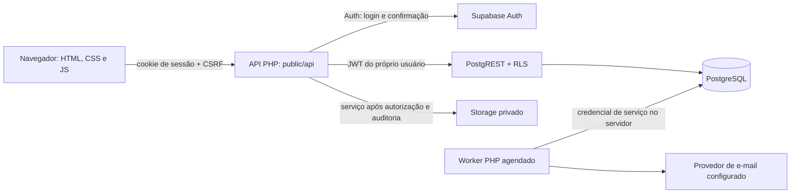

# Arquitetura do Movee

O projeto combina páginas HTML5, CSS3 e JavaScript puro com uma API PHP e um banco PostgreSQL novo no Supabase. A aplicação não depende de um framework de frontend, de TypeScript ou do banco citado no ZIP original.

## Fluxo de uma requisição

O navegador usa a sessão PHP. O token de acesso e o refresh token do Supabase ficam no servidor, associados à sessão. A chave privilegiada do Supabase é necessária para os comandos/serviços explicitamente documentados, incluindo transferir/assinar documentos privados após autorização, o primeiro administrador, a fila de e-mail e a confirmação de pagamento demonstrativo. As operações normais usam o JWT do usuário e continuam sujeitas às políticas RLS.

## Camadas

| Camada | Responsabilidade |
|---|---|
| `public/*.html` | Estrutura semântica e composições de cada página. |
| `public/assets/css/` | Identidade visual, componentes, foco, grades, menu e adaptações de tela. |
| `public/assets/js/common.js` | Sessão, navegação comum, API, escape e formatação. |
| Demais JavaScript | Estado de formulários e telas, validação de experiência, apresentação e chamadas autorizadas. |
| `public/api/` e `src/` | Sessões, CSRF, validações, limites de requisições, Auth, upload e comunicação HTTP com Supabase. |
| `sql/` | Modelo de dados, restrições, funções transacionais, RLS, catálogo inicial e testes separados. |
| `bin/` | Operações administrativas de servidor; não são rotas HTTP públicas. |
| `docs/` | Instalação, auditoria original, modelo de dados, operação e evidências de teste. |

O diretório publicado pelo servidor HTTP deve ser **somente `public/`**. `.env`, `src/`, `bin/`, SQL e documentação ficam fora da raiz pública.

## Papéis e conclusão do cadastro

O Supabase Auth é o responsável exclusivo pela senha. O perfil estende `auth.users` por chave primária/estrangeira UUID. Dados pessoais ficam no perfil; cliente, vendedor, entregador e administrador não repetem os dados pessoais em tabelas paralelas. Clientes, entregadores e administradores usam CPF; vendedores podem informar CPF ou CNPJ no campo `cpf_cnpj`.

Ao se cadastrar, o usuário informa um **papel solicitado**. O papel efetivo começa como cliente. Vendedores usam um subtipo de cadastro com as operações de cliente. Pedidos de entregador ou administrador só ganham o papel correspondente após decisão de um administrador autorizado. Alterar um parâmetro de formulário ou metadata do Auth não concede permissão administrativa.

A ordem de uso é:

1. Informar dados, senha e aceite de termos/privacidade.
2. Abrir o e-mail e confirmar pelo link validado no Supabase Auth, ou usar o código alternativo. O login depende da confirmação canônica.
3. Entrar e enviar documento de identidade em área autenticada.
4. Para entregador: concluir CNH, anexar a CNH, cadastrar e documentar veículo; enviar solicitação de aprovação.
5. Para administrador: enviar identidade e justificativa; aguardar decisão.

O upload é realizado após a autenticação para que o Storage possa vincular o objeto ao proprietário. Um cadastro ainda incompleto pode entrar para concluir os dados, mas não pode executar as operações que exigem confirmação, documentos ou aprovação.

## Solicitação, cotação e acompanhamento

A solicitação aceita vários itens. Cada um tem quantidade, peso por unidade, unidade de medida e dimensões por unidade. O banco converte o peso para `numeric` em quilogramas e calcula o volume em metros cúbicos. Quantidade multiplica peso e volume; ela não deve ser incluída novamente no peso informado.

O catálogo tem 11 categorias com limites e tarifas iniciais fictícias, configuráveis pela administração. A cotação considera os parâmetros recebidos, combustível estimado por consumo do veículo, preço por litro e adicional de pico nos dias/horários configurados em America/Sao_Paulo. Valida a capacidade e calcula o preço no banco. A criação da entrega repete a validação e o cálculo dentro da operação transacional; nenhum campo `price` enviado pelo navegador é aceito como preço final.

Sem credencial de roteamento, a distância é uma **estimativa declarada para o TCC**, identificada na interface. A integração opcional Geoapify calcula uma rota real pelo backend, que persiste a cotação com validade e a vincula ao titular, endereços e categoria. A administração pode exigir rota confiável para impedir distâncias livres. Não há cálculo automático de pedágio ou GPS em tempo real. A previsão de chegada é aproximada e não é promessa contratual.

O aceite usa bloqueio da entrega no PostgreSQL. Apenas um entregador aprovado, com veículo ativo e compatível e documentação exigida, pode concluir o aceite. A lista de oportunidades mostra um resumo sem divulgar os endereços completos a todos os entregadores. Depois do aceite, os participantes autorizados acessam os dados necessários à execução.

O cliente confere modelo/placa do veículo designado antes de liberar a coleta; divergências abrem chamado. O entregador deve usar o mesmo veículo nas atualizações e não pode alterar/desativar um veículo com entrega ativa.

O status segue uma sequência validada. A conclusão gera comprovante com o nome do recebedor e horário, além do evento correspondente. O rastreamento consulta código e histórico somente para quem possui autorização sobre a entrega; conhecer um código não concede acesso a dados pessoais.

## Documentos e dados pessoais

O bucket de documentos é privado. O PHP valida tamanho e conteúdo do arquivo antes de enviar ao Storage com credencial de serviço. A leitura confere autorização do usuário no banco, registra auditoria e usa URL assinada com validade curta; anon/authenticated não recebem acesso direto ao bucket. Um link assinado pode ser usado por quem o recebe durante sua validade; não deve ser compartilhado nem incluído em logs ou e-mails.

RLS e funções controlam propriedade e finalidade. Verificação automática de formato de arquivo não equivale a confirmar a autenticidade do documento. A decisão documental cabe à administração e fica registrada. Uma análise antivírus externa adicional pode ser incorporada antes de um uso comercial.

Endereços têm limite de três por conta, aplicado no banco com bloqueio por proprietário para impedir ultrapassagem em cadastros concorrentes. O endereço da entrega é uma cópia histórica estruturada; editar um endereço salvo não altera uma entrega já criada.

## Pagamentos e comunicação

O modo demonstrativo registra método, valor, status e a marcação `is_demo`. Nenhum número completo de cartão ou CVV é solicitado ou armazenado. Não ocorre cobrança financeira real. A operação privilegiada de confirmação demonstrativa é executada no servidor após checar o proprietário da entrega.

O pagamento real exige configurar o adaptador de checkout do Mercado Pago, as credenciais do servidor e o segredo de webhook. O status financeiro é confirmado pelo backend após validação e consulta ao provedor. Credenciais ausentes ou configuração incompleta não resultam em confirmação fictícia. Consulte o estado final e os testes em `MATRIZ-REQUISITOS.md` e `TESTES.md`.

As notificações internas são dados do banco. E-mails transacionais da aplicação passam por uma fila `outbox` e por um worker PHP, com tentativas e controle de processamento. As mensagens de login, confirmação e recuperação são enviadas pelo serviço de Auth configurado no Supabase. SMS depende de um provedor de Auth configurado e habilitado; não há códigos fixos de teste aceitos como confirmação.

## Decisões de normalização

O esquema detalhado, DER, tipos, índices, dicionário e permissões estão em `DATABASE.md`. Algumas escolhas evitam tabelas sem finalidade:

- Clientes e administradores são perfis com papel efetivo; o estado da solicitação administrativa fica em aprovações/histórico.
- Tarifas e limites do catálogo ficam na categoria de veículo e têm alteração auditada.
- Destinatário e endereços da entrega são instantâneos históricos, sem exigir cadastro do recebedor como usuário.
- Documentos guardam metadados e caminho privado; o binário fica no Storage.
- Eventos, pagamentos, comprovantes, avaliações e decisões mantêm a relação com sua entrega ou solicitação.

## Limite de validação

O ZIP é um sistema configurável para instalação. Não representa a criação remota automática de um projeto Supabase ou a contratação de provedores. `TESTES.md` registra o que foi efetivamente executado no ambiente de desenvolvimento e quais testes externos ainda exigem a instalação do usuário.

## Variante MongoDB

A entrega inclui uma variante de persistência MongoDB, documentada em `MONGODB.md`. A interface e o contrato da API são compartilhados; o Supabase Auth continua responsável por senha e confirmação. MongoDB substitui a persistência de domínio nessa variante, sem criar uma segunda tabela de senhas. Não execute uma instalação misturando operações de domínio dos dois bancos: siga a seleção de adaptador descrita no guia. A garantia de isolamento nessa variante é aplicada pelo backend, pois MongoDB não executa as políticas RLS do PostgreSQL.

## Banco e autenticação finais

A versão final usa os scripts 01..20 do pacote separado de banco. O script 20 combina RLS restritiva, verificação do e-mail canônico e guardas nas escritas/consultas protegidas. O site verifica esse mesmo estado antes de aceitar sessão, inclusive após renovação. A confirmação não depende de campos editáveis em metadata nem de uma segunda tabela de senhas.
