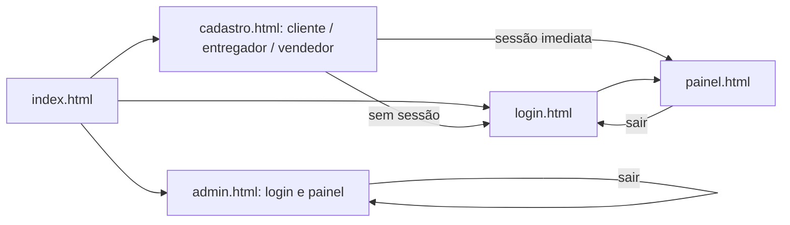

# Auditoria integral do projeto recebido

Fonte analisada: `moove-html_v2.zip`. Foram lidos os **13 arquivos** existentes: cinco HTML, seis JavaScript, um CSS e um Markdown. O arquivo compactado tem 17 entradas ao contar os quatro diretórios. O conteúdo dos arquivos totaliza 33.888 bytes. A leitura integral foi concluída antes das alterações na nova aplicação; os originais foram mantidos separados durante o trabalho.

O pedido colado pelo usuário é a especificação desta entrega. O `LEIA-ME.md` original descreve um banco anterior, mas não fornece esquema nem migrações. Essa frase foi tratada como documentação desatualizada do artefato, não como instrução: o usuário informou expressamente que não existe banco. A versão nova começa em um projeto Supabase vazio.

## Inventário e análise de cada arquivo

| Arquivo original | Conteúdo e conexões | Problemas observados | Tratamento na nova versão |
|---|---|---|---|
| `index.html` | Apresentação curta; links de cadastro para cliente, entregador e vendedor; links de login e administração. | Apenas três cartões; sem rastreamento, como funciona, veículos, ajuda ou rodapé. Não havia imagens. A identidade era azul-marinho e a marca era escrita “Moove”. | Página inicial Movee com identidade roxa/verde/branca, ações de solicitar/rastrear, seções e ilustrações próprias. Cadastro de vendedor preservado, com identificação por CPF/CNPJ e operações de cliente. |
| `login.html` | Formulário de e-mail/senha; carrega Supabase por CDN, configuração e `login.js`. | Não possui recuperação de senha, exibição de senha, retorno à ação desejada, verificação de canal ou link de cadastro administrativo. | Autenticação via PHP/Supabase Auth, recuperação por código, retorno permitido a páginas locais e navegação para os três tipos de cadastro. |
| `cadastro.html` | Formulário pessoal, senha e confirmação; endereço livre; seção condicional para placa/CNH. | Faltam nascimento, termos, documento oficial, foto de CNH, categoria/validade da CNH, dados completos do veículo, justificativa administrativa e escolha de canal. Endereço é texto não estruturado. | Cadastro e conclusão de perfil organizados por etapas. Upload ocorre após autenticação/confirmação e é obrigatório antes das operações protegidas pertinentes. |
| `painel.html` | Painel comum a cliente, vendedor e entregador; cadastro de itens em duas etapas; origem/destino e valor livres. | O usuário define diretamente o valor. Não há cálculo de frete, dimensões, categoria compatível, pagamento, endereços estruturados ou progresso logístico detalhado. A mesma tela concentra papéis distintos. | Painéis separados por finalidade e solicitação por etapas com cotação no banco. |
| `admin.html` | Login próprio e painel com métricas, cancelamentos, confiabilidade e tabela de entregas. | Acesso visual depende do JavaScript e de `user_roles`, cujo esquema e políticas não foram entregues. Não há aprovação, documentos, tarifas, suporte, histórico de decisões ou primeiro administrador. | Painel protegido por sessão e RLS/RPC, fila de aprovação, documentos privados, configurações e auditoria. |
| `css/estilo.css` | Tokens azul-marinho, cartões, formulários, grades e tabelas; 4.318 bytes. | `.acoes` e `.selo` definidos duas vezes; a cascata altera espaçamento e aparência. Layout uniforme, tipografia externa, ausência de menu móvel, estilos de movimento reduzido e composições próprias. Grades de largura mínima fixa podem pressionar telas estreitas. | Sistema visual comum com composições específicas, grades adaptativas, foco visível, estados vazios e tratamento de tabelas. A verificação executada está em `TESTES.md`. |
| `js/config.js` | URL de um projeto Supabase e chave publicável fixas; cria cliente global `db`. | Acopla o código a projeto externo não fornecido. Sem configuração por ambiente e sem banco reproduzível. A chave encontrada é **publicável**, não uma chave `service_role`; isso não prova vazamento de segredo, mas depende de RLS correto, inexistente no material recebido. | Configuração no servidor por `.env`; URL/chaves originais não reutilizadas. JWT e credenciais privilegiadas permanecem no servidor. |
| `js/validacoes.js` | Máscaras de CPF/telefone/placa, requisitos de senha, tradução de erros, escape HTML, peso em kg. | CPF valida somente 11 caracteres numéricos, aceitando sequências e dígitos verificadores incorretos. Telefone verifica apenas comprimento; não há CEP, idade, dimensões ou unidades. Validações são apenas do navegador. | Validação coerente nas camadas apropriadas, CPF com dígitos verificadores, normalização e restrições SQL. Escape de texto e senha mascarada preservados. |
| `js/login.js` | `signInWithPassword`; sucesso redireciona sempre a `painel.html`. | Sem recuperação/confirmar canal/continuação de ação. Falha inesperada de rede pode escapar do tratamento e deixar controle desativado. | API comum trata falhas; Supabase continua responsável pela senha; sessão e CSRF no PHP. |
| `js/cadastro.js` | Escolha cliente/entregador/vendedor; chama `cpf_disponivel`; manda dados pelo metadata de `signUp`. | RPC não fornecida; dados pessoais no metadata não criam tabelas sozinhos. CPF incompleto; sem política de aprovação; nenhuma confirmação de e-mail/SMS implementada na interface. Consulta pública de disponibilidade de CPF também permitiria inferir cadastro se o RPC existisse e fosse aberto sem controles. | Dados validados e perfil ligado a `auth.users`; pedido de papel não concede acesso; confirmação real depende do provedor configurado. |
| `js/painel.js` | Consulta `perfis`, `pedidos`, `itens_pedido`; aceita/atualiza entregas e salva pedido e itens em duas requisições. | Consulta todos os pedidos sem filtros de dono no cliente; proteção depende inteiramente de RLS ausente. Aceite não condiciona atomicamente a ausência de entregador. Status pode ser alterado diretamente. Pedido e itens não são transacionais: uma falha pode deixar pedido incompleto. Erros de atualização são ignorados. Preço vem do formulário. | RPCs transacionais, cotação no servidor, aceite bloqueado por linha, transições sequenciais, RLS e tratamento de erros. Lista de oportunidades do entregador recebe resumo sem endereço completo antes do aceite. |
| `js/admin.js` | Confere `user_roles`; lê pedidos e perfis; calcula confiabilidade; cancela por update direto. | Verificação de papel apenas no frontend não constitui autorização do banco. Esquema/permissões não disponíveis. Erros de leitura viram listas vazias; cancelamento ignora erro; ausência de trilha de auditoria e transições validadas. | Autorização conferida novamente em funções do banco e PHP, decisões com motivo/histórico e relatórios sobre dados autorizados. |
| `LEIA-ME.md` | Instruções de Live Server e referência a banco existente, papéis em `user_roles`. | Incompatível com a ausência de banco declarada pelo usuário. Não permite reproduzir ambiente, configurar Auth/Storage ou validar segurança. | Documentação de instalação do zero, migrações em ordem e comandos PHP. Live Server isolado não executa a nova API. |

## Navegação original e lacunas

Não existiam páginas de rastreamento, recuperação, verificação, endereços, veículos, perfil, pagamento, notificações, suporte, termos ou privacidade. A administração tinha uma autenticação duplicada, separada da navegação principal. As rotas não lembravam a operação que levou ao login.

## Segurança: evidências e limites

A ausência de SQL impede afirmar que o projeto remoto referenciado tinha ou não RLS. O problema comprovável é que o ZIP **não entrega** políticas, esquema, índices, funções, Storage ou testes que sustentem as operações executadas. Na versão original, esconder botões ou verificar um papel no JavaScript não seria suficiente para proteger as chamadas diretas ao Supabase.

O código original usa `esc()` na maior parte dos dados interpolados, uma prática aproveitada conceitualmente. Os números de pedido e UUIDs também devem ser tratados como dados; a versão nova evita confiar no frontend para status, preço, titularidade e papel. Não foi identificada uma senha ou chave `service_role` no ZIP original. A nova entrega não inclui credenciais de nenhum projeto.

Não havia backend PHP, upload ou pagamento no material recebido. Portanto, não se atribuem a ele vulnerabilidades de upload, SQL concatenado em PHP ou armazenamento de cartões inexistentes. Esses recursos foram projetados do zero na nova implementação.

## Funcionalidades preservadas e reorganizadas

- Cadastro, autenticação, confirmação de senha, máscaras brasileiras e mensagens de erro.
- Solicitação com vários itens e quantidade/peso individual, soma do peso e origem/destino.
- Aceite pelo entregador, evolução do status, conclusão e cancelamento permitido.
- Métricas, filtros e identificação de problemas operacionais.
- Uso por vendedores preservado como modalidade de cadastro própria, com CPF/CNPJ e operações de cliente; cliente, entregador e administrador continuam sendo os papéis efetivos de autorização.

A implementação substitui as tabelas indefinidas `perfis`, `pedidos`, `itens_pedido` e `user_roles` pelo novo modelo documentado em `DATABASE.md`. Não é uma migração de dados antigos, pois nenhum banco ou exportação de dados foi fornecido.

## Limites desta auditoria

A análise original foi estática e integral. Nenhum serviço do projeto Supabase referenciado no ZIP foi acessado ou alterado. O comportamento externo do projeto original não foi testado. Resultados executados sobre a versão nova, incluindo limitações de ambiente, estão exclusivamente em `TESTES.md`.
