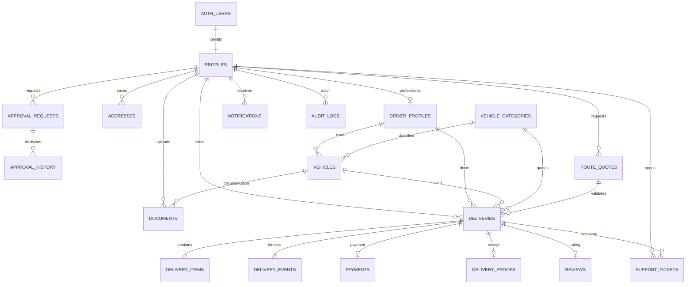

# Movee — banco Supabase completo, escrito por extenso

Instalação nova: execute os tópicos01..20 na ordem. Banco já instalado até19: somente20; até18:19 e20. Este documento transcreve integralmente a produção e separa os testes depois. Os mesmos arquivos estão em `sql/` no pacote do banco. Leia primeiro `ORDEM-DO-BANCO.md`. Auth/Storage são nativos do Supabase; não crie representações locais desses serviços no projeto remoto.

## 1. Estrutura inicial e parâmetros

Arquivo: `sql/01_initial.sql`.

```sql
-- Movee: execute 01..20 uma vez em projeto Supabase NOVO. Não usa banco anterior.
begin;
create extension if not exists pgcrypto;
-- Fechar permissões padrão antes de criar funções/tabelas durante a instalação.
alter default privileges in schema public revoke all on tables from anon,authenticated;
alter default privileges in schema public revoke execute on functions from public;
create schema if not exists private;
revoke all on schema private from public, anon, authenticated;
create table public.system_settings (
 key text primary key, value jsonb not null, updated_at timestamptz not null default now()
);
insert into public.system_settings values
 ('pricing','{"urgent_multiplier":1.25,"extra_service_fee":15,"max_extra_services":5,"tolls_enabled":false,"max_distance_km":1000,"route_required":false,"fuel_price_per_litre":6.20,"peak_multiplier":1.20,"peak_hours":[[7,9],[17,20]],"peak_weekdays":[1,2,3,4,5],"timezone":"America/Sao_Paulo"}'::jsonb,now()),
 ('retention','{"document_days_after_account_closure":180,"purpose":"Verificação de identidade e elegibilidade para transporte; acesso restrito."}'::jsonb,now());
commit;
```

## 2. Validações de CPF, CNPJ, telefone, endereço e peso

Arquivo: `sql/02_validations.sql`.

```sql
begin;
create function public.valid_cpf(v text) returns boolean language plpgsql immutable set search_path=public,pg_temp as $$
declare d text:=regexp_replace(coalesce(v,''),'\D','','g'); s int; x int; i int;
begin
 if coalesce(v,'') !~ '^[0-9.[:space:]-]+$' or d !~ '^\d{11}$' or d=repeat(substr(d,1,1),11) then return false; end if;
 for x in 10..11 loop
  s:=0; for i in 1..x-1 loop s:=s+substr(d,i,1)::int*(x+1-i); end loop;
  s:=(s*10)%11; if s=10 then s:=0; end if;
  if s<>substr(d,x,1)::int then return false; end if;
 end loop; return true;
end $$;
create function public.valid_phone(v text) returns boolean language plpgsql immutable set search_path=public,pg_temp as $$
declare d text:=regexp_replace(coalesce(v,''),'\D','','g');
begin
 if coalesce(v,'') !~ '^[0-9+() .-]+$' then return false; end if;
 if length(d) in (12,13) and left(d,2)='55' then d:=substr(d,3); end if;
 if left(d,2)<>all(array['11','12','13','14','15','16','17','18','19','21','22','24','27','28','31','32','33','34','35','37','38','41','42','43','44','45','46','47','48','49','51','53','54','55','61','62','63','64','65','66','67','68','69','71','73','74','75','77','79','81','82','83','84','85','86','87','88','89','91','92','93','94','95','96','97','98','99']) then return false; end if;
 return (length(d)=10 and substr(d,3) ~ '^[2-5][0-9]{7}$') or (length(d)=11 and substr(d,3) ~ '^9[0-9]{8}$');
end $$;
create function public.valid_full_name(v text) returns boolean language sql immutable set search_path=public,pg_temp as $$ select length(trim(v)) between 4 and 140 and trim(v) ~ '^[[:alpha:]À-ÖØ-öø-ÿĀ-ſ][[:alpha:]À-ÖØ-öø-ÿĀ-ſ''’-]*( [[:alpha:]À-ÖØ-öø-ÿĀ-ſ][[:alpha:]À-ÖØ-öø-ÿĀ-ſ''’-]*)+$' $$;
create function public.weight_kg(p_weight numeric,p_unit text) returns numeric language plpgsql immutable set search_path=public,pg_temp as $$
begin
 if p_weight is null or p_weight<=0 or p_weight::text in ('NaN','Infinity','-Infinity') then raise exception 'Peso inválido.'; end if;
 case p_unit when 'mg' then return p_weight/1000000; when 'g' then return p_weight/1000; when 'kg' then return p_weight; when 't' then return p_weight*1000; else raise exception 'Unidade de peso inválida.'; end case;
end $$;
create function public.valid_address(v jsonb) returns boolean language sql immutable set search_path=public,pg_temp as $$
 select coalesce(jsonb_typeof(v)='object' and length(trim(coalesce(v->>'street',''))) between 2 and 200 and length(trim(coalesce(v->>'number',''))) between 1 and 30 and length(trim(coalesce(v->>'neighborhood',''))) between 2 and 100 and length(trim(coalesce(v->>'city',''))) between 2 and 100 and length(coalesce(v->>'complement',''))<=100 and length(coalesce(v->>'reference',''))<=250 and coalesce(v->>'state','') ~ '^(AC|AL|AP|AM|BA|CE|DF|ES|GO|MA|MT|MS|MG|PA|PB|PR|PE|PI|RJ|RN|RS|RO|RR|SC|SP|SE|TO)$' and coalesce(v->>'postal_code','') ~ '^[0-9]{5}-?[0-9]{3}$',false)
$$;
create function public.valid_cnpj(v text) returns boolean language plpgsql immutable set search_path=public,pg_temp as $$
declare d text:=upper(regexp_replace(coalesce(v,''),'[^A-Za-z0-9]','','g')); weights int[]:=array[6,5,4,3,2,9,8,7,6,5,4,3,2]; s int; x int; i int;
begin
 if coalesce(v,'') !~ '^[A-Za-z0-9./[:space:]-]+$' or d !~ '^[A-Z0-9]{12}[0-9]{2}$' or d=repeat(substr(d,1,1),14) then return false; end if;
 for x in 13..14 loop
  s:=0; for i in 1..x-1 loop s:=s+(ascii(substr(d,i,1))-48)*weights[i+14-x]; end loop;
  s:=s%11; if s<2 then s:=0; else s:=11-s; end if;
  if s<>substr(d,x,1)::int then return false; end if;
 end loop; return true;
end $$;
create function public.valid_tax_id(v text) returns boolean language sql immutable set search_path=public,pg_temp as $$ select public.valid_cpf(v) or public.valid_cnpj(v) $$;
commit;
```

## 3. Perfis ligados ao Supabase Auth

Arquivo: `sql/03_profiles.sql`.

```sql
begin;
create table public.profiles (
 id uuid primary key references auth.users(id) on delete cascade,
 full_name text not null check(public.valid_full_name(full_name)),
 cpf_cnpj text not null unique check(cpf_cnpj ~ '^([0-9]{11}|[A-Z0-9]{12}[0-9]{2})$' and public.valid_tax_id(cpf_cnpj)),
 phone text not null check(public.valid_phone(phone)),
 birth_date date not null check(birth_date>=current_date-interval '120 years' and birth_date<=current_date-interval '18 years'),
 role text not null default 'client' check(role in ('client','driver','admin')),
 requested_role text not null default 'client' check(requested_role in ('client','seller','driver','admin')),
 check(requested_role='seller' or (cpf_cnpj ~ '^[0-9]{11}$' and public.valid_cpf(cpf_cnpj))),
 terms_accepted_at timestamptz not null, verification_channel text not null default 'email' check(verification_channel in ('email','sms')),
 created_at timestamptz not null default now(), updated_at timestamptz not null default now()
);
create function private.is_admin() returns boolean language sql stable security definer set search_path=public,pg_temp as $$ select exists(select 1 from public.profiles where id=auth.uid() and role='admin') $$;
create function public.is_admin() returns boolean language sql stable security definer set search_path=public,pg_temp as $$ select private.is_admin() $$;
-- Cliente não duplica dados pessoais: é um perfil com role=client.
commit;
```

## 4. Dados dos entregadores

Arquivo: `sql/04_drivers.sql`.

```sql
begin;
create table public.driver_profiles (
 id uuid primary key references public.profiles(id) on delete cascade,
 cnh_number text check(cnh_number ~ '^\d{11}$'),
 cnh_category text check(cnh_category in ('A','B','AB','C','AC','D','AD','E','AE')),
 cnh_expires_at date check(cnh_expires_at<=current_date+3653),
 status text not null default 'pending' check(status in ('pending','in_review','approved','rejected','suspended')),
 created_at timestamptz not null default now()
);
commit;
```

## 5. Solicitações e histórico de aprovação

Arquivo: `sql/05_approvals.sql`.

```sql
begin;
create table public.approval_requests (
 id uuid primary key default gen_random_uuid(), user_id uuid not null references public.profiles(id) on delete cascade,
 kind text not null check(kind in ('driver','admin')),
 status text not null default 'pending' check(status in ('pending','in_review','approved','rejected','suspended')),
 justification text not null check(length(justification) between 10 and 2000),
 created_at timestamptz not null default now(), updated_at timestamptz not null default now(), unique(user_id,kind)
);
create table public.approval_history (
 id uuid primary key default gen_random_uuid(), request_id uuid not null references public.approval_requests(id) on delete cascade,
 actor_id uuid references public.profiles(id) on delete set null,
 status text not null check(status in ('pending','in_review','approved','rejected','suspended')),
 reason text not null check(length(reason) between 3 and 2000), created_at timestamptz not null default now()
);
commit;
```

## 6. Endereços

Arquivo: `sql/06_addresses.sql`.

```sql
begin;
create table public.addresses (
 id uuid primary key default gen_random_uuid(), user_id uuid not null default auth.uid() references public.profiles(id) on delete cascade,
 label text not null check(length(label) between 2 and 40), postal_code text not null check(postal_code ~ '^\d{8}$'),
 street text not null check(length(street) between 2 and 200), number text not null check(length(number) between 1 and 30),
 complement text not null default '' check(length(complement)<=100), neighborhood text not null check(length(neighborhood) between 2 and 100),
 city text not null check(length(city) between 2 and 100), state text not null check(state ~ '^(AC|AL|AP|AM|BA|CE|DF|ES|GO|MA|MT|MS|MG|PA|PB|PR|PE|PI|RJ|RN|RS|RO|RR|SC|SP|SE|TO)$'),
 reference text not null default '' check(length(reference)<=250), is_default boolean not null default false,
 created_at timestamptz not null default now()
);
commit;
```

## 7. Categorias, capacidades, tarifas e combustível

Arquivo: `sql/07_vehicle_categories.sql`.

```sql
begin;
create table public.vehicle_categories (
 id text primary key check(id ~ '^[a-z_]+$'), name text not null,
 max_weight_kg numeric(16,6) not null check(max_weight_kg>0), max_volume_m3 numeric(16,6) not null check(max_volume_m3>0),
 length_cm numeric not null check(length_cm>0), width_cm numeric not null check(width_cm>0), height_cm numeric not null check(height_cm>0),
 base_price numeric(12,2) not null check(base_price>=0), price_per_km numeric(12,2) not null check(price_per_km>=0),
 weight_price numeric(12,4) not null default 0 check(weight_price>=0), volume_price numeric(12,2) not null default 0 check(volume_price>=0),
 operational_fee numeric(12,2) not null default 0 check(operational_fee>=0), protection_fee numeric(12,2) not null default 0 check(protection_fee>=0),
 fuel_km_per_litre numeric(8,3) not null check((id='bicycle' and fuel_km_per_litre=0) or (id<>'bicycle' and fuel_km_per_litre>0 and fuel_km_per_litre<=100)),
 description text not null, protection text not null, image text not null, active boolean not null default true
);
-- Tarifas fictícias para TCC. Ajustar antes de operação comercial.
insert into public.vehicle_categories values
('bicycle','Bicicleta',5,.04,40,35,30,8,1.2,.15,2,0,2,0,'Documentos e pequenos volumes.','Bolsa de transporte','assets/img/bicycle.svg',true),
('motorcycle','Moto',20,.12,60,50,40,12,1.8,.12,3,2,3,35,'Agilidade para volumes leves.','Baú fechado','assets/img/motorcycle.svg',true),
('compact','Carro compacto',150,.6,100,80,75,20,2.2,.06,5,4,5,12,'Caixas e compras do dia a dia.','Compartimento fechado','assets/img/compact.svg',true),
('utility','Carro utilitário',300,1.5,150,100,100,30,2.8,.05,6,6,7,10,'Cargas urbanas compactas.','Compartimento fechado','assets/img/utility.svg',true),
('fiorino','Fiorino ou similar',650,3.1,180,130,130,40,3.2,.04,7,8,9,10,'Carga protegida para comércios.','Baú fechado','assets/img/fiorino.svg',true),
('small_van','Van pequena',1000,6,250,150,160,55,3.8,.035,8,10,12,8,'Mais espaço para sua operação.','Compartimento fechado','assets/img/small-van.svg',true),
('large_van','Van grande',1500,12,350,170,200,75,4.5,.03,9,15,15,7,'Volumes maiores com proteção.','Compartimento fechado','assets/img/large-van.svg',true),
('pickup','Caminhonete',1000,3,220,150,90,50,3.6,.04,6,10,10,8,'Materiais e cargas resistentes.','Cobertura opcional','assets/img/pickup.svg',true),
('small_truck','Caminhão pequeno',3000,20,420,200,220,110,5.5,.025,10,25,20,6,'Mudanças e carga fracionada.','Baú fechado','assets/img/small-truck.svg',true),
('medium_truck','Caminhão médio',8000,40,650,230,260,180,7,.02,12,40,30,4,'Capacidade para cargas comerciais.','Baú fechado','assets/img/medium-truck.svg',true),
('large_truck','Caminhão grande',14000,65,900,240,280,280,9,.015,14,60,45,3,'Grandes volumes planejados.','Baú fechado','assets/img/large-truck.svg',true);
commit;
```

## 8. Veículos dos entregadores

Arquivo: `sql/08_vehicles.sql`.

```sql
begin;
create table public.vehicles (
 id uuid primary key default gen_random_uuid(), driver_id uuid not null default auth.uid() references public.driver_profiles(id) on delete cascade,
 category_id text not null references public.vehicle_categories(id), brand text not null check(length(brand) between 2 and 80), model text not null check(length(model) between 2 and 80),
 plate text unique check(plate ~ '^[A-Z]{3}[0-9][A-Z0-9][0-9]{2}$'), year int not null check(year between 1980 and extract(year from current_date)::int+1),
 active boolean not null default true, created_at timestamptz not null default now(),
 check(category_id='bicycle' or plate is not null)
);
commit;
```

## 9. Documentos privados

Arquivo: `sql/09_documents.sql`.

```sql
begin;
create table public.documents (
 id uuid primary key default gen_random_uuid(), user_id uuid not null default auth.uid() references public.profiles(id) on delete cascade,
 vehicle_id uuid references public.vehicles(id) on delete cascade, kind text not null check(kind in ('identity','cnh','vehicle')),
 storage_path text not null unique check(length(storage_path)<300 and storage_path !~ '\.\.'),
 mime_type text not null check(mime_type in ('image/jpeg','image/png','application/pdf')), size_bytes int not null check(size_bytes between 100 and 5242880),
 status text not null default 'pending' check(status in ('pending','verified','rejected')), created_at timestamptz not null default now(),
 check((kind='vehicle')=(vehicle_id is not null))
);
commit;
```

## 10. Entregas, mercadorias, histórico e rotas confiáveis

Arquivo: `sql/10_deliveries.sql`.

```sql
begin;
create table public.route_quotes (
 id uuid primary key default gen_random_uuid(), user_id uuid not null references public.profiles(id), category_id text not null references public.vehicle_categories(id),
 pickup jsonb not null check(public.valid_address(pickup)), destination jsonb not null check(public.valid_address(destination)),
 distance_km numeric(12,3) not null check(distance_km>0 and distance_km<=10000), duration_minutes numeric(12,3) not null check(duration_minutes>0 and duration_minutes<=14400),
 expires_at timestamptz not null, created_at timestamptz not null default now()
);
create table public.deliveries (
 id uuid primary key default gen_random_uuid(), code text not null unique default ('MV-'||upper(encode(gen_random_bytes(6),'hex'))),
 client_id uuid not null references public.profiles(id), driver_id uuid references public.driver_profiles(id), vehicle_id uuid references public.vehicles(id), category_id text not null references public.vehicle_categories(id),
 status text not null default 'awaiting_payment' check(status in ('awaiting_payment','awaiting_driver','to_pickup','collected','in_transit','near_destination','delivered','cancelled')),
 pickup jsonb not null check(public.valid_address(pickup)), destination jsonb not null check(public.valid_address(destination)),
 recipient_name text not null check(length(recipient_name) between 3 and 160), recipient_phone text not null check(public.valid_phone(recipient_phone)),
 distance_km numeric(12,3) not null check(distance_km>0), total_weight_kg numeric(20,6) not null check(total_weight_kg>0), total_volume_m3 numeric(20,9) not null check(total_volume_m3>0),
 price numeric(14,2) not null check(price>=0), price_breakdown jsonb not null,
 scheduled_at timestamptz not null, notes text not null default '' check(length(notes)<=2000), special_instructions text not null default '' check(length(special_instructions)<=2000),
 urgent boolean not null default false, protection boolean not null default false, extras numeric not null default 0 check(extras between 0 and 5 and extras=trunc(extras)), tolls numeric not null default 0 check(tolls>=0),
 route_quote_id uuid references public.route_quotes(id),
 vehicle_confirmed_at timestamptz, vehicle_confirmed_by uuid references public.profiles(id),
 eta_at timestamptz, created_at timestamptz not null default now(), updated_at timestamptz not null default now(),
 check((driver_id is null)=(vehicle_id is null))
);
create table public.delivery_items (
 id uuid primary key default gen_random_uuid(), delivery_id uuid not null references public.deliveries(id) on delete cascade,
 description text not null check(length(description) between 2 and 500), quantity int not null check(quantity between 1 and 10000),
 unit_weight_kg numeric(20,6) not null check(unit_weight_kg>0), length_cm numeric not null check(length_cm>0), width_cm numeric not null check(width_cm>0), height_cm numeric not null check(height_cm>0)
);
create table public.delivery_events (
 id uuid primary key default gen_random_uuid(), delivery_id uuid not null references public.deliveries(id) on delete cascade,
 status text not null, note text not null default '' check(length(note)<=2000), created_at timestamptz not null default now()
);
commit;
```

## 11. Pagamentos

Arquivo: `sql/11_payments.sql`.

```sql
begin;
create table public.payments (
 id uuid primary key default gen_random_uuid(), delivery_id uuid not null unique references public.deliveries(id), user_id uuid not null references public.profiles(id),
 method text not null check(method in ('pix','credit','debit')), status text not null default 'pending' check(status in ('pending','confirmed','failed','refunded')),
 amount numeric(14,2) not null check(amount>=0), is_demo boolean not null default true, provider_reference text unique,
 created_at timestamptz not null default now(), updated_at timestamptz not null default now()
);
commit;
```

## 12. Notificações, suporte, avaliações e auditoria

Arquivo: `sql/12_communication.sql`.

```sql
begin;
create table public.notifications (
 id uuid primary key default gen_random_uuid(), user_id uuid not null references public.profiles(id) on delete cascade,
 title text not null, body text not null, read_at timestamptz, created_at timestamptz not null default now()
);
create table public.outbox (
 id uuid primary key default gen_random_uuid(), event text not null, payload jsonb not null,
 status text not null default 'pending' check(status in ('pending','processing','sent','failed')),
 attempts int not null default 0, locked_at timestamptz, last_error text, available_at timestamptz not null default now(), created_at timestamptz not null default now()
);
create table public.audit_logs (
 id uuid primary key default gen_random_uuid(), actor_id uuid references public.profiles(id) on delete set null,
 action text not null, entity text not null, entity_id text, details jsonb not null default '{}', created_at timestamptz not null default now()
);
create table public.reviews (
 id uuid primary key default gen_random_uuid(), delivery_id uuid not null unique references public.deliveries(id), client_id uuid not null default auth.uid() references public.profiles(id), driver_id uuid not null references public.driver_profiles(id),
 rating int not null check(rating between 1 and 5), comment text not null default '' check(length(comment)<=1000), created_at timestamptz not null default now()
);
create table public.delivery_proofs (
 id uuid primary key default gen_random_uuid(), delivery_id uuid not null unique references public.deliveries(id), driver_id uuid not null references public.driver_profiles(id),
 recipient_name text not null check(length(recipient_name) between 3 and 160), notes text not null default '', created_at timestamptz not null default now()
);
create table public.support_tickets (
 id uuid primary key default gen_random_uuid(), user_id uuid not null default auth.uid() references public.profiles(id), delivery_id uuid references public.deliveries(id),
 subject text not null check(length(subject) between 5 and 150), message text not null check(length(message) between 10 and 4000),
 status text not null default 'open' check(status in ('open','in_progress','closed')), admin_reply text not null default '' check(length(admin_reply)<=4000), created_at timestamptz not null default now()
);
create function private.notify(p_user uuid,p_title text,p_body text,p_event text) returns void language plpgsql security definer set search_path=public,pg_temp as $$
begin
 insert into public.notifications(user_id,title,body) values(p_user,p_title,p_body);
 insert into public.outbox(event,payload) values(p_event,jsonb_build_object('user_id',p_user,'title',p_title,'body',p_body));
end $$;
commit;
```

## 13. Cadastro e aprovação de contas

Arquivo: `sql/13_account_functions.sql`.

```sql
begin;
create function private.on_signup() returns trigger language plpgsql security definer set search_path=public,pg_temp as $$
declare m jsonb:=new.raw_user_meta_data; r text:=coalesce(m->>'requested_role','client');
begin
 if coalesce((m->>'terms')::boolean,false) is not true then raise exception 'Aceite os termos e a política de privacidade.'; end if;
 if r not in ('client','seller','driver','admin') then raise exception 'Tipo de conta inválido.'; end if;
 if (m->>'birth_date')::date>current_date-interval '18 years' then raise exception 'Cadastro disponível para maiores de 18 anos.'; end if;
 insert into public.profiles(id,full_name,cpf_cnpj,phone,birth_date,role,requested_role,terms_accepted_at,verification_channel)
 values(new.id,trim(m->>'full_name'),upper(regexp_replace(m->>'cpf_cnpj','[^A-Za-z0-9]','','g')),regexp_replace(m->>'phone','\D','','g'),(m->>'birth_date')::date,'client',r,now(),coalesce(m->>'verification_channel','email'));
 if r='driver' then insert into public.driver_profiles(id) values(new.id); end if;
 perform private.notify(new.id,'Bem-vindo ao Movee','Confirme seu canal e complete os documentos do cadastro.','account.created');
 return new;
end $$;
create trigger movee_signup after insert on auth.users for each row execute function private.on_signup();
create function public.complete_profile(p_full_name text,p_cpf_cnpj text,p_phone text,p_birth_date date,p_requested_role text,p_terms boolean) returns public.profiles language plpgsql security definer set search_path=public,pg_temp as $$
declare p public.profiles;
begin
 if auth.uid() is null then raise exception 'Autenticação necessária.'; end if;
 select * into p from public.profiles where id=auth.uid() for update;
 if p.id is null then raise exception 'Perfil não encontrado.'; end if;
 if p_requested_role<>p.requested_role or upper(regexp_replace(p_cpf_cnpj,'[^A-Za-z0-9]','','g'))<>p.cpf_cnpj then raise exception 'CPF e tipo solicitado não podem ser alterados pelo usuário.'; end if;
 if p_terms is not true or p_birth_date>current_date-interval '18 years' then raise exception 'Dados ou aceite inválidos.'; end if;
 update public.profiles set full_name=trim(p_full_name),phone=regexp_replace(p_phone,'\D','','g'),birth_date=p_birth_date,updated_at=now() where id=auth.uid() returning * into p;
 return p;
end $$;
create function public.save_driver(p_cnh_number text,p_cnh_category text,p_cnh_expires_at date) returns public.driver_profiles language plpgsql security definer set search_path=public,pg_temp as $$
declare d public.driver_profiles;
begin
 if not exists(select 1 from public.profiles where id=auth.uid() and requested_role='driver') then raise exception 'Cadastro de entregador necessário.'; end if;
 if p_cnh_number is null or p_cnh_category is null or p_cnh_expires_at is null or p_cnh_expires_at<current_date then raise exception 'CNH vencida.'; end if;
 select * into d from public.driver_profiles where id=auth.uid() for update;
 if d.status in ('approved','suspended') then raise exception 'Para alterar CNH aprovada ou suspensa, solicite suporte e nova análise.'; end if;
 if (d.cnh_number,d.cnh_category,d.cnh_expires_at) is distinct from (p_cnh_number,p_cnh_category,p_cnh_expires_at) then update public.documents set status='pending' where user_id=auth.uid() and kind='cnh'; end if;
 update public.driver_profiles set cnh_number=p_cnh_number,cnh_category=p_cnh_category,cnh_expires_at=p_cnh_expires_at,status='pending' where id=auth.uid() returning * into d;
 return d;
end $$;
create function public.submit_approval(p_kind text,p_justification text) returns public.approval_requests language plpgsql security definer set search_path=public,pg_temp as $$
declare a public.approval_requests; u public.profiles;
begin
 select * into u from public.profiles where id=auth.uid() for update;
 if u.id is null or u.requested_role<>p_kind or p_kind not in ('driver','admin') then raise exception 'Solicitação não permitida.'; end if;
 if length(trim(p_justification))<10 then raise exception 'Justificativa deve ter pelo menos 10 caracteres.'; end if;
 if not exists(select 1 from public.documents where user_id=u.id and kind='identity' and status<>'rejected') then raise exception 'Envie documento de identidade.'; end if;
 if p_kind='driver' then
  if not exists(select 1 from public.driver_profiles where id=u.id and cnh_number is not null and cnh_category is not null and cnh_expires_at>=current_date) then raise exception 'Preencha os dados da CNH.'; end if;
  if not exists(select 1 from public.documents where user_id=u.id and kind='cnh' and status<>'rejected') then raise exception 'Envie a foto da CNH.'; end if;
  if not exists(select 1 from public.vehicles v join public.documents d on d.vehicle_id=v.id and d.kind='vehicle' and d.status<>'rejected' where v.driver_id=u.id and v.active) then raise exception 'Cadastre e documente ao menos um veículo.'; end if;
 end if;
 select * into a from public.approval_requests where user_id=u.id and kind=p_kind;
 if a.status='pending' then return a; end if;
 if a.status in ('approved','suspended','in_review') then raise exception 'Solicitação já está em análise, aprovada ou suspensa.'; end if;
 insert into public.approval_requests(user_id,kind,justification) values(u.id,p_kind,trim(p_justification)) on conflict(user_id,kind) do update set status='pending',justification=excluded.justification,updated_at=now() returning * into a;
 if p_kind='driver' then update public.driver_profiles set status='pending' where id=u.id; end if;
 insert into public.approval_history(request_id,actor_id,status,reason) values(a.id,u.id,'pending','Solicitação enviada para análise');
 perform private.notify(u.id,'Solicitação recebida','Acompanhe a análise pelo seu perfil.','approval.submitted');
 insert into public.outbox(event,payload) values('approval.admin_notice',jsonb_build_object('to','MoveeEntregas@gmail.com','request_id',a.id,'kind',p_kind,'path','/admin.html'));
 return a;
end $$;
create function public.review_document(p_document_id uuid,p_status text,p_reason text) returns public.documents language plpgsql security definer set search_path=public,pg_temp as $$
declare d public.documents;
begin
 if not private.is_admin() then raise exception 'Acesso administrativo necessário.'; end if;
 if p_status not in ('verified','rejected') or length(trim(p_reason))<3 then raise exception 'Informe uma decisão e justificativa.'; end if;
 update public.documents set status=p_status where id=p_document_id returning * into d;
 if d.id is null then raise exception 'Documento não encontrado.'; end if;
 insert into public.audit_logs(actor_id,action,entity,entity_id,details) values(auth.uid(),'document.review','documents',d.id::text,jsonb_build_object('status',p_status,'reason',p_reason));
 perform private.notify(d.user_id,'Documento analisado',p_reason,'document.reviewed'); return d;
end $$;
create function public.review_account(p_request_id uuid,p_status text,p_reason text) returns public.approval_requests language plpgsql security definer set search_path=public,pg_temp as $$
declare a public.approval_requests;
begin
 if not private.is_admin() then raise exception 'Acesso administrativo necessário.'; end if;
 if p_status not in ('in_review','approved','rejected','suspended') or length(trim(p_reason))<3 then raise exception 'Decisão e justificativa obrigatórias.'; end if;
 select * into a from public.approval_requests where id=p_request_id for update;
 if a.id is null or a.user_id=auth.uid() then raise exception 'Solicitação inexistente ou autoaprovação proibida.'; end if;
 if p_status='approved' then
  if not exists(select 1 from public.documents where user_id=a.user_id and kind='identity' and status='verified') then raise exception 'Verifique a identidade antes de aprovar.'; end if;
  if a.kind='driver' and (not exists(select 1 from public.documents where user_id=a.user_id and kind='cnh' and status='verified') or not exists(select 1 from public.driver_profiles where id=a.user_id and cnh_number is not null and cnh_category is not null and cnh_expires_at>=current_date) or not exists(select 1 from public.vehicles v join public.documents d on d.vehicle_id=v.id and d.kind='vehicle' and d.status='verified' where v.driver_id=a.user_id and v.active)) then raise exception 'CNH e documentação de veículo válidas e verificadas são obrigatórias.'; end if;
 end if;
 update public.approval_requests set status=p_status,updated_at=now() where id=a.id returning * into a;
 if a.kind='driver' then update public.driver_profiles set status=p_status where id=a.user_id; end if;
 update public.profiles set role=case when p_status='approved' then a.kind else 'client' end,updated_at=now() where id=a.user_id;
 insert into public.approval_history(request_id,actor_id,status,reason) values(a.id,auth.uid(),p_status,p_reason);
 insert into public.audit_logs(actor_id,action,entity,entity_id,details) values(auth.uid(),'account.review','approval_requests',a.id::text,jsonb_build_object('status',p_status,'reason',p_reason));
 perform private.notify(a.user_id,'Atualização da sua solicitação',p_reason,'approval.'||p_status); return a;
end $$;
commit;
```

## 14. Cálculo de frete, pico, rastreamento e veículo exato

Arquivo: `sql/14_delivery_functions.sql`.

```sql
begin;
create function public.quote_delivery(p_category_id text,p_items jsonb,p_distance_km numeric,p_urgent boolean,p_protection boolean,p_extras numeric,p_tolls numeric,p_scheduled_at timestamptz default null,p_route_id uuid default null) returns jsonb language plpgsql security definer set search_path=public,pg_temp as $$
declare c public.vehicle_categories; i jsonb; w numeric:=0; vol numeric:=0; iw numeric; q int; l numeric; wd numeric; h numeric; cfg jsonb; subtotal numeric; result numeric; b jsonb; fuel numeric; peak_fee numeric; peak_applied boolean:=false; local_time timestamp; peak_window jsonb; hour_num numeric; scheduled timestamptz:=coalesce(p_scheduled_at,now()); rq public.route_quotes;
begin
 select * into c from public.vehicle_categories where id=p_category_id and active;
 select value into cfg from public.system_settings where key='pricing';
 if p_route_id is not null then
  select * into rq from public.route_quotes where id=p_route_id and user_id=auth.uid() and category_id=p_category_id and expires_at>now();
  if rq.id is null or p_distance_km is distinct from rq.distance_km then raise exception 'Cotação de rota inválida, expirada ou distância divergente.'; end if;
 elsif coalesce((cfg->>'route_required')::boolean,false) then raise exception 'Calcule a rota real antes de cotar o frete.'; end if;
 if scheduled<now()-interval '5 minutes' or scheduled>now()+interval '1 year' then raise exception 'Agendamento fora do período permitido.'; end if;
 local_time:=scheduled at time zone (cfg->>'timezone');
 hour_num:=extract(hour from local_time)+extract(minute from local_time)/60;
 if exists(select 1 from jsonb_array_elements_text(cfg->'peak_weekdays') as peak_day(day_value) where peak_day.day_value::int=extract(isodow from local_time)::int) then
  for peak_window in select value from jsonb_array_elements(cfg->'peak_hours') loop
   if hour_num>=(peak_window->>0)::numeric and hour_num<(peak_window->>1)::numeric then peak_applied:=true; end if;
  end loop;
 end if;
 fuel:=case when c.fuel_km_per_litre>0 then round(p_distance_km/c.fuel_km_per_litre*(cfg->>'fuel_price_per_litre')::numeric,2) else 0 end;
 if c.id is null then raise exception 'Categoria indisponível.'; end if;
 if p_items is null or jsonb_typeof(p_items)<>'array' or jsonb_array_length(p_items) not between 1 and 30 then raise exception 'Informe de 1 a 30 mercadorias.'; end if;
 if p_distance_km is null or p_distance_km<=0 or p_distance_km>(cfg->>'max_distance_km')::numeric or p_distance_km::text='NaN' then raise exception 'Distância estimada inválida.'; end if;
 if p_extras is null or p_extras<0 or p_extras>(cfg->>'max_extra_services')::numeric or p_extras<>trunc(p_extras) then raise exception 'Quantidade de serviços extras inválida.'; end if;
 if p_tolls is null or p_tolls<0 or p_tolls>10000 or (p_tolls<>0 and not (cfg->>'tolls_enabled')::boolean) then raise exception 'Pedágios exigem configuração e cotação externa; use zero nesta versão.'; end if;
 for i in select value from jsonb_array_elements(p_items) loop
  if length(trim(i->>'description')) not between 2 and 500 or i->>'description' is null then raise exception 'Descreva cada mercadoria.'; end if;
  if (i->>'quantity')::numeric<>trunc((i->>'quantity')::numeric) then raise exception 'Quantidade deve ser inteira.'; end if;
  q:=(i->>'quantity')::int; iw:=public.weight_kg((i->>'weight')::numeric,i->>'unit');
  l:=(i->>'length_cm')::numeric; wd:=(i->>'width_cm')::numeric; h:=(i->>'height_cm')::numeric;
  if q is null or q not between 1 and 10000 or iw<.000001 or iw>14000 or l is null or wd is null or h is null or least(l,wd,h)<.001 or greatest(l,wd,h)>10000 or l::text='NaN' or wd::text='NaN' or h::text='NaN' then raise exception 'Peso, quantidade ou dimensões inválidos. Peso mínimo 1 mg.'; end if;
  if l>c.length_cm or wd>c.width_cm or h>c.height_cm then raise exception 'Dimensões incompatíveis com o veículo selecionado.'; end if;
  w:=w+iw*q; vol:=vol+l*wd*h*q/1000000;
 end loop;
 if w>c.max_weight_kg or vol>c.max_volume_m3 then raise exception 'Peso ou volume total ultrapassa a capacidade do veículo.'; end if;
 b:=jsonb_build_object('base',c.base_price,'fuel',fuel,'fuel_price_per_litre',(cfg->>'fuel_price_per_litre')::numeric,'fuel_km_per_litre',c.fuel_km_per_litre,'scheduled_time',scheduled,'pricing_timezone',cfg->>'timezone','peak_applied',peak_applied,'distance',round(p_distance_km*c.price_per_km,2),'weight',round(w*c.weight_price,2),'volume',round(vol*c.volume_price,2),'operational',c.operational_fee,'protection',case when p_protection then c.protection_fee else 0 end,'extras',p_extras*(cfg->>'extra_service_fee')::numeric,'tolls',p_tolls,'distance_source',case when p_route_id is null then 'manual_estimate' else 'provider_route' end,'tariffs','fictitious_configurable');
 subtotal:=fuel+c.base_price+round(p_distance_km*c.price_per_km,2)+round(w*c.weight_price,2)+round(vol*c.volume_price,2)+c.operational_fee+(case when p_protection then c.protection_fee else 0 end)+p_extras*(cfg->>'extra_service_fee')::numeric+p_tolls;
 result:=round(subtotal*(case when p_urgent then (cfg->>'urgent_multiplier')::numeric else 1 end),2);
 b:=b||jsonb_build_object('urgency',result-subtotal);
 peak_fee:=case when peak_applied then round(result*((cfg->>'peak_multiplier')::numeric-1),2) else 0 end;
 result:=result+peak_fee; b:=b||jsonb_build_object('peak',peak_fee,'total',result);
 return jsonb_build_object('price',result,'breakdown',b,'total_weight_kg',w,'total_volume_m3',vol);
end $$;
create function public.create_delivery(p_payload jsonb) returns public.deliveries language plpgsql security definer set search_path=public,pg_temp as $$
declare d public.deliveries; u public.profiles; q jsonb; i jsonb; schedule timestamptz; route_id uuid; rq public.route_quotes;
begin
 select * into u from public.profiles where id=auth.uid();
 if u.id is null or u.role<>'client' or u.requested_role not in ('client','seller') then raise exception 'Utilize uma conta de cliente para solicitar entregas.'; end if;
 if not exists(select 1 from auth.users where id=u.id and email_confirmed_at is not null and (u.verification_channel='email' or (phone_confirmed_at is not null and regexp_replace(phone,'[^0-9]','','g')=(case when length(u.phone) in (10,11) then '55'||u.phone else u.phone end)))) then raise exception 'Confirme o canal escolhido antes de solicitar uma entrega.'; end if;
 if not exists(select 1 from public.documents where user_id=u.id and kind='identity' and status<>'rejected') then raise exception 'Envie um documento oficial de identidade no perfil.'; end if;
 route_id:=nullif(p_payload->>'route_id','')::uuid;
 if route_id is not null then
  select * into rq from public.route_quotes where id=route_id and user_id=auth.uid() and category_id=p_payload->>'category_id' and expires_at>now();
  if rq.id is null or rq.pickup is distinct from p_payload->'pickup' or rq.destination is distinct from p_payload->'destination' then raise exception 'Os endereços devem coincidir com a rota real calculada.'; end if;
 end if;
 schedule:=(p_payload->>'scheduled_at')::timestamptz;
 if schedule is null or schedule<now()-interval '5 minutes' or schedule>now()+interval '1 year' then raise exception 'Data de agendamento inválida.'; end if;
 if not coalesce(public.valid_address(p_payload->'pickup'),false) or not coalesce(public.valid_address(p_payload->'destination'),false) then raise exception 'Preencha os endereços completos.'; end if;
 q:=public.quote_delivery(p_payload->>'category_id',p_payload->'items',(p_payload->>'distance_km')::numeric,coalesce((p_payload->>'urgent')::boolean,false),coalesce((p_payload->>'protection')::boolean,false),coalesce((p_payload->>'extras')::numeric,0),coalesce((p_payload->>'tolls')::numeric,0),schedule,route_id);
 insert into public.deliveries(client_id,category_id,pickup,destination,recipient_name,recipient_phone,distance_km,total_weight_kg,total_volume_m3,price,price_breakdown,scheduled_at,notes,special_instructions,urgent,protection,extras,tolls,route_quote_id,eta_at)
 values(u.id,p_payload->>'category_id',p_payload->'pickup',p_payload->'destination',trim(p_payload->>'recipient_name'),regexp_replace(p_payload->>'recipient_phone','\D','','g'),(p_payload->>'distance_km')::numeric,(q->>'total_weight_kg')::numeric,(q->>'total_volume_m3')::numeric,(q->>'price')::numeric,q->'breakdown',schedule,coalesce(p_payload->>'notes',''),coalesce(p_payload->>'special_instructions',''),coalesce((p_payload->>'urgent')::boolean,false),coalesce((p_payload->>'protection')::boolean,false),coalesce((p_payload->>'extras')::numeric,0),coalesce((p_payload->>'tolls')::numeric,0),route_id,schedule+make_interval(mins=>greatest(30,ceil((p_payload->>'distance_km')::numeric*2+15)::int))) returning * into d;
 for i in select value from jsonb_array_elements(p_payload->'items') loop
  insert into public.delivery_items(delivery_id,description,quantity,unit_weight_kg,length_cm,width_cm,height_cm) values(d.id,trim(i->>'description'),(i->>'quantity')::int,public.weight_kg((i->>'weight')::numeric,i->>'unit'),(i->>'length_cm')::numeric,(i->>'width_cm')::numeric,(i->>'height_cm')::numeric);
 end loop;
 insert into public.delivery_events(delivery_id,status,note) values(d.id,d.status,'Solicitação criada. Aguardando etapa de pagamento.');
 perform private.notify(u.id,'Entrega solicitada',d.code||': confira o pagamento para disponibilizar a entrega.','delivery.created'); return d;
end $$;
create function public.available_deliveries() returns jsonb language plpgsql security definer set search_path=public,pg_temp as $$
begin
 if not exists(select 1 from public.driver_profiles dp join public.profiles p on p.id=dp.id where dp.id=auth.uid() and dp.status='approved' and p.role='driver' and dp.cnh_expires_at>=current_date) then raise exception 'Entregador aprovado e CNH válida necessários.'; end if;
 return coalesce((select jsonb_agg(jsonb_build_object('id',d.id,'code',d.code,'category_id',d.category_id,'total_weight_kg',d.total_weight_kg,'total_volume_m3',d.total_volume_m3,'price',d.price,'scheduled_at',d.scheduled_at,'created_at',d.created_at,'pickup_city',d.pickup->>'city','destination_city',d.destination->>'city','distance_km',d.distance_km) order by d.created_at desc) from public.deliveries d where d.status='awaiting_driver' and d.driver_id is null and exists(select 1 from public.vehicles v join public.documents doc on doc.vehicle_id=v.id and doc.status='verified' where v.driver_id=auth.uid() and v.active and v.category_id=d.category_id)),'[]'::jsonb);
end $$;
create function public.accept_delivery(p_delivery_id uuid,p_vehicle_id uuid) returns public.deliveries language plpgsql security definer set search_path=public,pg_temp as $$
declare d public.deliveries; v public.vehicles; dp public.driver_profiles;
begin
 select * into dp from public.driver_profiles where id=auth.uid() for share;
 if dp.id is null or dp.status<>'approved' or dp.cnh_number is null or dp.cnh_category is null or dp.cnh_expires_at is null or dp.cnh_expires_at<current_date or not exists(select 1 from public.profiles where id=auth.uid() and role='driver') then raise exception 'Seu cadastro deve estar aprovado e a CNH válida.'; end if;
 select * into v from public.vehicles where id=p_vehicle_id and driver_id=auth.uid() and active for share;
 if v.id is null or not exists(select 1 from public.documents where vehicle_id=v.id and kind='vehicle' and status='verified') then raise exception 'Veículo indisponível ou documento não verificado.'; end if;
 if (v.category_id='motorcycle' and dp.cnh_category not in ('A','AB','AC','AD','AE')) or (v.category_id in ('small_truck','medium_truck','large_truck') and dp.cnh_category not in ('C','AC','D','AD','E','AE')) or (v.category_id not in ('bicycle','motorcycle','small_truck','medium_truck','large_truck') and dp.cnh_category='A') then raise exception 'Categoria de CNH incompatível com o veículo.'; end if;
 select * into d from public.deliveries where id=p_delivery_id for update;
 if d.id is null or d.status<>'awaiting_driver' or d.driver_id is not null then raise exception 'Esta entrega já foi aceita ou está indisponível.'; end if;
 if d.category_id<>v.category_id then raise exception 'Veículo incompatível com a categoria solicitada.'; end if;
 if not exists(select 1 from public.vehicle_categories c where c.id=d.category_id and c.active and c.max_weight_kg>=d.total_weight_kg and c.max_volume_m3>=d.total_volume_m3 and not exists(select 1 from public.delivery_items di where di.delivery_id=d.id and (di.length_cm>c.length_cm or di.width_cm>c.width_cm or di.height_cm>c.height_cm))) then raise exception 'Categoria desativada ou capacidade alterada: solicite revisão da entrega.'; end if;
 update public.deliveries set driver_id=auth.uid(),vehicle_id=v.id,status='to_pickup',updated_at=now() where id=d.id returning * into d;
 insert into public.delivery_events(delivery_id,status,note) values(d.id,d.status,'Entregador a caminho da coleta.');
 perform private.notify(d.client_id,'Entregador designado',d.code||': o entregador está a caminho da coleta.','delivery.assigned'); return d;
end $$;
create function public.advance_delivery(p_delivery_id uuid,p_status text,p_note text,p_recipient_name text default null,p_vehicle_id uuid default null) returns public.deliveries language plpgsql security definer set search_path=public,pg_temp as $$
declare d public.deliveries; expected text;
begin
 select * into d from public.deliveries where id=p_delivery_id for update;
 if d.id is null or d.driver_id<>auth.uid() or auth.uid() is null then raise exception 'Você não é o entregador desta entrega.'; end if;
 if p_vehicle_id is null or p_vehicle_id is distinct from d.vehicle_id then raise exception 'Utilize exatamente o veículo designado para esta entrega.'; end if;
 if p_status='collected' and (d.vehicle_confirmed_at is null or d.vehicle_confirmed_by is distinct from d.client_id) then raise exception 'O cliente deve conferir e confirmar modelo e placa antes da coleta.'; end if;
 if not exists(select 1 from public.driver_profiles where id=auth.uid() and status='approved') then raise exception 'Cadastro sem autorização para atualizar entregas. Solicite suporte.'; end if;
 expected:=case d.status when 'to_pickup' then 'collected' when 'collected' then 'in_transit' when 'in_transit' then 'near_destination' when 'near_destination' then 'delivered' else null end;
 if expected is null or p_status<>expected then raise exception 'Transição de status inválida.'; end if;
 if length(coalesce(p_note,''))>2000 then raise exception 'Observação muito longa.'; end if;
 if p_status='delivered' then
  if length(trim(coalesce(p_recipient_name,''))) not between 3 and 160 then raise exception 'Informe o nome de quem recebeu a mercadoria.'; end if;
  insert into public.delivery_proofs(delivery_id,driver_id,recipient_name,notes) values(d.id,auth.uid(),trim(p_recipient_name),coalesce(p_note,''));
 end if;
 update public.deliveries set status=p_status,updated_at=now() where id=d.id returning * into d;
 insert into public.delivery_events(delivery_id,status,note) values(d.id,p_status,coalesce(p_note,''));
 perform private.notify(d.client_id,case when p_status='delivered' then 'Entrega concluída' else 'Sua entrega avançou' end,d.code||': consulte o histórico de acompanhamento.','delivery.'||p_status); return d;
end $$;
create function public.cancel_delivery(p_delivery_id uuid,p_reason text) returns public.deliveries language plpgsql security definer set search_path=public,pg_temp as $$
declare d public.deliveries;
begin
 select * into d from public.deliveries where id=p_delivery_id for update;
 if d.id is null or not coalesce((d.client_id=auth.uid() or private.is_admin()),false) then raise exception 'Entrega indisponível.'; end if;
 if length(trim(p_reason))<3 then raise exception 'Informe o motivo do cancelamento.'; end if;
 if d.status in ('delivered','cancelled') or (not private.is_admin() and d.status not in ('awaiting_payment','awaiting_driver')) then raise exception 'Cancelamento indisponível nesta etapa; solicite suporte.'; end if;
 update public.deliveries set status='cancelled',updated_at=now() where id=d.id returning * into d;
 insert into public.delivery_events(delivery_id,status,note) values(d.id,'cancelled',p_reason);
 -- Nenhum estorno real é inventado: pagamento demonstrativo é marcado; operação real exige provedor.
 update public.payments set status='refunded',updated_at=now() where delivery_id=d.id and is_demo and status='confirmed';
 if private.is_admin() then insert into public.audit_logs(actor_id,action,entity,entity_id,details) values(auth.uid(),'delivery.cancel','deliveries',d.id::text,jsonb_build_object('reason',p_reason)); end if;
 perform private.notify(d.client_id,'Entrega cancelada',d.code||': '||p_reason,'delivery.cancelled'); return d;
end $$;
create function public.track_delivery(p_code text) returns jsonb language plpgsql security definer set search_path=public,pg_temp as $$
declare d public.deliveries; name text;
begin
 select * into d from public.deliveries where code=upper(trim(p_code)) and (client_id=auth.uid() or driver_id=auth.uid() or private.is_admin());
 if d.id is null then return null; end if;
 select split_part(full_name,' ',1) into name from public.profiles where id=d.driver_id;
 return jsonb_build_object('delivery',jsonb_build_object('code',d.code,'status',d.status,'eta_at',d.eta_at,'created_at',d.created_at,'driver_name',name,'vehicle_confirmed_at',d.vehicle_confirmed_at,'vehicle',(select jsonb_build_object('id',v.id,'category_id',v.category_id,'brand',v.brand,'model',v.model,'plate',v.plate) from public.vehicles v where v.id=d.vehicle_id)),'events',coalesce((select jsonb_agg(jsonb_build_object('status',e.status,'note',e.note,'created_at',e.created_at) order by e.created_at,e.id) from public.delivery_events e where delivery_id=d.id),'[]'::jsonb));
end $$;
create function public.assigned_vehicle(p_delivery_id uuid) returns jsonb language plpgsql security definer set search_path=public,pg_temp as $$
declare d public.deliveries;
begin
 select * into d from public.deliveries where id=p_delivery_id and (client_id=auth.uid() or driver_id=auth.uid() or private.is_admin());
 if d.id is null then raise exception 'Entrega não encontrada ou sem permissão.'; end if;
 return (select jsonb_build_object('id',v.id,'category_id',v.category_id,'brand',v.brand,'model',v.model,'plate',v.plate,'vehicle_confirmed_at',d.vehicle_confirmed_at) from public.vehicles v where v.id=d.vehicle_id);
end $$;
create function public.confirm_pickup_vehicle(p_delivery_id uuid,p_matches boolean,p_note text) returns public.deliveries language plpgsql security definer set search_path=public,pg_temp as $$
declare d public.deliveries;
begin
 select * into d from public.deliveries where id=p_delivery_id for update;
 if auth.uid() is null or d.id is null or d.client_id<>auth.uid() or d.status<>'to_pickup' then raise exception 'Apenas o cliente pode conferir o veículo antes da coleta.'; end if;
 if p_matches is null or p_note is null or length(trim(p_note)) not between 3 and 2000 then raise exception 'Informe o resultado da conferência e uma observação.'; end if;
 if p_matches then
  update public.deliveries set vehicle_confirmed_at=now(),vehicle_confirmed_by=auth.uid(),updated_at=now() where id=d.id returning * into d;
  insert into public.delivery_events(delivery_id,status,note) values(d.id,d.status,'Cliente confirmou modelo e placa do veículo designado.');
  perform private.notify(d.driver_id,'Veículo confirmado pelo cliente',d.code||': a coleta foi liberada para o veículo designado.','delivery.vehicle_confirmed');
 else
  if d.vehicle_confirmed_at is null and exists(select 1 from public.support_tickets where delivery_id=d.id and subject='Divergência de veículo na coleta' and status in ('open','in_progress')) then return d; end if;
  update public.deliveries set vehicle_confirmed_at=null,vehicle_confirmed_by=null,updated_at=now() where id=d.id returning * into d;
  insert into public.support_tickets(user_id,delivery_id,subject,message) values(d.client_id,d.id,'Divergência de veículo na coleta','Veículo divergente: '||p_note);
  insert into public.delivery_events(delivery_id,status,note) values(d.id,d.status,'Cliente informou divergência de veículo; coleta bloqueada para análise do suporte.');
  perform private.notify(d.client_id,'Coleta bloqueada para conferência',d.code||': o suporte recebeu a divergência de veículo.','delivery.vehicle_mismatch');
  perform private.notify(d.driver_id,'Divergência de veículo informada',d.code||': a coleta permanece bloqueada. Consulte o suporte.','delivery.vehicle_mismatch');
  insert into public.notifications(user_id,title,body) select id,'Divergência de veículo',d.code||': consulte o chamado de suporte.' from public.profiles where role='admin';
 end if;
 insert into public.audit_logs(actor_id,action,entity,entity_id,details) values(auth.uid(),'delivery.vehicle_check','deliveries',d.id::text,jsonb_build_object('matches',p_matches,'note',p_note,'vehicle_id',d.vehicle_id));
 return d;
end $$;
commit;
```

## 15. Configurações administrativas e operações exclusivas de serviço

Arquivo: `sql/15_admin_service_functions.sql`.

```sql
begin;
alter table public.payments add column provider text not null default 'demo' check(provider in ('demo','mercadopago'));
alter table public.payments add column currency text not null default 'BRL' check(currency='BRL');
create function public.update_tariff(p_category_id text,p_values jsonb) returns public.vehicle_categories language plpgsql security definer set search_path=public,pg_temp as $$
declare c public.vehicle_categories; before_row jsonb;
begin
 if not private.is_admin() then raise exception 'Acesso administrativo necessário.'; end if;
 if exists(select 1 from jsonb_object_keys(p_values) k where k not in ('base_price','price_per_km','weight_price','volume_price','operational_fee','protection_fee','active','name','description','protection','max_weight_kg','max_volume_m3','length_cm','width_cm','height_cm','fuel_km_per_litre')) then raise exception 'Parâmetro de tarifa desconhecido.'; end if;
 select to_jsonb(v) into before_row from public.vehicle_categories v where id=p_category_id for update;
 if before_row is null then raise exception 'Categoria não encontrada.'; end if;
 update public.vehicle_categories set fuel_km_per_litre=coalesce((p_values->>'fuel_km_per_litre')::numeric,fuel_km_per_litre),base_price=coalesce((p_values->>'base_price')::numeric,base_price),price_per_km=coalesce((p_values->>'price_per_km')::numeric,price_per_km),weight_price=coalesce((p_values->>'weight_price')::numeric,weight_price),volume_price=coalesce((p_values->>'volume_price')::numeric,volume_price),operational_fee=coalesce((p_values->>'operational_fee')::numeric,operational_fee),protection_fee=coalesce((p_values->>'protection_fee')::numeric,protection_fee),active=coalesce((p_values->>'active')::boolean,active),name=coalesce(p_values->>'name',name),description=coalesce(p_values->>'description',description),protection=coalesce(p_values->>'protection',protection),max_weight_kg=coalesce((p_values->>'max_weight_kg')::numeric,max_weight_kg),max_volume_m3=coalesce((p_values->>'max_volume_m3')::numeric,max_volume_m3),length_cm=coalesce((p_values->>'length_cm')::numeric,length_cm),width_cm=coalesce((p_values->>'width_cm')::numeric,width_cm),height_cm=coalesce((p_values->>'height_cm')::numeric,height_cm) where id=p_category_id returning * into c;
 insert into public.audit_logs(actor_id,action,entity,entity_id,details) values(auth.uid(),'tariff.update','vehicle_categories',c.id,jsonb_build_object('before',before_row,'after',to_jsonb(c))); return c;
end $$;
create function public.admin_report() returns jsonb language plpgsql security definer set search_path=public,pg_temp as $$
begin
 if not private.is_admin() then raise exception 'Acesso administrativo necessário.'; end if;
 return jsonb_build_object('pricing',(select value from public.system_settings where key='pricing'),'users',(select count(*) from public.profiles),'deliveries',(select count(*) from public.deliveries),'delivered',(select count(*) from public.deliveries where status='delivered'),'active',(select count(*) from public.deliveries where status not in ('delivered','cancelled')),'pending_approvals',(select count(*) from public.approval_requests where status in ('pending','in_review')),'demo_revenue',(select coalesce(sum(amount),0) from public.payments where status='confirmed' and is_demo),'live_revenue',(select coalesce(sum(amount),0) from public.payments where status='confirmed' and not is_demo),'by_status',(select coalesce(jsonb_object_agg(status,n),'{}') from (select status,count(*) n from public.deliveries group by status) s),'daily',(select coalesce(jsonb_agg(to_jsonb(s)),'[]') from (select created_at::date AS "day",count(*) deliveries from public.deliveries group by 1 order by 1 desc limit 30) s));
end $$;
create function public.record_demo_payment(p_delivery_id uuid,p_method text) returns public.payments language plpgsql security definer set search_path=public,pg_temp as $$
declare d public.deliveries; p public.payments;
begin
 select * into d from public.deliveries where id=p_delivery_id for update;
 if d.id is null then raise exception 'Entrega não encontrada.'; end if;
 select * into p from public.payments where delivery_id=d.id;
 if p.id is not null and p.status='confirmed' and p.is_demo then return p; end if;
 if d.status<>'awaiting_payment' or p.id is not null then raise exception 'Pagamento indisponível nesta etapa.'; end if;
 insert into public.payments(delivery_id,user_id,method,status,amount,is_demo,provider_reference,provider) values(d.id,d.client_id,p_method,'confirmed',d.price,true,'DEMO-'||d.id::text,'demo') returning * into p;
 update public.deliveries set status='awaiting_driver',updated_at=now() where id=d.id;
 insert into public.delivery_events(delivery_id,status,note) values(d.id,'awaiting_driver','Pagamento DEMONSTRATIVO registrado. Nenhum valor real foi movimentado.');
 perform private.notify(d.client_id,'Pagamento demonstrativo confirmado',d.code||': nenhum valor real foi cobrado.','payment.confirmed'); return p;
end $$;
create function public.prepare_provider_payment(p_delivery_id uuid,p_method text,p_preference_id text) returns public.payments language plpgsql security definer set search_path=public,pg_temp as $$
declare d public.deliveries; p public.payments;
begin
 select * into d from public.deliveries where id=p_delivery_id for update;
 if d.id is null or d.status<>'awaiting_payment' or p_preference_id is null or length(trim(p_preference_id))<3 then raise exception 'Entrega indisponível para pagamento.'; end if;
 select * into p from public.payments where delivery_id=d.id;
 if p.id is not null and (p.is_demo or p.status='confirmed') then raise exception 'Pagamento já existente.'; end if;
 insert into public.payments(delivery_id,user_id,method,status,amount,is_demo,provider_reference,provider) values(d.id,d.client_id,p_method,'pending',d.price,false,p_preference_id,'mercadopago') on conflict(delivery_id) do update set provider_reference=excluded.provider_reference,method=excluded.method,updated_at=now() returning * into p;
 return p;
end $$;
create function public.confirm_provider_payment(p_delivery_id uuid,p_transaction_id text,p_amount numeric,p_currency text) returns public.payments language plpgsql security definer set search_path=public,pg_temp as $$
declare d public.deliveries; p public.payments;
begin
 select * into d from public.deliveries where id=p_delivery_id for update;
 select * into p from public.payments where delivery_id=p_delivery_id for update;
 if d.id is null or p.id is null or p.is_demo or p_currency is distinct from 'BRL' or p_amount is null or p_amount is distinct from d.price or p.amount is distinct from p_amount or p_transaction_id is null or length(trim(p_transaction_id))<1 then raise exception 'Pagamento incompatível com a entrega.'; end if;
 if p.status='confirmed' and p.provider_reference=p_transaction_id then return p; end if;
 if p.status='confirmed' or d.status<>'awaiting_payment' then raise exception 'Entrega já processada ou cancelada; analise o pagamento pelo provedor.'; end if;
 update public.payments set status='confirmed',provider_reference=p_transaction_id,updated_at=now() where id=p.id returning * into p;
 update public.deliveries set status='awaiting_driver',updated_at=now() where id=d.id;
 insert into public.delivery_events(delivery_id,status,note) values(d.id,'awaiting_driver','Pagamento confirmado pelo provedor.');
 perform private.notify(d.client_id,'Pagamento confirmado',d.code||': aguardando entregador.','payment.confirmed'); return p;
end $$;
create function public.bootstrap_admin(p_user_id uuid) returns public.profiles language plpgsql security definer set search_path=public,pg_temp as $$
declare p public.profiles;
begin
 perform pg_advisory_xact_lock(91561001);
 if exists(select 1 from public.profiles where role='admin') then raise exception 'Já existe administrador. Utilize o fluxo de aprovação.'; end if;
 select * into p from public.profiles where id=p_user_id and requested_role='admin' for update;
 if p.id is null or not exists(select 1 from auth.users where id=p_user_id and email_confirmed_at is not null) or not exists(select 1 from public.documents where user_id=p_user_id and kind='identity' and status<>'rejected') then raise exception 'Primeiro administrador deve ser cadastrado, confirmar e-mail e enviar identidade; confira o documento manualmente antes do bootstrap.'; end if;
 update public.profiles set role='admin',updated_at=now() where id=p.id returning * into p;
 insert into public.documents as d (id,user_id,vehicle_id,kind,storage_path,mime_type,size_bytes,status,created_at) select id,user_id,vehicle_id,kind,storage_path,mime_type,size_bytes,'verified',created_at from public.documents where user_id=p.id and kind='identity' on conflict(id) do update set status='verified';
 insert into public.approval_requests(user_id,kind,status,justification) values(p.id,'admin','approved','Bootstrap inicial por operador com chave de serviço') on conflict(user_id,kind) do update set status='approved' returning id into p_user_id;
 insert into public.approval_history(request_id,actor_id,status,reason) values(p_user_id,null,'approved','Bootstrap inicial executado por operador de infraestrutura');
 insert into public.audit_logs(action,entity,entity_id,details) values('admin.bootstrap','profiles',p.id::text,'{"actor":"trusted_service_operator"}');
 perform private.notify(p.id,'Acesso administrativo configurado','Você é o primeiro administrador do Movee.','approval.approved'); return p;
end $$;
create function public.claim_outbox(p_limit int default 20) returns setof public.outbox language sql security definer set search_path=public,pg_temp as $$
 update public.outbox set status='processing',locked_at=now(),attempts=attempts+1 where id in (select id from public.outbox where ((status in ('pending','failed') and available_at<=now()) or (status='processing' and locked_at<now()-interval '15 minutes')) and attempts<8 order by created_at for update skip locked limit least(greatest(p_limit,1),100)) returning *
$$;
create function public.finish_outbox(p_id uuid,p_success boolean,p_error text default null) returns void language sql security definer set search_path=public,pg_temp as $$
 update public.outbox set status=case when p_success then 'sent' else 'failed' end,last_error=case when p_success then null else left(p_error,500) end,available_at=now()+interval '5 minutes',locked_at=null where id=p_id and status='processing'
$$;
create function public.log_document_access(p_document_id uuid) returns text language plpgsql security definer set search_path=public,pg_temp as $$
declare d public.documents;
begin
 select * into d from public.documents where id=p_document_id and (user_id=auth.uid() or private.is_admin());
 if d.id is null then raise exception 'Documento indisponível.'; end if;
 insert into public.audit_logs(actor_id,action,entity,entity_id,details) values(auth.uid(),'document.access','documents',d.id::text,'{"access":"signed_url_requested"}'); return d.storage_path;
end $$;
create function public.get_pricing_settings() returns jsonb language plpgsql security definer set search_path=public,pg_temp as $$
begin
 if not private.is_admin() then raise exception 'Acesso administrativo necessário.'; end if;
 return (select value from public.system_settings where key='pricing');
end $$;
create function public.update_pricing_settings(p_values jsonb) returns jsonb language plpgsql security definer set search_path=public,pg_temp as $$
declare merged jsonb; previous jsonb; k text; n numeric; w jsonb; wd jsonb;
begin
 if not private.is_admin() then raise exception 'Acesso administrativo necessário.'; end if;
 if p_values is null or jsonb_typeof(p_values) is distinct from 'object' or exists(select 1 from jsonb_object_keys(p_values) x where x not in ('urgent_multiplier','extra_service_fee','max_extra_services','tolls_enabled','max_distance_km','fuel_price_per_litre','peak_multiplier','peak_hours','peak_weekdays','timezone','route_required')) then raise exception 'Configuração de preço inválida.'; end if;
 select value into previous from public.system_settings where key='pricing' for update;
 merged:=previous||p_values;
 foreach k in array array['urgent_multiplier','extra_service_fee','max_extra_services','max_distance_km','fuel_price_per_litre','peak_multiplier'] loop
  n:=(merged->>k)::numeric;
  if n is null or n::text in ('NaN','Infinity','-Infinity') or n<0 or n>10000 then raise exception 'Valor numérico inválido: %',k; end if;
 end loop;
 if (merged->>'urgent_multiplier')::numeric<1 or (merged->>'urgent_multiplier')::numeric>5 or (merged->>'peak_multiplier')::numeric<1 or (merged->>'peak_multiplier')::numeric>5 or (merged->>'fuel_price_per_litre')::numeric>100 or (merged->>'extra_service_fee')::numeric>1000 or (merged->>'max_extra_services')::numeric not between 0 and 5 or (merged->>'max_extra_services')::numeric<>trunc((merged->>'max_extra_services')::numeric) or (merged->>'max_distance_km')::numeric<=0 then raise exception 'Parâmetros fora dos limites de preço.'; end if;
 if merged->>'timezone' is distinct from 'America/Sao_Paulo' or jsonb_typeof(merged->'tolls_enabled') is distinct from 'boolean' or jsonb_typeof(merged->'route_required') is distinct from 'boolean' then raise exception 'Fuso ou opções inválidas.'; end if;
 if jsonb_typeof(merged->'peak_hours') is distinct from 'array' or jsonb_array_length(merged->'peak_hours')>8 or jsonb_typeof(merged->'peak_weekdays') is distinct from 'array' or jsonb_array_length(merged->'peak_weekdays')>7 then raise exception 'Janelas de pico inválidas.'; end if;
 for w in select value from jsonb_array_elements(merged->'peak_hours') loop
  if jsonb_typeof(w) is distinct from 'array' or jsonb_array_length(w)<>2 or jsonb_typeof(w->0) is distinct from 'number' or jsonb_typeof(w->1) is distinct from 'number' or (w->>0)::numeric<0 or (w->>1)::numeric>24 or (w->>0)::numeric>=(w->>1)::numeric or (w->>0)::numeric<>trunc((w->>0)::numeric) or (w->>1)::numeric<>trunc((w->>1)::numeric) then raise exception 'Janela de pico deve ser [hora inicial,hora final].'; end if;
 end loop;
 for wd in select value from jsonb_array_elements(merged->'peak_weekdays') loop
  if jsonb_typeof(wd) is distinct from 'number' or wd::text::numeric not between 1 and 7 or wd::text::numeric<>trunc(wd::text::numeric) then raise exception 'Dias de pico devem ser ISO 1 a 7.'; end if;
 end loop;
 update public.system_settings set value=merged,updated_at=now() where key='pricing';
 insert into public.audit_logs(actor_id,action,entity,entity_id,details) values(auth.uid(),'pricing.update','system_settings','pricing',jsonb_build_object('before',previous,'after',merged));
 return merged;
end $$;
create function public.store_route_quote(p_user_id uuid,p_category_id text,p_pickup jsonb,p_destination jsonb,p_distance_km numeric,p_duration_minutes numeric,p_expires_at timestamptz) returns uuid language plpgsql security definer set search_path=public,pg_temp as $$
declare result uuid;
begin
 if p_expires_at is null or p_expires_at<=now() or p_expires_at>now()+interval '1 hour' then raise exception 'Validade de rota inválida.'; end if;
 insert into public.route_quotes(user_id,category_id,pickup,destination,distance_km,duration_minutes,expires_at) values(p_user_id,p_category_id,p_pickup,p_destination,p_distance_km,p_duration_minutes,p_expires_at) returning id into result;
 return result;
end $$;
commit;
```

## 16. Triggers de integridade

Arquivo: `sql/16_triggers.sql`.

```sql
begin;
create function private.address_guard() returns trigger language plpgsql security definer set search_path=public,pg_temp as $$
begin
 -- Lock de linha do perfil serializa cadastros simultâneos do mesmo titular.
 perform 1 from public.profiles where id=new.user_id for update;
 if tg_op='INSERT' and (select count(*) from public.addresses where user_id=new.user_id)>=3 then raise exception 'Limite de três endereços atingido.'; end if;
 if tg_op='UPDATE' and new.user_id<>old.user_id then raise exception 'Titular do endereço não pode mudar.'; end if;
 if new.is_default then update public.addresses set is_default=false where user_id=new.user_id and id<>new.id and is_default; end if;
 return new;
end $$;
create trigger addresses_guard before insert or update on public.addresses for each row execute function private.address_guard();
create function private.vehicle_guard() returns trigger language plpgsql security definer set search_path=public,pg_temp as $$
begin
 if tg_op='UPDATE' and new is distinct from old and exists(select 1 from public.deliveries where vehicle_id=old.id and status in ('to_pickup','collected','in_transit','near_destination')) then raise exception 'Veículo designado para entrega em andamento não pode ser alterado ou desativado.'; end if;
 if tg_op='UPDATE' and (new.driver_id<>old.driver_id or new.id<>old.id) then raise exception 'Titular do veículo não pode mudar.'; end if;
 if tg_op='UPDATE' and (new.category_id,new.brand,new.model,new.plate,new.year) is distinct from (old.category_id,old.brand,old.model,old.plate,old.year) and exists(select 1 from public.documents where vehicle_id=old.id and status='verified') then raise exception 'Veículo verificado: solicite ao suporte a alteração de documentação.'; end if;
 return new;
end $$;
create trigger vehicles_guard before update on public.vehicles for each row execute function private.vehicle_guard();
create function private.document_guard() returns trigger language plpgsql security definer set search_path=public,pg_temp as $$
begin
 if split_part(new.storage_path,'/',1)<>new.user_id::text then raise exception 'Caminho de documento inválido.'; end if;
 if new.vehicle_id is not null and not exists(select 1 from public.vehicles where id=new.vehicle_id and driver_id=new.user_id) then raise exception 'Veículo não pertence ao titular.'; end if;
 if not exists(select 1 from storage.objects where bucket_id='movee-documents' and name=new.storage_path) then raise exception 'Arquivo não encontrado no armazenamento privado.'; end if;
 return new;
end $$;
create trigger documents_guard before insert on public.documents for each row execute function private.document_guard();
create function private.review_guard() returns trigger language plpgsql security definer set search_path=public,pg_temp as $$
begin
 if not exists(select 1 from public.deliveries where id=new.delivery_id and client_id=new.client_id and driver_id=new.driver_id and status='delivered') then raise exception 'Avaliação permitida somente para sua entrega concluída.'; end if;
 return new;
end $$;
create trigger reviews_guard before insert on public.reviews for each row execute function private.review_guard();
create function private.support_guard() returns trigger language plpgsql security definer set search_path=public,pg_temp as $$
begin
 if tg_op='INSERT' and new.delivery_id is not null and not exists(select 1 from public.deliveries where id=new.delivery_id and (client_id=new.user_id or driver_id=new.user_id)) then raise exception 'Entrega não vinculada ao solicitante.'; end if;
 if tg_op='UPDATE' then
  if not private.is_admin() then raise exception 'Acesso administrativo necessário.'; end if;
  insert into public.audit_logs(actor_id,action,entity,entity_id,details) values(auth.uid(),'support.update','support_tickets',new.id::text,jsonb_build_object('status',new.status,'reply',new.admin_reply));
  if new.admin_reply is distinct from old.admin_reply then perform private.notify(new.user_id,'Seu suporte recebeu uma resposta',new.subject||': acesse a central de ajuda.','support.replied'); end if;
 end if;
 return new;
end $$;
create trigger support_guard before insert or update on public.support_tickets for each row execute function private.support_guard();
create function private.on_confirmation() returns trigger language plpgsql security definer set search_path=public,pg_temp as $$
begin
 if (new.email_confirmed_at is not null and old.email_confirmed_at is null) or (new.phone_confirmed_at is not null and old.phone_confirmed_at is null) then perform private.notify(new.id,'Canal confirmado','Seu canal de contato foi confirmado. Complete os documentos do perfil.','account.confirmed'); end if;
 return new;
end $$;
create trigger movee_confirmation after update of email_confirmed_at,phone_confirmed_at on auth.users for each row execute function private.on_confirmation();
commit;
```

## 17. Permissões, RLS e Storage privado

Arquivo: `sql/17_rls_storage.sql`.

```sql
begin;
-- Deny by default. RLS também se aplica a chamadas diretas que ignorem o PHP.
do $$ declare t text; begin foreach t in array array['system_settings','profiles','driver_profiles','approval_requests','approval_history','addresses','vehicle_categories','vehicles','documents','route_quotes','deliveries','delivery_items','delivery_events','payments','notifications','outbox','audit_logs','reviews','delivery_proofs','support_tickets'] loop execute format('alter table public.%I enable row level security',t); execute format('revoke all on table public.%I from anon, authenticated',t); end loop; end $$;
grant usage on schema public to anon,authenticated,service_role;
grant all on all tables in schema public to service_role;
create policy profiles_read on public.profiles for select to authenticated using(id=auth.uid() or public.is_admin());
create policy drivers_read on public.driver_profiles for select to authenticated using(id=auth.uid() or public.is_admin());
create policy approvals_read on public.approval_requests for select to authenticated using(user_id=auth.uid() or public.is_admin());
create policy approval_history_read on public.approval_history for select to authenticated using(public.is_admin() or exists(select 1 from public.approval_requests a where a.id=request_id and a.user_id=auth.uid()));
create policy addresses_read on public.addresses for select to authenticated using(user_id=auth.uid());
create policy addresses_insert on public.addresses for insert to authenticated with check(user_id=auth.uid());
create policy addresses_update on public.addresses for update to authenticated using(user_id=auth.uid()) with check(user_id=auth.uid());
create policy addresses_delete on public.addresses for delete to authenticated using(user_id=auth.uid());
create policy categories_read on public.vehicle_categories for select to anon,authenticated using(active or public.is_admin());
create policy vehicles_read on public.vehicles for select to authenticated using(driver_id=auth.uid() or public.is_admin());
create policy vehicles_insert on public.vehicles for insert to authenticated with check(driver_id=auth.uid() and exists(select 1 from public.driver_profiles where id=auth.uid()));
create policy vehicles_update on public.vehicles for update to authenticated using(driver_id=auth.uid()) with check(driver_id=auth.uid());
create policy vehicles_delete on public.vehicles for delete to authenticated using(driver_id=auth.uid());
create policy documents_read on public.documents for select to authenticated using(user_id=auth.uid() or public.is_admin());
create policy documents_insert on public.documents for insert to authenticated with check(user_id=auth.uid() and status='pending');
create policy deliveries_read on public.deliveries for select to authenticated using(client_id=auth.uid() or driver_id=auth.uid() or public.is_admin());
create policy items_read on public.delivery_items for select to authenticated using(exists(select 1 from public.deliveries d where d.id=delivery_id and (d.client_id=auth.uid() or d.driver_id=auth.uid() or public.is_admin())));
create policy events_read on public.delivery_events for select to authenticated using(exists(select 1 from public.deliveries d where d.id=delivery_id and (d.client_id=auth.uid() or d.driver_id=auth.uid() or public.is_admin())));
create policy payments_read on public.payments for select to authenticated using(user_id=auth.uid() or public.is_admin());
create policy notifications_read on public.notifications for select to authenticated using(user_id=auth.uid());
create policy notifications_update on public.notifications for update to authenticated using(user_id=auth.uid()) with check(user_id=auth.uid());
create policy reviews_read on public.reviews for select to authenticated using(client_id=auth.uid() or driver_id=auth.uid() or public.is_admin());
create policy reviews_insert on public.reviews for insert to authenticated with check(client_id=auth.uid());
create policy proofs_read on public.delivery_proofs for select to authenticated using(exists(select 1 from public.deliveries d where d.id=delivery_id and (d.client_id=auth.uid() or d.driver_id=auth.uid() or public.is_admin())));
create policy support_read on public.support_tickets for select to authenticated using(user_id=auth.uid() or public.is_admin());
create policy support_insert on public.support_tickets for insert to authenticated with check(user_id=auth.uid() and status='open' and admin_reply='');
create policy support_update on public.support_tickets for update to authenticated using(public.is_admin()) with check(public.is_admin());
create policy audits_read on public.audit_logs for select to authenticated using(public.is_admin());
create policy settings_read on public.system_settings for select to authenticated using(public.is_admin());
grant select on public.profiles,public.driver_profiles,public.approval_requests,public.approval_history,public.addresses,public.vehicles,public.documents,public.deliveries,public.delivery_items,public.delivery_events,public.payments,public.notifications,public.reviews,public.delivery_proofs,public.support_tickets,public.audit_logs,public.system_settings to authenticated;
grant select on public.vehicle_categories to anon,authenticated;
grant insert(user_id,label,postal_code,street,number,complement,neighborhood,city,state,reference,is_default) on public.addresses to authenticated;
grant update(label,postal_code,street,number,complement,neighborhood,city,state,reference,is_default) on public.addresses to authenticated;
grant delete on public.addresses to authenticated;
grant insert(driver_id,category_id,brand,model,plate,year,active) on public.vehicles to authenticated;
grant update(category_id,brand,model,plate,year,active) on public.vehicles to authenticated;
grant delete on public.vehicles to authenticated;
grant insert(user_id,vehicle_id,kind,storage_path,mime_type,size_bytes) on public.documents to authenticated;
grant update(read_at) on public.notifications to authenticated;
grant insert(delivery_id,client_id,driver_id,rating,comment) on public.reviews to authenticated;
grant insert(user_id,delivery_id,subject,message) on public.support_tickets to authenticated;
grant update(status,admin_reply) on public.support_tickets to authenticated;
-- Todos os RPCs devem ser explicitamente concedidos. Chave pública nunca é serviço.
revoke execute on all functions in schema public from public,anon,authenticated;
grant execute on function public.valid_cpf(text),public.valid_cnpj(text),public.valid_tax_id(text),public.valid_phone(text),public.valid_full_name(text),public.valid_address(jsonb),public.weight_kg(numeric,text),public.is_admin() to anon,authenticated;
grant execute on function public.complete_profile(text,text,text,date,text,boolean),public.save_driver(text,text,date),public.submit_approval(text,text),public.review_document(uuid,text,text),public.review_account(uuid,text,text),public.create_delivery(jsonb),public.available_deliveries(),public.accept_delivery(uuid,uuid),public.advance_delivery(uuid,text,text,text,uuid),public.cancel_delivery(uuid,text),public.track_delivery(text),public.update_tariff(text,jsonb),public.admin_report(),public.get_pricing_settings(),public.update_pricing_settings(jsonb),public.assigned_vehicle(uuid),public.confirm_pickup_vehicle(uuid,boolean,text),public.log_document_access(uuid) to authenticated;
grant execute on function public.quote_delivery(text,jsonb,numeric,boolean,boolean,numeric,numeric,timestamptz,uuid) to anon,authenticated;
grant execute on all functions in schema public to service_role;
-- Upload de Storage somente pelo PHP com service_role após validar bytes; JWT de usuário não pode inserir objetos.
-- Storage privado; SVG/HTML/executáveis não são aceitos. O PHP também inspeciona assinatura MIME.
insert into storage.buckets(id,name,public,file_size_limit,allowed_mime_types) values('movee-documents','movee-documents',false,5242880,array['image/jpeg','image/png','application/pdf']);
-- Sem SELECT/INSERT/UPDATE/DELETE de Storage para JWT público: BFF autoriza/audita via log_document_access e assina por serviço.
-- Sem UPDATE/DELETE público: URLs assinadas curtas, auditoria de consulta via BFF, retenção por operador.
commit;
```

## 18. Índices, validações finais e views

Arquivo: `sql/18_indexes_views.sql`.

```sql
begin;
create index profiles_requested_role_idx on public.profiles(requested_role);
create index driver_status_idx on public.driver_profiles(status);
create index approval_status_idx on public.approval_requests(kind,status,created_at);
create index approval_history_request_idx on public.approval_history(request_id,created_at);
create index addresses_owner_idx on public.addresses(user_id);
create unique index addresses_one_default_idx on public.addresses(user_id) where is_default;
create index vehicles_driver_idx on public.vehicles(driver_id,category_id) where active;
create index documents_owner_idx on public.documents(user_id,kind,status);
create index documents_vehicle_idx on public.documents(vehicle_id) where vehicle_id is not null;
create index route_quotes_owner_idx on public.route_quotes(user_id,expires_at);
create index deliveries_client_idx on public.deliveries(client_id,created_at desc);
create index deliveries_driver_idx on public.deliveries(driver_id,created_at desc);
create index deliveries_available_idx on public.deliveries(category_id,created_at) where status='awaiting_driver' and driver_id is null;
create index delivery_items_parent_idx on public.delivery_items(delivery_id);
create index delivery_events_parent_idx on public.delivery_events(delivery_id,created_at);
create index payments_user_idx on public.payments(user_id,created_at);
create index notifications_user_idx on public.notifications(user_id,created_at desc);
create index outbox_queue_idx on public.outbox(status,available_at) where status in ('pending','failed','processing');
create index audits_actor_idx on public.audit_logs(actor_id,created_at desc);
create index reviews_driver_idx on public.reviews(driver_id);
create index support_user_idx on public.support_tickets(user_id,created_at);
create index support_status_idx on public.support_tickets(status,created_at);
-- security_invoker exige PostgreSQL 15+, padrão atual do Supabase.
create view public.driver_approvals with(security_invoker=true) as select a.id,a.user_id,p.full_name,a.status,a.created_at,a.justification from public.approval_requests a join public.profiles p on p.id=a.user_id where a.kind='driver';
create view public.admin_approvals with(security_invoker=true) as select a.id,a.user_id,p.full_name,a.status,a.created_at,a.justification from public.approval_requests a join public.profiles p on p.id=a.user_id where a.kind='admin';
create view public.clients with(security_invoker=true) as select id,full_name,requested_role,created_at from public.profiles where requested_role in ('client','seller');
grant select on public.driver_approvals,public.admin_approvals,public.clients to authenticated;
comment on table public.profiles is 'Dados pessoais únicos ligados ao Supabase Auth. Papel não alterável pelo usuário. seller é subtipo de cliente.';
comment on column public.profiles.cpf_cnpj is 'CPF para pessoas; vendedor pode usar CPF ou CNPJ numérico/alfanumérico válido.';
comment on table public.documents is 'Somente metadados; arquivos no bucket privado movee-documents. Retenção documentada em docs/DATABASE.md.';
comment on column public.deliveries.distance_km is 'Estimativa manual informada: sem mapa, geocodificação ou GPS reais nesta configuração.';
comment on column public.payments.is_demo is 'true identifica simulação sem cobrança real; confirmação live somente via serviço e provedor.';
-- Valores especiais de numeric não representam peso, distância, dimensões ou dinheiro.
do $$ declare r record; begin
 for r in select c.table_name,c.column_name from information_schema.columns c where c.table_schema='public' and c.data_type in ('numeric','decimal','real','double precision') loop
  execute format('alter table public.%I add constraint %I check (%I::text not in (''NaN'',''Infinity'',''-Infinity''))',r.table_name,r.table_name||'_'||r.column_name||'_finite',r.column_name);
 end loop;
end $$;
alter table public.vehicle_categories add constraint category_dimensions_sane check(greatest(length_cm,width_cm,height_cm)<=10000);
alter table public.vehicle_categories add constraint category_capacity_sane check(max_weight_kg<=100000 and max_volume_m3<=1000);
alter table public.vehicle_categories add constraint category_text_limits check(length(name) between 2 and 100 and length(description)<=1000 and length(protection)<=1000);
alter table public.vehicle_categories add constraint category_tariff_limits check(greatest(base_price,price_per_km,weight_price,volume_price,operational_fee,protection_fee)<=1000000);
commit;
```

## 19. Comissão30/70, histórico financeiro e rendimentos mensais

Arquivo: `sql/19_admin_monthly_revenue.sql`.

```sql
-- Movee atualização 19: comissão de 30% da empresa / 70% do entregador.
-- Instalação final nova: execute01..20. Versão anterior até18: aplique19 e20; até19: somente20.
-- Não aplica a comissão atual retroativamente a entregas/pagamentos antigos.
begin;

alter table public.deliveries add column if not exists commission_percent numeric(5,2);
alter table public.deliveries add column if not exists commission_amount numeric(14,2);
alter table public.payments add column if not exists confirmed_at timestamptz;
alter table public.payments add column if not exists confirmation_time_estimated boolean not null default false;
alter table public.payments add column if not exists commission_percent numeric(5,2);
alter table public.payments add column if not exists commission_amount numeric(14,2);

-- Acrescenta o padrão pedido pelo proprietário, preservando configuração já alterada.
update public.system_settings set value=value||'{"commission_percent":30}'::jsonb,updated_at=now()
 where key='pricing' and not(value ? 'commission_percent');

-- Apenas a data anterior disponível é recuperável; a comissão antiga continua desconhecida.
update public.payments set confirmed_at=coalesce(updated_at,created_at),confirmation_time_estimated=true
 where status in ('confirmed','refunded') and confirmed_at is null;

do $$begin
 if not exists(select 1 from pg_constraint where conname='deliveries_commission_snapshot_check' and conrelid='public.deliveries'::regclass) then
  alter table public.deliveries add constraint deliveries_commission_snapshot_check check(
   (commission_percent is null and commission_amount is null) or
   (commission_percent is not null and commission_amount is not null and commission_percent between 0 and 100
    and commission_percent::text not in ('NaN','Infinity','-Infinity') and commission_amount>=0
    and commission_amount::text not in ('NaN','Infinity','-Infinity') and commission_amount=round(price*commission_percent/100,2))
  );
 end if;
 if not exists(select 1 from pg_constraint where conname='payments_commission_snapshot_check' and conrelid='public.payments'::regclass) then
  alter table public.payments add constraint payments_commission_snapshot_check check(
   (commission_percent is null and commission_amount is null) or
   (commission_percent is not null and commission_amount is not null and commission_percent between 0 and 100
    and commission_percent::text not in ('NaN','Infinity','-Infinity') and commission_amount>=0
    and commission_amount::text not in ('NaN','Infinity','-Infinity') and commission_amount=round(amount*commission_percent/100,2))
  );
 end if;
end$$;

create or replace function private.capture_delivery_commission() returns trigger
language plpgsql security definer set search_path=public,pg_temp as $$
declare rate numeric;
begin
 if tg_op='UPDATE' then
  if new.commission_percent is distinct from old.commission_percent or new.commission_amount is distinct from old.commission_amount or new.price is distinct from old.price then
   raise exception 'O valor e a comissão da entrega criada não podem ser alterados.';
  end if;
  return new;
 end if;
 select (value->>'commission_percent')::numeric into rate from public.system_settings where key='pricing';
 rate:=coalesce(rate,30);
 if rate<0 or rate>100 or rate::text in ('NaN','Infinity','-Infinity') then raise exception 'Percentual de comissão inválido.'; end if;
 new.commission_percent:=rate;
 new.commission_amount:=round(new.price*rate/100,2);
 return new;
end $$;
drop trigger if exists delivery_commission_snapshot on public.deliveries;
create trigger delivery_commission_snapshot before insert or update on public.deliveries
 for each row execute function private.capture_delivery_commission();

create or replace function private.capture_payment_confirmation() returns trigger
language plpgsql security definer set search_path=public,pg_temp as $$
declare snapshot public.deliveries;
begin
 if tg_op='UPDATE' and old.confirmed_at is not null then
  if new.confirmed_at is distinct from old.confirmed_at or new.commission_percent is distinct from old.commission_percent
   or new.commission_amount is distinct from old.commission_amount or new.confirmation_time_estimated is distinct from old.confirmation_time_estimated
   or new.amount is distinct from old.amount then
   raise exception 'A data, o valor e a comissão de um pagamento confirmado são imutáveis.';
  end if;
  return new;
 end if;
 if new.status='confirmed' then
  select * into snapshot from public.deliveries where id=new.delivery_id;
  if snapshot.id is null or snapshot.price is distinct from new.amount then raise exception 'Pagamento incompatível com o valor da entrega.'; end if;
  new.confirmed_at:=now();
  new.confirmation_time_estimated:=false;
  new.commission_percent:=snapshot.commission_percent;
  new.commission_amount:=snapshot.commission_amount;
 else
  new.confirmed_at:=null;
  new.confirmation_time_estimated:=false;
  new.commission_percent:=null;
  new.commission_amount:=null;
 end if;
 return new;
end $$;
drop trigger if exists payment_financial_snapshot on public.payments;
create trigger payment_financial_snapshot before insert or update on public.payments
 for each row execute function private.capture_payment_confirmation();

create index if not exists payments_real_confirmed_month_idx on public.payments(confirmed_at)
 where status='confirmed' and not is_demo;

create or replace function public.admin_monthly_revenue(p_year integer) returns jsonb
language plpgsql stable security definer set search_path=public,pg_temp as $$
declare result jsonb; period_start timestamptz; period_end timestamptz;
begin
 if not private.is_admin() then raise exception 'Acesso administrativo necessário.'; end if;
 if p_year is null or p_year not between 2000 and 2100 then raise exception 'Informe um ano inteiro entre 2000 e 2100.'; end if;
 period_start:=make_date(p_year,1,1)::timestamp at time zone 'America/Sao_Paulo';
 period_end:=make_date(p_year+1,1,1)::timestamp at time zone 'America/Sao_Paulo';
 with eligible as (
  select p.*,extract(month from p.confirmed_at at time zone 'America/Sao_Paulo')::integer as revenue_month
  from public.payments p where p.status='confirmed' and not p.is_demo and p.confirmed_at>=period_start and p.confirmed_at<period_end
 ), monthly as (
  select revenue_month,sum(amount) as gross_amount,
   coalesce(sum(commission_amount),0) as commission_amount,
   coalesce(sum(amount-commission_amount) filter(where commission_amount is not null),0) as driver_amount,
   count(*) as payment_count,count(*) filter(where commission_amount is not null) as commission_payment_count,
   count(*) filter(where commission_amount is null) as unconfigured_payment_count
  from eligible group by revenue_month
 ), months as (
  select m,make_date(p_year,m,1) as month_start,coalesce(t.gross_amount,0) as gross_amount,
   coalesce(t.commission_amount,0) as commission_amount,coalesce(t.driver_amount,0) as driver_amount,
   coalesce(t.payment_count,0) as payment_count,coalesce(t.commission_payment_count,0) as commission_payment_count,
   coalesce(t.unconfigured_payment_count,0) as unconfigured_payment_count
  from generate_series(1,12) m left join monthly t on t.revenue_month=m
 )
 select jsonb_build_object(
  'year',p_year,'currency','BRL','timezone','America/Sao_Paulo','basis','confirmed_company_commission',
  'commission_percent',coalesce((select (value->>'commission_percent')::numeric from public.system_settings where key='pricing'),30),
  'months',(select jsonb_agg(jsonb_build_object('month',m,'month_start',month_start,'gross_amount',gross_amount,'commission_amount',commission_amount,
    'driver_amount',driver_amount,'payment_count',payment_count,'commission_payment_count',commission_payment_count,'unconfigured_payment_count',unconfigured_payment_count) order by m) from months),
  'total_gross_amount',(select coalesce(sum(gross_amount),0) from months),
  'total_commission_amount',(select coalesce(sum(commission_amount),0) from months),
  'total_driver_amount',(select coalesce(sum(driver_amount),0) from months),
  'total_payment_count',(select coalesce(sum(payment_count),0) from months),
  'total_commission_payment_count',(select coalesce(sum(commission_payment_count),0) from months),
  'unconfigured_payment_count',(select coalesce(sum(unconfigured_payment_count),0) from months),
  'legacy_confirmation_count',(select count(*) from eligible where confirmation_time_estimated),
  'demo_excluded_count',(select count(*) from public.payments p where p.status='confirmed' and p.is_demo and p.confirmed_at>=period_start and p.confirmed_at<period_end),
  'refunded_excluded_count',(select count(*) from public.payments p where p.status='refunded' and not p.is_demo and p.confirmed_at>=period_start and p.confirmed_at<period_end)
 ) into result;
 return result;
end $$;
revoke all on function public.admin_monthly_revenue(integer) from public,anon;
grant execute on function public.admin_monthly_revenue(integer) to authenticated,service_role;

comment on column public.deliveries.commission_percent is 'Percentual preservado na criação. Padrão inicial 30% Movee; alteração administrativa afeta somente novas entregas.';
comment on column public.payments.confirmed_at is 'Instante imutável da confirmação. Registros antigos podem usar uma data anterior estimada, indicada pela coluna específica.';
comment on column public.payments.commission_amount is 'Receita de comissão da Movee, separada do total do frete e de repasses. Nulo significa histórico sem comissão conhecida.';

-- Configuração auditada; a nova taxa vale somente para futuras entregas.
create or replace function public.update_pricing_settings(p_values jsonb) returns jsonb language plpgsql security definer set search_path=public,pg_temp as $$
declare merged jsonb; previous jsonb; k text; n numeric; w jsonb; wd jsonb;
begin
 if not private.is_admin() then raise exception 'Acesso administrativo necessário.'; end if;
 if p_values is null or jsonb_typeof(p_values) is distinct from 'object' or exists(select 1 from jsonb_object_keys(p_values) x where x not in ('urgent_multiplier','extra_service_fee','max_extra_services','tolls_enabled','max_distance_km','fuel_price_per_litre','peak_multiplier','peak_hours','peak_weekdays','timezone','route_required','commission_percent')) then raise exception 'Configuração de preço inválida.'; end if;
 select value into previous from public.system_settings where key='pricing' for update;
 merged:=previous||p_values;
 if jsonb_typeof(merged->'commission_percent') is distinct from 'number' or (merged->>'commission_percent')::numeric not between 0 and 100 or (merged->>'commission_percent')::numeric<>round((merged->>'commission_percent')::numeric,2) then raise exception 'Comissão deve ser um percentual de 0 a 100, com até duas casas decimais.'; end if;
 foreach k in array array['urgent_multiplier','extra_service_fee','max_extra_services','max_distance_km','fuel_price_per_litre','peak_multiplier'] loop
  n:=(merged->>k)::numeric;
  if n is null or n::text in ('NaN','Infinity','-Infinity') or n<0 or n>10000 then raise exception 'Valor numérico inválido: %',k; end if;
 end loop;
 if (merged->>'urgent_multiplier')::numeric<1 or (merged->>'urgent_multiplier')::numeric>5 or (merged->>'peak_multiplier')::numeric<1 or (merged->>'peak_multiplier')::numeric>5 or (merged->>'fuel_price_per_litre')::numeric>100 or (merged->>'extra_service_fee')::numeric>1000 or (merged->>'max_extra_services')::numeric not between 0 and 5 or (merged->>'max_extra_services')::numeric<>trunc((merged->>'max_extra_services')::numeric) or (merged->>'max_distance_km')::numeric<=0 then raise exception 'Parâmetros fora dos limites de preço.'; end if;
 if merged->>'timezone' is distinct from 'America/Sao_Paulo' or jsonb_typeof(merged->'tolls_enabled') is distinct from 'boolean' or jsonb_typeof(merged->'route_required') is distinct from 'boolean' then raise exception 'Fuso ou opções inválidas.'; end if;
 if jsonb_typeof(merged->'peak_hours') is distinct from 'array' or jsonb_array_length(merged->'peak_hours')>8 or jsonb_typeof(merged->'peak_weekdays') is distinct from 'array' or jsonb_array_length(merged->'peak_weekdays')>7 then raise exception 'Janelas de pico inválidas.'; end if;
 for w in select value from jsonb_array_elements(merged->'peak_hours') loop
  if jsonb_typeof(w) is distinct from 'array' or jsonb_array_length(w)<>2 or jsonb_typeof(w->0) is distinct from 'number' or jsonb_typeof(w->1) is distinct from 'number' or (w->>0)::numeric<0 or (w->>1)::numeric>24 or (w->>0)::numeric>=(w->>1)::numeric or (w->>0)::numeric<>trunc((w->>0)::numeric) or (w->>1)::numeric<>trunc((w->>1)::numeric) then raise exception 'Janela de pico deve ser [hora inicial,hora final].'; end if;
 end loop;
 for wd in select value from jsonb_array_elements(merged->'peak_weekdays') loop
  if jsonb_typeof(wd) is distinct from 'number' or wd::text::numeric not between 1 and 7 or wd::text::numeric<>trunc(wd::text::numeric) then raise exception 'Dias de pico devem ser ISO 1 a 7.'; end if;
 end loop;
 update public.system_settings set value=merged,updated_at=now() where key='pricing';
 insert into public.audit_logs(actor_id,action,entity,entity_id,details) values(auth.uid(),'pricing.update','system_settings','pricing',jsonb_build_object('before',previous,'after',merged));
 return merged;
end $$;

revoke all on function public.update_pricing_settings(jsonb) from public,anon;
grant execute on function public.update_pricing_settings(jsonb) to authenticated,service_role;

-- Oportunidades preservam a redação de dados pessoais e mostram a divisão contratada.
create or replace function public.available_deliveries() returns jsonb language plpgsql security definer set search_path=public,pg_temp as $$
begin
 if not exists(select 1 from public.driver_profiles dp join public.profiles p on p.id=dp.id where dp.id=auth.uid() and dp.status='approved' and p.role='driver' and dp.cnh_expires_at>=current_date) then raise exception 'Entregador aprovado e CNH válida necessários.'; end if;
 return coalesce((select jsonb_agg(jsonb_build_object('id',d.id,'code',d.code,'category_id',d.category_id,'total_weight_kg',d.total_weight_kg,'total_volume_m3',d.total_volume_m3,'price',d.price,'commission_percent',d.commission_percent,'commission_amount',d.commission_amount,'driver_amount',case when d.commission_amount is not null then d.price-d.commission_amount else null end,'scheduled_at',d.scheduled_at,'created_at',d.created_at,'pickup_city',d.pickup->>'city','destination_city',d.destination->>'city','distance_km',d.distance_km) order by d.created_at desc) from public.deliveries d where d.status='awaiting_driver' and d.driver_id is null and exists(select 1 from public.vehicles v join public.documents doc on doc.vehicle_id=v.id and doc.status='verified' where v.driver_id=auth.uid() and v.active and v.category_id=d.category_id)),'[]'::jsonb);
end $$;

revoke all on function public.available_deliveries() from public,anon;
grant execute on function public.available_deliveries() to authenticated,service_role;
commit;
```

## 20. Confirmação canônica de e-mail e proteção da conta

Arquivo: `sql/20_email_confirmation.sql`.

```sql
-- Movee 20: confirmação de e-mail obrigatória para a conta autenticada.
-- Instalação nova: execute01..20. Banco já atualizadoaté19: executesomente20.
-- A fonte de verdade é auth.users.email_confirmed_at; metadata não confirma e-mail.
-- Ative Confirm email em Supabase Auth e configure o template/SMTP entregue no site.
begin;

create or replace function private.email_is_verified() returns boolean
language sql stable security definer set search_path=public,pg_temp as $$
 select exists(select 1 from auth.users u where u.id=auth.uid() and u.email_confirmed_at is not null)
$$;
revoke all on function private.email_is_verified() from public,anon,authenticated;

-- Wrapper mínimo para políticas: o schema private continua sem acesso público.
create or replace function public.email_is_verified() returns boolean
language sql stable security definer set search_path=public,pg_temp as $$
 select private.email_is_verified()
$$;
revoke all on function public.email_is_verified() from public;
grant execute on function public.email_is_verified() to anon,authenticated,service_role;

create or replace function private.require_confirmed_email() returns void
language plpgsql stable security definer set search_path=public,pg_temp as $$
begin
 if not private.email_is_verified() then
  raise exception 'Confirme seu e-mail antes de acessar a conta.' using errcode='P0001';
 end if;
end $$;
revoke all on function private.require_confirmed_email() from public,anon,authenticated;

-- Mesmo um papel administrativo antigo precisa do canal de e-mail confirmado.
create or replace function private.is_admin() returns boolean
language sql stable security definer set search_path=public,pg_temp as $$
 select private.email_is_verified() and exists(select 1 from public.profiles p where p.id=auth.uid() and p.role='admin')
$$;
revoke all on function private.is_admin() from public,anon,authenticated;

-- Políticas permissivas anteriores continuam determinando propriedade/papel.
-- Esta política RESTRITIVA é combinada com todas elas e bloqueia JWT não confirmado.
do $$declare t text;
begin
 foreach t in array array['system_settings','profiles','driver_profiles','approval_requests','approval_history','addresses','vehicles','documents','route_quotes','deliveries','delivery_items','delivery_events','payments','notifications','outbox','audit_logs','reviews','delivery_proofs','support_tickets'] loop
  execute format('drop policy if exists email_confirmation_required on public.%I',t);
  execute format('create policy email_confirmation_required on public.%I as restrictive for all to authenticated using(public.email_is_verified()) with check(public.email_is_verified())',t);
 end loop;
end $$;

-- Funções SECURITY DEFINER também estão cobertas ao escrever dados de negócio.
-- auth.uid() nulo identifica rotinas internas de Auth/serviço: signup, fila e webhook
-- não representam uma sessão de usuário e mantêm o fluxo já protegido por grants.
create or replace function private.guard_verified_account_write() returns trigger
language plpgsql security definer set search_path=public,pg_temp as $$
begin
 if auth.uid() is not null then perform private.require_confirmed_email(); end if;
 if tg_op='DELETE' then return old; end if;
 return new;
end $$;
revoke all on function private.guard_verified_account_write() from public,anon,authenticated;
do $$declare t text;
begin
 foreach t in array array['system_settings','profiles','driver_profiles','approval_requests','approval_history','addresses','vehicles','documents','route_quotes','deliveries','delivery_items','delivery_events','payments','notifications','outbox','audit_logs','reviews','delivery_proofs','support_tickets'] loop
  execute format('drop trigger if exists a_require_confirmed_email on public.%I',t);
  execute format('create trigger a_require_confirmed_email before insert or update or delete on public.%I for each row execute function private.guard_verified_account_write()',t);
 end loop;
end $$;

-- RPCs de consulta com SECURITY DEFINER exigem confirmação antes da leitura.

create or replace function public.available_deliveries() returns jsonb language plpgsql security definer set search_path=public,pg_temp as $$
begin
 perform private.require_confirmed_email();
 if not exists(select 1 from public.driver_profiles dp join public.profiles p on p.id=dp.id where dp.id=auth.uid() and dp.status='approved' and p.role='driver' and dp.cnh_expires_at>=current_date) then raise exception 'Entregador aprovado e CNH válida necessários.'; end if;
 return coalesce((select jsonb_agg(jsonb_build_object('id',d.id,'code',d.code,'category_id',d.category_id,'total_weight_kg',d.total_weight_kg,'total_volume_m3',d.total_volume_m3,'price',d.price,'commission_percent',d.commission_percent,'commission_amount',d.commission_amount,'driver_amount',case when d.commission_amount is not null then d.price-d.commission_amount else null end,'scheduled_at',d.scheduled_at,'created_at',d.created_at,'pickup_city',d.pickup->>'city','destination_city',d.destination->>'city','distance_km',d.distance_km) order by d.created_at desc) from public.deliveries d where d.status='awaiting_driver' and d.driver_id is null and exists(select 1 from public.vehicles v join public.documents doc on doc.vehicle_id=v.id and doc.status='verified' where v.driver_id=auth.uid() and v.active and v.category_id=d.category_id)),'[]'::jsonb);
end $$;
revoke all on function public.available_deliveries() from public,anon;
grant execute on function public.available_deliveries() to authenticated,service_role;


create or replace function public.assigned_vehicle(p_delivery_id uuid) returns jsonb language plpgsql security definer set search_path=public,pg_temp as $$
declare d public.deliveries;
begin
 perform private.require_confirmed_email();
 select * into d from public.deliveries where id=p_delivery_id and (client_id=auth.uid() or driver_id=auth.uid() or private.is_admin());
 if d.id is null then raise exception 'Entrega não encontrada ou sem permissão.'; end if;
 return (select jsonb_build_object('id',v.id,'category_id',v.category_id,'brand',v.brand,'model',v.model,'plate',v.plate,'vehicle_confirmed_at',d.vehicle_confirmed_at) from public.vehicles v where v.id=d.vehicle_id);
end $$;
revoke all on function public.assigned_vehicle(uuid) from public,anon;
grant execute on function public.assigned_vehicle(uuid) to authenticated,service_role;


create or replace function public.track_delivery(p_code text) returns jsonb language plpgsql security definer set search_path=public,pg_temp as $$
declare d public.deliveries; name text;
begin
 perform private.require_confirmed_email();
 select * into d from public.deliveries where code=upper(trim(p_code)) and (client_id=auth.uid() or driver_id=auth.uid() or private.is_admin());
 if d.id is null then return null; end if;
 select split_part(full_name,' ',1) into name from public.profiles where id=d.driver_id;
 return jsonb_build_object('delivery',jsonb_build_object('code',d.code,'status',d.status,'eta_at',d.eta_at,'created_at',d.created_at,'driver_name',name,'vehicle_confirmed_at',d.vehicle_confirmed_at,'vehicle',(select jsonb_build_object('id',v.id,'category_id',v.category_id,'brand',v.brand,'model',v.model,'plate',v.plate) from public.vehicles v where v.id=d.vehicle_id)),'events',coalesce((select jsonb_agg(jsonb_build_object('status',e.status,'note',e.note,'created_at',e.created_at) order by e.created_at,e.id) from public.delivery_events e where delivery_id=d.id),'[]'::jsonb));
end $$;
revoke all on function public.track_delivery(text) from public,anon;
grant execute on function public.track_delivery(text) to authenticated,service_role;


comment on function public.email_is_verified() is 'Confirmação canônica em Supabase Auth; não usa metadata editável nem códigos fixos.';
commit;
```

## 21. Testes separados da produção

Somente uma base descartável de testes, após a instalação completa.

### 21.1. 01_validations.sql

```sql
-- Rodar DEPOIS de 01..18. Não modifica dados. Falha imediatamente em regressão.
begin;
do $$
begin
 if not public.valid_cpf('529.982.247-25') then raise exception 'CPF válido rejeitado'; end if;
 if public.valid_cpf('111.111.111-11') or public.valid_cpf('52998224724') then raise exception 'CPF inválido aceito'; end if;
 if not public.valid_cnpj('11.222.333/0001-81') then raise exception 'CNPJ válido rejeitado'; end if;
 if public.valid_cnpj('11.222.333/0001-82') then raise exception 'CNPJ inválido aceito'; end if;
 if not public.valid_cnpj('12.ABC.345/01DE-35') then raise exception 'CNPJ alfanumérico válido rejeitado'; end if;
 if public.weight_kg(1000000,'mg')<>1 or public.weight_kg(1000,'g')<>1 or public.weight_kg(1,'t')<>1000 or public.weight_kg(.000001,'kg')<>.000001 then raise exception 'Conversão de peso incorreta'; end if;
 if not public.valid_phone('(11) 99999-1234') or public.valid_phone('000') then raise exception 'Validação telefone incorreta'; end if;
 if public.valid_tax_id('invalid') then raise exception 'Identificação inválida aceita'; end if;
 raise notice 'PASS: CPF/CNPJ numérico/alfanumérico, telefone e conversões exatas.';
end $$;
rollback;
```

### 21.2. 02_workflow.sql

```sql
-- Teste de integração transacional. Executar como postgres no SQL Editor APENAS em projeto de teste.
-- Insere usuários/objetos fictícios por SQL (não envia e-mails e não testa Auth real/Storage físico).
-- Todos os dados são descartados por ROLLBACK. UUIDs fixos não devem existir previamente.
begin;
create function pg_temp.assert_true(ok boolean,msg text) returns void language plpgsql as $$ begin if ok is distinct from true then raise exception 'ASSERT: %',msg; end if; end $$;
create function pg_temp.expect_error(command text,msg text) returns void language plpgsql as $$ begin begin execute command; exception when others then return; end; raise exception 'EXPECTED ERROR: %',msg; end $$;
create temp table test_ids(key text primary key,id uuid); grant all on test_ids to authenticated,service_role;
insert into auth.users(id,email,email_confirmed_at,raw_user_meta_data) values
('10000000-0000-0000-0000-000000000001','client@movee.invalid',now(),'{"full_name":"Cliente Exemplo","cpf_cnpj":"52998224725","phone":"11999991234","birth_date":"1990-01-01","requested_role":"client","terms":true}'),
('10000000-0000-0000-0000-000000000002','driver@movee.invalid',now(),'{"full_name":"Entregador Exemplo","cpf_cnpj":"11144477735","phone":"11988881234","birth_date":"1990-01-01","requested_role":"driver","terms":true}'),
('10000000-0000-0000-0000-000000000003','admin@movee.invalid',now(),'{"full_name":"Admin Exemplo","cpf_cnpj":"12345678909","phone":"11977771234","birth_date":"1990-01-01","requested_role":"admin","terms":true}'),
('10000000-0000-0000-0000-000000000004','seller@movee.invalid',now(),'{"full_name":"Loja Exemplo","cpf_cnpj":"11222333000181","phone":"11966661234","birth_date":"1990-01-01","requested_role":"seller","terms":true}');
select pg_temp.assert_true((select count(*)=4 from public.profiles where id::text like '10000000%'),'perfis criados pelo trigger');
select pg_temp.assert_true((select bool_and(role='client') from public.profiles where id::text like '10000000%'),'metadata não concede papel admin/driver');
-- Metadados simulados de Storage para exercitar o vínculo de documento (sem upload físico).
insert into storage.objects(bucket_id,name) select 'movee-documents',id::text||'/identity.png' from public.profiles where id::text like '10000000%';
insert into public.documents(user_id,kind,storage_path,mime_type,size_bytes) select id,'identity',id::text||'/identity.png','image/png',100 from public.profiles where id::text like '10000000%';
select public.bootstrap_admin('10000000-0000-0000-0000-000000000003');
select pg_temp.expect_error($q$select public.bootstrap_admin('10000000-0000-0000-0000-000000000001')$q$,'bootstrap deve ocorrer uma única vez');
set local role authenticated;
select set_config('request.jwt.claim.sub','10000000-0000-0000-0000-000000000001',true);
select set_config('request.jwt.claims','{"sub":"10000000-0000-0000-0000-000000000001","role":"authenticated"}',true);
select pg_temp.assert_true((select count(*)=1 from public.profiles),'RLS perfis isola cliente');
select pg_temp.expect_error($q$update public.profiles set role='admin' where id=auth.uid()$q$,'cliente não pode promover papel');
select pg_temp.expect_error($q$select public.record_demo_payment(gen_random_uuid(),'pix')$q$,'pagamento de serviço não disponível a cliente');
select pg_temp.expect_error($q$select public.bootstrap_admin(auth.uid())$q$,'bootstrap de serviço não disponível a cliente');
insert into public.addresses(label,postal_code,street,number,neighborhood,city,state,is_default) values
('Casa','01001000','Praça da Sé','1','Sé','São Paulo','SP',true),('Trabalho','01001000','Praça da Sé','2','Sé','São Paulo','SP',false),('Faculdade','01001000','Praça da Sé','3','Sé','São Paulo','SP',false);
select pg_temp.expect_error($q$insert into public.addresses(label,postal_code,street,number,neighborhood,city,state) values('Quarto','01001000','Praça da Sé','4','Sé','São Paulo','SP')$q$,'limite três endereços');
update public.addresses set is_default=true where label='Trabalho';
select pg_temp.assert_true((select count(*)=1 from public.addresses where is_default),'somente um endereço principal');
select pg_temp.expect_error($q$select public.quote_delivery('bicycle','[{"description":"Caixas","quantity":1,"weight":50,"unit":"kg","length_cm":20,"width_cm":20,"height_cm":20}]',10,false,false,0,0)$q$,'peso incompatível');
select pg_temp.expect_error($q$select public.quote_delivery('bicycle','[{"description":"Caixas","quantity":1,"weight":-1,"unit":"kg","length_cm":20,"width_cm":20,"height_cm":20}]',10,false,false,0,0)$q$,'peso negativo');
select pg_temp.expect_error($q$select public.quote_delivery('bicycle',null,10,false,false,0,0)$q$,'mercadorias nulas');
select pg_temp.assert_true((public.quote_delivery('motorcycle','[{"description":"Caixa","quantity":2,"weight":1000,"unit":"g","length_cm":10,"width_cm":10,"height_cm":10}]',10,false,false,0,0)->>'total_weight_kg')::numeric=2,'peso unitário multiplicado pela quantidade');
insert into test_ids select 'delivery',(public.create_delivery(jsonb_build_object('category_id','motorcycle','items','[{"description":"Caixa","quantity":1,"weight":1000,"unit":"g","length_cm":10,"width_cm":10,"height_cm":10}]'::jsonb,'distance_km',10,'pickup','{"street":"Rua da Coleta","number":"10","neighborhood":"Centro","city":"São Paulo","state":"SP","postal_code":"01001000"}'::jsonb,'destination','{"street":"Rua da Entrega","number":"20","neighborhood":"Centro","city":"São Paulo","state":"SP","postal_code":"01002000"}'::jsonb,'recipient_name','Pessoa Exemplo','recipient_phone','11999991234','scheduled_at',now()+interval '1 day','urgent',false,'protection',false,'extras',0,'tolls',0))).id;
select pg_temp.assert_true((select status='awaiting_payment' from public.deliveries where id=(select id from test_ids where key='delivery')),'entrega aguarda pagamento');
-- Entregador preenche cadastro e veículo.
select set_config('request.jwt.claim.sub','10000000-0000-0000-0000-000000000002',true);
select set_config('request.jwt.claims','{"sub":"10000000-0000-0000-0000-000000000002","role":"authenticated"}',true);
select pg_temp.assert_true((select count(*)=0 from public.deliveries),'entregador não designado não lê dados privados');
select pg_temp.assert_true((select count(*)=0 from public.addresses),'endereços isolados');
select public.save_driver('12345678901','AB',current_date+365);
insert into public.vehicles(category_id,brand,model,plate,year) values('motorcycle','Marca','Moto','ABC1D23',2025) returning id;
insert into test_ids select 'vehicle',id from public.vehicles limit 1;
reset role;
insert into storage.objects(bucket_id,name) values('movee-documents','10000000-0000-0000-0000-000000000002/cnh.png'),('movee-documents','10000000-0000-0000-0000-000000000002/vehicle.png');
insert into public.documents(user_id,kind,storage_path,mime_type,size_bytes) values('10000000-0000-0000-0000-000000000002','cnh','10000000-0000-0000-0000-000000000002/cnh.png','image/png',100);
insert into public.documents(user_id,vehicle_id,kind,storage_path,mime_type,size_bytes) select '10000000-0000-0000-0000-000000000002',id,'vehicle','10000000-0000-0000-0000-000000000002/vehicle.png','image/png',100 from test_ids where key='vehicle';
set local role authenticated;
select set_config('request.jwt.claim.sub','10000000-0000-0000-0000-000000000002',true);
insert into test_ids select 'approval',(public.submit_approval('driver','Quero atuar como entregador profissional.')).id;
select pg_temp.expect_error($q$select public.available_deliveries()$q$,'entregador pendente não consulta ofertas');
-- Administrador verifica documentos e aprova.
select set_config('request.jwt.claim.sub','10000000-0000-0000-0000-000000000003',true);
select set_config('request.jwt.claims','{"sub":"10000000-0000-0000-0000-000000000003","role":"authenticated"}',true);
select pg_temp.expect_error($q$select public.review_account((select id from test_ids where key='approval'),'approved','Dados conferidos')$q$,'aprovação exige revisão de documentos');
select public.review_document(id,'verified','Documento conferido no teste') from public.documents where user_id='10000000-0000-0000-0000-000000000002';
select public.review_account((select id from test_ids where key='approval'),'approved','Dados conferidos');
select pg_temp.assert_true((public.admin_report()->>'pending_approvals')::int=0,'relatório administrativo');
-- Serviço registra pagamento demonstrativo com preço recalculado, sem cartão.
reset role;
set local role service_role;
select public.record_demo_payment((select id from test_ids where key='delivery'),'pix');
select public.record_demo_payment((select id from test_ids where key='delivery'),'pix');
select pg_temp.assert_true((select count(*)=1 from public.payments where delivery_id=(select id from test_ids where key='delivery')),'pagamento idempotente');
set local role authenticated;
select set_config('request.jwt.claim.sub','10000000-0000-0000-0000-000000000002',true);
select set_config('request.jwt.claims','{"sub":"10000000-0000-0000-0000-000000000002","role":"authenticated"}',true);
select pg_temp.assert_true(jsonb_array_length(public.available_deliveries())=1,'oferta aprovada disponível');
select public.accept_delivery((select id from test_ids where key='delivery'),(select id from test_ids where key='vehicle'));
select pg_temp.expect_error($q$select public.accept_delivery((select id from test_ids where key='delivery'),(select id from test_ids where key='vehicle'))$q$,'entrega não aceita duas vezes');
select pg_temp.expect_error($q$select public.advance_delivery((select id from test_ids where key='delivery'),'delivered','Pular coleta','Recebedor Exemplo',(select id from test_ids where key='vehicle'))$q$,'não pula etapas');
select pg_temp.expect_error($q$select public.advance_delivery((select id from test_ids where key='delivery'),'collected','Coleta antes da conferência',null,(select id from test_ids where key='vehicle'))$q$,'coleta exige conferência física pelo cliente');
select pg_temp.expect_error($q$select public.advance_delivery((select id from test_ids where key='delivery'),'collected','Veículo diferente',null,'00000000-0000-0000-0000-000000000000')$q$,'exige veículo exato designado');
select set_config('request.jwt.claim.sub','10000000-0000-0000-0000-000000000001',true);
select public.confirm_pickup_vehicle((select id from test_ids where key='delivery'),false,'Modelo e placa divergentes');
select pg_temp.assert_true((select count(*)=1 from public.support_tickets where delivery_id=(select id from test_ids where key='delivery')),'divergência abre incidente');
select public.confirm_pickup_vehicle((select id from test_ids where key='delivery'),true,'Modelo e placa conferidos');
select pg_temp.assert_true((public.assigned_vehicle((select id from test_ids where key='delivery'))->>'plate')='ABC1D23','cliente consulta veículo designado');
select set_config('request.jwt.claim.sub','10000000-0000-0000-0000-000000000002',true);
select pg_temp.expect_error($q$update public.vehicles set active=false where id=(select id from test_ids where key='vehicle')$q$,'veículo não pode desativar durante entrega');
select public.advance_delivery((select id from test_ids where key='delivery'),'collected','Coleta registrada',null,(select id from test_ids where key='vehicle'));
select public.advance_delivery((select id from test_ids where key='delivery'),'in_transit','Em transporte',null,(select id from test_ids where key='vehicle'));
select public.advance_delivery((select id from test_ids where key='delivery'),'near_destination','Próximo ao destino',null,(select id from test_ids where key='vehicle'));
select pg_temp.expect_error($q$select public.advance_delivery((select id from test_ids where key='delivery'),'delivered','Sem recebedor',null,(select id from test_ids where key='vehicle'))$q$,'comprovante exige recebedor');
select public.advance_delivery((select id from test_ids where key='delivery'),'delivered','Entrega concluída','Pessoa Recebedora',(select id from test_ids where key='vehicle'));
select pg_temp.assert_true((select count(*)=1 from public.delivery_proofs where delivery_id=(select id from test_ids where key='delivery')),'comprovante criado');
-- Cliente acompanha e avalia entrega concluída.
select set_config('request.jwt.claim.sub','10000000-0000-0000-0000-000000000001',true);
select set_config('request.jwt.claims','{"sub":"10000000-0000-0000-0000-000000000001","role":"authenticated"}',true);
select pg_temp.assert_true((public.track_delivery((select code from public.deliveries where id=(select id from test_ids where key='delivery')))->'delivery'->>'status')='delivered','rastreamento com histórico');
insert into public.reviews(delivery_id,driver_id,rating,comment) select id,'10000000-0000-0000-0000-000000000002',5,'Tudo certo no teste.' from test_ids where key='delivery';
select pg_temp.assert_true((select count(*)>0 from public.notifications),'notificações registradas');
select pg_temp.assert_true(public.track_delivery('MV-INEXISTENTE') is null,'busca ausente é vazia');
reset role;
select pg_temp.assert_true((select count(*)>0 from public.audit_logs),'auditoria administrativa registrada');
select pg_temp.assert_true((select count(*)>0 from public.outbox),'e-mails enfileirados');
do $$ begin raise notice 'PASS: cadastro, RLS, bootstrap, endereços, cotação, documentos, aprovação, pagamento, aceite, etapas, comprovante, avaliação, rastreamento, notificações e auditoria.'; end $$;
rollback;
```

### 21.3. 03_malformed_input.sql

```sql
-- Casos negativos. Execute como postgres APENAS no banco de teste, após migrations.
begin;
create function pg_temp.expect_error(command text,msg text) returns void language plpgsql as $$ begin begin execute command; exception when others then return; end; raise exception 'EXPECTED ERROR: %',msg; end $$;
create function pg_temp.assert_true(ok boolean,msg text) returns void language plpgsql as $$ begin if ok is distinct from true then raise exception 'ASSERT: %',msg; end if; end $$;
select pg_temp.assert_true(not public.valid_cpf('A52998224725'),'CPF não permite letras');
select pg_temp.assert_true(not public.valid_phone('10999991234'),'DDD inexistente');
select pg_temp.assert_true(not public.valid_phone('11888881234'),'celular deve começar com 9');
select pg_temp.assert_true(public.valid_phone('1132221234'),'telefone fixo brasileiro');
select pg_temp.assert_true(not public.valid_full_name('Nome 123'),'nome sem dígitos');
select pg_temp.assert_true(public.valid_full_name('João Pedro da Silva'),'nome com partículas');
select pg_temp.expect_error($q$insert into auth.users(id,email,raw_user_meta_data) values('20000000-0000-0000-0000-000000000001','invalid@movee.invalid','{"full_name":"Nome 123","cpf_cnpj":"52998224725","phone":"11999991234","birth_date":"1990-01-01","requested_role":"client","terms":true}')$q$,'nome inválido no banco');
select pg_temp.expect_error($q$insert into auth.users(id,email,raw_user_meta_data) values('20000000-0000-0000-0000-000000000001','invalid@movee.invalid','{"full_name":"Nome Exemplo","cpf_cnpj":"52998224725","phone":"11999991234","birth_date":"1800-01-01","requested_role":"client","terms":true}')$q$,'idade máxima');
select pg_temp.expect_error($q$insert into auth.users(id,email,raw_user_meta_data) values('20000000-0000-0000-0000-000000000001','invalid@movee.invalid','{"full_name":"Nome Exemplo","cpf_cnpj":"A52998224725","phone":"11999991234","birth_date":"1990-01-01","requested_role":"client","terms":true}')$q$,'CPF canônico único');
select pg_temp.expect_error($q$select public.quote_delivery('motorcycle','[{"description":"Caixa","quantity":null,"weight":1,"unit":"kg","length_cm":10,"width_cm":10,"height_cm":10}]',10,false,false,0,0)$q$,'quantidade nula');
select pg_temp.expect_error($q$select public.quote_delivery('motorcycle','[{"description":"Caixa","quantity":1.5,"weight":1,"unit":"kg","length_cm":10,"width_cm":10,"height_cm":10}]',10,false,false,0,0)$q$,'quantidade fracionária');
select pg_temp.expect_error($q$select public.quote_delivery('motorcycle','[{"description":"Caixa","quantity":1,"weight":"NaN","unit":"kg","length_cm":10,"width_cm":10,"height_cm":10}]',10,false,false,0,0)$q$,'NaN peso');
select pg_temp.expect_error($q$select public.quote_delivery('motorcycle','[{"description":"Caixa","quantity":1,"weight":1,"unit":"kg","length_cm":-10,"width_cm":10,"height_cm":10}]',10,false,false,0,0)$q$,'dimensão negativa');
select pg_temp.expect_error($q$select public.quote_delivery('motorcycle','[{"description":"Caixa","quantity":1,"weight":1,"unit":"lb","length_cm":10,"width_cm":10,"height_cm":10}]',10,false,false,0,0)$q$,'unidade inválida');
select pg_temp.expect_error($q$select public.quote_delivery('motorcycle','[{"description":"Caixa","quantity":1,"weight":1,"unit":"kg","length_cm":10,"width_cm":10,"height_cm":10}]','Infinity',false,false,0,0)$q$,'distância infinita');
select pg_temp.expect_error($q$select public.quote_delivery('motorcycle','[{"description":"Caixa","quantity":1,"weight":1,"unit":"kg","length_cm":10,"width_cm":10,"height_cm":10}]',10,false,false,-1,0)$q$,'extras negativos');
select pg_temp.expect_error($q$select public.quote_delivery('motorcycle','[{"description":"Caixa","quantity":1,"weight":1,"unit":"kg","length_cm":10,"width_cm":10,"height_cm":10}]',10,false,false,0,10)$q$,'pedágio sem integração');
select pg_temp.expect_error($q$update public.vehicle_categories set base_price='NaN' where id='motorcycle'$q$,'tarifa NaN');
select pg_temp.expect_error($q$update public.vehicle_categories set max_volume_m3='Infinity' where id='motorcycle'$q$,'volume infinito');
select pg_temp.expect_error($q$update public.vehicle_categories set length_cm=10001 where id='motorcycle'$q$,'dimensões fora do domínio');
select pg_temp.expect_error($q$select public.prepare_provider_payment(null,'pix',null)$q$,'preferência nula');
select pg_temp.expect_error($q$select public.confirm_provider_payment(null,null,null,null)$q$,'confirmação nula');
do $$ begin raise notice 'PASS: entradas malformadas, formatos brasileiros, idades, finitude numérica e limites do domínio.'; end $$;
rollback;
```

### 21.4. 04_pricing_routes.sql

```sql
-- Frete com combustível/pico e vínculo de rota confiável. Dados fictícios, rollback.
begin;
create function pg_temp.assert_true(ok boolean,msg text) returns void language plpgsql as $$ begin if ok is distinct from true then raise exception 'ASSERT: %',msg; end if; end $$;
create function pg_temp.expect_error(command text,msg text) returns void language plpgsql as $$ begin begin execute command; exception when others then return; end; raise exception 'EXPECTED ERROR: %',msg; end $$;
create temp table pricing_fixture(key text primary key,value jsonb); grant all on pricing_fixture to authenticated;
insert into pricing_fixture values
('items','[{"description":"Caixa","quantity":1,"weight":1,"unit":"kg","length_cm":10,"width_cm":10,"height_cm":10}]'),
('address','{"postal_code":"01001000","street":"Rua Exemplo","number":"1","complement":"","neighborhood":"Centro","city":"São Paulo","state":"SP","reference":""}');
insert into pricing_fixture select 'off_schedule',to_jsonb((date_trunc('week',now() at time zone 'America/Sao_Paulo')+interval '1 week 12 hours') at time zone 'America/Sao_Paulo');
insert into pricing_fixture select 'peak_schedule',to_jsonb((date_trunc('week',now() at time zone 'America/Sao_Paulo')+interval '1 week 8 hours') at time zone 'America/Sao_Paulo');
insert into pricing_fixture select 'off',public.quote_delivery('motorcycle',(select value from pricing_fixture where key='items'),35,false,false,0,0,(select (value#>>'{}')::timestamptz from pricing_fixture where key='off_schedule'));
insert into pricing_fixture select 'peak',public.quote_delivery('motorcycle',(select value from pricing_fixture where key='items'),35,false,false,0,0,(select (value#>>'{}')::timestamptz from pricing_fixture where key='peak_schedule'));
select pg_temp.assert_true((select (value->'breakdown'->>'fuel')::numeric=6.20 and (value->'breakdown'->>'peak_applied')::boolean=false from pricing_fixture where key='off'),'combustível = km / rendimento * preço litro');
select pg_temp.assert_true((select (value->'breakdown'->>'peak_applied')::boolean from pricing_fixture where key='peak'),'pico segunda-feira 8h São Paulo');
select pg_temp.assert_true((select (p.value->>'price')::numeric=(o.value->>'price')::numeric+round((o.value->>'price')::numeric*.20,2) from pricing_fixture p cross join pricing_fixture o where p.key='peak' and o.key='off'),'pico aplica20% sobre subtotal final');
select pg_temp.assert_true((public.quote_delivery('bicycle',(select value from pricing_fixture where key='items'),35,false,false,0,0,(select (value#>>'{}')::timestamptz from pricing_fixture where key='off_schedule'))->'breakdown'->>'fuel')::numeric=0,'bicicleta não cobra combustível');
insert into auth.users(id,email,email_confirmed_at,raw_user_meta_data) values('40000000-0000-0000-0000-000000000001','route@movee.invalid',now(),'{"full_name":"Cliente Roteirizado","cpf_cnpj":"52998224725","phone":"11999991234","birth_date":"1990-01-01","requested_role":"client","terms":true}');
insert into storage.objects(bucket_id,name) values('movee-documents','40000000-0000-0000-0000-000000000001/identity.png');
insert into public.documents(user_id,kind,storage_path,mime_type,size_bytes) values('40000000-0000-0000-0000-000000000001','identity','40000000-0000-0000-0000-000000000001/identity.png','image/png',100);
insert into pricing_fixture select 'route',to_jsonb(public.store_route_quote('40000000-0000-0000-0000-000000000001','motorcycle',(select value from pricing_fixture where key='address'),(select value from pricing_fixture where key='address'),35,60,now()+interval '15 minutes'));
update public.system_settings set value=value||'{"route_required":true}' where key='pricing';
set local role authenticated;
select set_config('request.jwt.claim.sub','40000000-0000-0000-0000-000000000001',true);
select pg_temp.expect_error($q$select * from public.route_quotes$q$,'rotas confiáveis não são editáveis/lidas diretamente pelo usuário');
select pg_temp.expect_error($q$select public.store_route_quote(auth.uid(),'motorcycle',(select value from pricing_fixture where key='address'),(select value from pricing_fixture where key='address'),1,1,now()+interval '10 minutes')$q$,'usuário não pode inserir distância supostamente confiável');
select pg_temp.expect_error($q$select public.quote_delivery('motorcycle',(select value from pricing_fixture where key='items'),35,false,false,0,0)$q$,'rota obrigatória não pode ser omitida');
select pg_temp.expect_error($q$select public.quote_delivery('motorcycle',(select value from pricing_fixture where key='items'),1,false,false,0,0,null,(select (value#>>'{}')::uuid from pricing_fixture where key='route'))$q$,'distância não pode divergir da rota');
select pg_temp.assert_true((public.quote_delivery('motorcycle',(select value from pricing_fixture where key='items'),35,false,false,0,0,null,(select (value#>>'{}')::uuid from pricing_fixture where key='route'))->'breakdown'->>'distance_source')='provider_route','rota confiável identificada no detalhamento');
insert into pricing_fixture select 'payload',jsonb_build_object('category_id','motorcycle','items',(select value from pricing_fixture where key='items'),'distance_km',35,'pickup',(select value from pricing_fixture where key='address'),'destination',(select value from pricing_fixture where key='address'),'recipient_name','Pessoa Exemplo','recipient_phone','11999991234','scheduled_at',(select value#>>'{}' from pricing_fixture where key='off_schedule'),'urgent',false,'protection',false,'extras',0,'tolls',0,'route_id',(select value#>>'{}' from pricing_fixture where key='route'));
select pg_temp.expect_error($q$select public.create_delivery(jsonb_set((select value from pricing_fixture where key='payload'),'{pickup,number}','"999"'))$q$,'troca de endereço após rota deve ser rejeitada');
select pg_temp.assert_true((public.create_delivery((select value from pricing_fixture where key='payload'))).route_quote_id=(select (value#>>'{}')::uuid from pricing_fixture where key='route'),'entrega guarda rota validada e cotação automática');
reset role;
do $$ begin raise notice 'PASS: combustível, pico por fuso/dia, bicicleta sem combustível, rota confiável serviço/owner/km/endereços e preço integrado.'; end $$;
rollback;
```

### 21.5. 05_monthly_revenue.sql

```sql
-- SOMENTE em projeto descartável de testes, após SQL 01..19.
-- Fixtures financeiras e datas artificiais; nenhuma chamada de pagamento real.
-- O trigger de datas é desabilitado por instantes apenas para construir o histórico de teste.
-- Toda alteração é revertida por ROLLBACK.
begin;
create function pg_temp.assert_true(ok boolean,msg text) returns void language plpgsql as $$begin if ok is distinct from true then raise exception 'ASSERT: %',msg; end if; end$$;
create function pg_temp.expect_error(command text,msg text) returns void language plpgsql as $$begin begin execute command; exception when others then return; end; raise exception 'EXPECTED ERROR: %',msg; end$$;
grant execute on function pg_temp.expect_error(text,text),pg_temp.assert_true(boolean,text) to anon,authenticated;
create temp table revenue_fixture(key text primary key,id uuid);
grant all on revenue_fixture to authenticated;
insert into auth.users(id,email,email_confirmed_at,raw_user_meta_data) values
('73000000-0000-4000-8000-000000000001','revenue-client@movee.invalid',now(),'{"full_name":"Cliente Receita","cpf_cnpj":"52998224725","phone":"11987654321","birth_date":"1990-01-01","requested_role":"client","terms":true}'),
('73000000-0000-4000-8000-000000000002','revenue-admin@movee.invalid',now(),'{"full_name":"Admin Receita","cpf_cnpj":"11144477735","phone":"11987654321","birth_date":"1990-01-01","requested_role":"admin","terms":true}');
update public.profiles set role='admin' where id='73000000-0000-4000-8000-000000000002';
create function pg_temp.revenue_delivery(p_key text) returns uuid language plpgsql as $$
declare result uuid; addr jsonb:='{"street":"Rua de Teste","number":"10","neighborhood":"Centro","city":"São Paulo","state":"SP","postal_code":"01001000"}';
begin
 insert into public.deliveries(client_id,category_id,pickup,destination,recipient_name,recipient_phone,distance_km,total_weight_kg,total_volume_m3,price,price_breakdown,scheduled_at)
 values('73000000-0000-4000-8000-000000000001','bicycle',addr,addr,'Pessoa Recebedora','11987654321',1,1,.001,10,'{}',now()+interval '1 day') returning id into result;
 insert into revenue_fixture values(p_key,result); return result;
end$$;
set local role authenticated;
select set_config('request.jwt.claim.sub','73000000-0000-4000-8000-000000000002',true);
select public.update_pricing_settings('{"commission_percent":30}');
reset role;
select pg_temp.revenue_delivery('january');
select pg_temp.assert_true((select commission_percent=30 and commission_amount=3 and price-commission_amount=7 from public.deliveries where id=(select id from revenue_fixture where key='january')),'R$10 gera R$3 empresa e R$7 entregador');
set local role authenticated;
select set_config('request.jwt.claim.sub','73000000-0000-4000-8000-000000000002',true);
select public.update_pricing_settings('{"commission_percent":25}');
reset role;
select pg_temp.revenue_delivery('february');
select pg_temp.assert_true((select commission_percent=30 and commission_amount=3 from public.deliveries where id=(select id from revenue_fixture where key='january')),'nova taxa não muda entrega anterior');
select pg_temp.assert_true((select commission_percent=25 and commission_amount=2.50 from public.deliveries where id=(select id from revenue_fixture where key='february')),'nova entrega captura taxa alterada');
select pg_temp.expect_error($q$update public.deliveries set commission_amount=1 where id=(select id from revenue_fixture where key='january')$q$,'snapshot de comissão imutável');
-- Confirmação de pagamento copia o snapshot da entrega, mesmo que a taxa atual seja outra.
insert into public.payments(delivery_id,user_id,method,status,amount,is_demo,provider,provider_reference)
select id,'73000000-0000-4000-8000-000000000001','pix','confirmed',10,false,'mercadopago','REVTEST-JAN' from revenue_fixture where key='january';
select pg_temp.assert_true((select commission_percent=30 and commission_amount=3 and confirmed_at is not null and not confirmation_time_estimated from public.payments where provider_reference='REVTEST-JAN'),'pagamento copia comissão original e registra confirmação');
select pg_temp.expect_error($q$update public.payments set confirmed_at=confirmed_at+interval '1 day' where provider_reference='REVTEST-JAN'$q$,'data de confirmação imutável');
select pg_temp.expect_error($q$update public.payments set commission_amount=1 where provider_reference='REVTEST-JAN'$q$,'comissão financeira imutável');
select pg_temp.revenue_delivery('demo');
select pg_temp.revenue_delivery('pending');
select pg_temp.revenue_delivery('failed');
select pg_temp.revenue_delivery('refunded');
select pg_temp.revenue_delivery('legacy');
-- Fixture histórica: não se presume a taxa de uma entrega anterior à implantação.
alter table public.deliveries disable trigger delivery_commission_snapshot;
update public.deliveries set commission_percent=null,commission_amount=null where id=(select id from revenue_fixture where key='legacy');
alter table public.deliveries enable trigger delivery_commission_snapshot;
alter table public.payments disable trigger payment_financial_snapshot;
update public.payments set confirmed_at='2050-02-01T02:59:59Z',confirmation_time_estimated=false where provider_reference='REVTEST-JAN';
insert into public.payments(delivery_id,user_id,method,status,amount,is_demo,provider,provider_reference,confirmed_at,commission_percent,commission_amount,confirmation_time_estimated)
select f.id,'73000000-0000-4000-8000-000000000001','pix',case f.key when 'pending' then 'pending' when 'failed' then 'failed' when 'refunded' then 'refunded' else 'confirmed' end,10,f.key='demo',case when f.key='demo' then 'demo' else 'mercadopago' end,'REVTEST-'||f.key,
case f.key when 'february' then '2050-02-01T03:00:00Z'::timestamptz when 'legacy' then '2050-04-01T12:00:00Z'::timestamptz when 'pending' then null when 'failed' then null else '2050-03-01T12:00:00Z'::timestamptz end,
case when f.key in ('pending','failed','legacy') then null else 25 end,
case when f.key in ('pending','failed','legacy') then null else 2.50 end,
f.key='legacy'
from revenue_fixture f where f.key<>'january';
alter table public.payments enable trigger payment_financial_snapshot;
set local role authenticated;
select set_config('request.jwt.claim.sub','73000000-0000-4000-8000-000000000002',true);
create temp table revenue_result as select public.admin_monthly_revenue(2050) r;
select pg_temp.assert_true((select jsonb_array_length(r->'months')=12 from revenue_result),'12 meses, inclusive meses vazios');
select pg_temp.assert_true((select r->>'basis'='confirmed_company_commission' and r->>'timezone'='America/Sao_Paulo' from revenue_result),'receita de comissão e fuso operacional explícitos');
select pg_temp.assert_true((select (r->>'total_gross_amount')::numeric=30 and (r->>'total_commission_amount')::numeric=5.50 and (r->>'total_driver_amount')::numeric=14.50 from revenue_result),'totais reais excluem simulações, falhas, pendentes e estornos');
select pg_temp.assert_true((select (r->>'total_payment_count')::int=3 and (r->>'total_commission_payment_count')::int=2 and (r->>'unconfigured_payment_count')::int=1 from revenue_result),'comissão histórica desconhecida é sinalizada');
select pg_temp.assert_true((select (r->>'demo_excluded_count')::int=1 and (r->>'refunded_excluded_count')::int=1 and (r->>'legacy_confirmation_count')::int=1 from revenue_result),'exclusões e datas históricas estimadas identificadas');
select pg_temp.assert_true((select (r->'months'->0->>'gross_amount')::numeric=10 and (r->'months'->0->>'commission_amount')::numeric=3 and (r->'months'->0->>'driver_amount')::numeric=7 from revenue_result),'02h59UTC pertence a janeiro em São Paulo');
select pg_temp.assert_true((select (r->'months'->1->>'gross_amount')::numeric=10 and (r->'months'->1->>'commission_amount')::numeric=2.50 from revenue_result),'03hUTC inicia fevereiro em São Paulo');
select pg_temp.assert_true((select (r->'months'->2->>'gross_amount')::numeric=0 and (r->'months'->11->>'commission_amount')::numeric=0 from revenue_result),'meses sem receita ficam zerados');
select pg_temp.assert_true((public.admin_monthly_revenue(2051)->>'total_commission_amount')::numeric=0 and jsonb_array_length(public.admin_monthly_revenue(2051)->'months')=12,'ano inteiro sem pagamentos retorna12 meses e zero');
select pg_temp.expect_error($q$select public.admin_monthly_revenue(1999)$q$,'ano abaixo do mínimo');
select pg_temp.expect_error($q$select public.admin_monthly_revenue(2101)$q$,'ano acima do máximo');
select pg_temp.expect_error($q$select public.update_pricing_settings('{"commission_percent":101}')$q$,'comissão acima de 100%');
select set_config('request.jwt.claim.sub','73000000-0000-4000-8000-000000000001',true);
select pg_temp.expect_error($q$select public.admin_monthly_revenue(2050)$q$,'cliente não acessa relatório financeiro');
select pg_temp.expect_error($q$select public.update_pricing_settings('{"commission_percent":30}')$q$,'cliente não altera comissão');
reset role;
set local role anon;
select pg_temp.expect_error($q$select public.admin_monthly_revenue(2050)$q$,'anônimo não acessa relatório financeiro');
reset role;
do $$begin raise notice 'PASS: receita mensal30/70, snapshots, confirmação imutável, meses/SP, exclusões, legado, ano e permissões.'; end$$;
rollback;
```

### 21.6. 06_email_confirmation.sql

```sql
-- APENAS projeto/base de testes descartável após01..20. Não envia e-mail real.
-- Simula o estado canônico de Auth para testar RLS, RPCs e confirmação de canal.
-- Dados e mudanças são removidos por ROLLBACK.
begin;
create function pg_temp.assert_true(ok boolean,msg text) returns void language plpgsql as $$
begin if ok is distinct from true then raise exception 'ASSERT: %',msg; end if; end $$;
create function pg_temp.expect_confirmation_error(command text,msg text) returns void language plpgsql as $$
begin
 begin execute command;
 exception when others then
  if sqlerrm like '%Confirme seu e-mail%' then return; end if;
  raise exception 'ERRO DIFERENTE (%): %',msg,sqlerrm;
 end;
 raise exception 'EXPECTED CONFIRMATION ERROR: %',msg;
end $$;
grant execute on function pg_temp.assert_true(boolean,text),pg_temp.expect_confirmation_error(text,text) to authenticated,anon,service_role;

insert into auth.users(id,email,email_confirmed_at,raw_user_meta_data) values
('20000000-0000-4000-8000-000000000001','unconfirmed@movee.invalid',null,'{"full_name":"Cliente Pendente","cpf_cnpj":"52998224725","phone":"11999991234","birth_date":"1990-01-01","requested_role":"client","terms":true,"email_confirmed_at":"2026-01-01"}'),
('20000000-0000-4000-8000-000000000002','confirmed@movee.invalid',now(),'{"full_name":"Cliente Confirmado","cpf_cnpj":"11144477735","phone":"11988881234","birth_date":"1990-01-01","requested_role":"client","terms":true}'),
('20000000-0000-4000-8000-000000000003','admin-pending@movee.invalid',null,'{"full_name":"Admin Pendente","cpf_cnpj":"12345678909","phone":"11977771234","birth_date":"1990-01-01","requested_role":"admin","terms":true}'),
('20000000-0000-4000-8000-000000000004','driver-pending@movee.invalid',null,'{"full_name":"Entregador Pendente","cpf_cnpj":"16899535009","phone":"11966661234","birth_date":"1990-01-01","requested_role":"driver","terms":true}'),
('20000000-0000-4000-8000-000000000005','seller-pending@movee.invalid',null,'{"full_name":"Loja Pendente","cpf_cnpj":"11222333000181","phone":"11955551234","birth_date":"1990-01-01","requested_role":"seller","terms":true}');
update public.profiles set role='admin' where id='20000000-0000-4000-8000-000000000003';
update public.profiles set role='driver' where id='20000000-0000-4000-8000-000000000004';
update public.driver_profiles set status='approved',cnh_number='12345678901',cnh_category='AB',cnh_expires_at=current_date+365 where id='20000000-0000-4000-8000-000000000004';
insert into public.addresses(user_id,label,postal_code,street,number,neighborhood,city,state) values
('20000000-0000-4000-8000-000000000001','Casa','01001000','Praça da Sé','1','Sé','São Paulo','SP'),
('20000000-0000-4000-8000-000000000002','Casa','01001000','Praça da Sé','2','Sé','São Paulo','SP');

set local role authenticated;
select set_config('request.jwt.claim.sub','20000000-0000-4000-8000-000000000001',true);
select pg_temp.assert_true(not public.email_is_verified(),'metadata não substitui confirmação nativa de Auth');
select pg_temp.assert_true((select count(*)=0 from public.profiles),'perfil protegido antes da confirmação');
select pg_temp.assert_true((select count(*)=0 from public.addresses),'endereços não são legíveis com JWT não confirmado');
select pg_temp.expect_confirmation_error($q$select public.complete_profile('Cliente Pendente','52998224725','11999991234','1990-01-01','client',true)$q$,'RPC definer de perfil não ignora e-mail');
select pg_temp.expect_confirmation_error($q$select public.track_delivery('MV-NAOEXISTE')$q$,'rastreamento exige confirmação mesmo sem resultado');
select pg_temp.expect_confirmation_error($q$select public.assigned_vehicle(gen_random_uuid())$q$,'veículo designado exige confirmação');
select pg_temp.expect_confirmation_error($q$insert into public.addresses(label,postal_code,street,number,neighborhood,city,state) values('Trabalho','01001000','Praça da Sé','3','Sé','São Paulo','SP')$q$,'insert direto é bloqueado');
update public.addresses set street='Rua Alterada' where user_id=auth.uid();
select pg_temp.assert_true((select count(*)=0 from public.addresses),'update direto não revela nem altera endereço oculto');

select set_config('request.jwt.claim.sub','20000000-0000-4000-8000-000000000003',true);
select pg_temp.assert_true(not public.is_admin(),'papel admin antigo não dispensa e-mail confirmado');
select pg_temp.assert_true((select count(*)=0 from public.profiles),'admin não confirmado não lê usuários');
select pg_temp.expect_confirmation_error($q$select public.assigned_vehicle(gen_random_uuid())$q$,'admin não confirmado não consulta veículo');

select set_config('request.jwt.claim.sub','20000000-0000-4000-8000-000000000004',true);
select pg_temp.expect_confirmation_error($q$select public.available_deliveries()$q$,'entregador aprovado continua exigindo e-mail');
reset role;
select set_config('request.jwt.claim.sub','',true);
update public.driver_profiles set status='pending' where id='20000000-0000-4000-8000-000000000004';
set local role authenticated;
select set_config('request.jwt.claim.sub','20000000-0000-4000-8000-000000000004',true);
select pg_temp.expect_confirmation_error($q$select public.save_driver('12345678901','AB',current_date+365)$q$,'RPC definer de entregador exige confirmação');

select set_config('request.jwt.claim.sub','20000000-0000-4000-8000-000000000005',true);
select pg_temp.assert_true(not public.email_is_verified(),'vendedor CPF/CNPJ também confirma e-mail');
select pg_temp.assert_true((select count(*)=0 from public.profiles),'vendedor não confirmado não lê conta');

select set_config('request.jwt.claim.sub','20000000-0000-4000-8000-000000000002',true);
select pg_temp.assert_true(public.email_is_verified(),'conta confirmada existente permanece confirmada');
select pg_temp.assert_true((select count(*)=1 from public.profiles),'perfil confirmado continua visível ao próprio usuário');
insert into public.addresses(label,postal_code,street,number,neighborhood,city,state) values('Trabalho','01001000','Praça da Sé','4','Sé','São Paulo','SP');
select pg_temp.assert_true((select count(*)=2 from public.addresses),'CRUD autorizado preservado após confirmação');
select public.complete_profile('Cliente Confirmado','11144477735','11988881234','1990-01-01','client',true);
select pg_temp.assert_true(public.track_delivery('MV-NAOEXISTE') is null,'busca vazia legítima continua retornando null');

-- Um serviço Auth atualiza o estado canônico. A aplicação não cria código fixo/flag duplicado.
reset role;
select set_config('request.jwt.claim.sub','',true);
update auth.users set email_confirmed_at=now() where id='20000000-0000-4000-8000-000000000001';
update auth.users set email_confirmed_at=now() where id='20000000-0000-4000-8000-000000000003';
set local role authenticated;
select set_config('request.jwt.claim.sub','20000000-0000-4000-8000-000000000001',true);
select pg_temp.assert_true(public.email_is_verified(),'confirmação de Auth libera a conta sem flag paralelo');
select pg_temp.assert_true((select count(*)=1 from public.addresses),'endereço pré-existente aparece após confirmar');
select set_config('request.jwt.claim.sub','20000000-0000-4000-8000-000000000003',true);
select pg_temp.assert_true(public.is_admin(),'admin confirmado preserva autorização administrativa');
select pg_temp.assert_true((public.admin_monthly_revenue(extract(year from current_date)::int)->>'basis')='confirmed_company_commission','relatório30/70 continua autorizado');

reset role;
select set_config('request.jwt.claim.sub','',true);
set local role service_role;
insert into public.notifications(user_id,title,body) values('20000000-0000-4000-8000-000000000004','Serviço de teste','Rotina interna preservada antes da confirmação do destinatário.');
select pg_temp.assert_true((select count(*)=1 from public.notifications where title='Serviço de teste'),'serviço com UID nulo pode notificar conta pendente');
reset role;
set local role anon;
select pg_temp.assert_true((select count(*)=11 from public.vehicle_categories where active),'catálogo público continua disponível');
select pg_temp.assert_true(not public.email_is_verified(),'visitante público não possui confirmação de conta');
reset role;
do $$begin raise notice 'PASS: confirmação canônica, RLS, RPCs, papéis, conta liberada, serviços internos e catálogo público.'; end$$;
rollback;
```

## 22. DER, dicionário, relacionamentos e permissões

# Banco de dados Movee — PostgreSQL / Supabase

Este banco é novo e foi desenhado para os arquivos desta entrega. Nenhuma tabela do ZIP original é reaproveitada. PostgreSQL 15 ou superior é necessário para `security_invoker` nas views.

## Instalação e ordem dos scripts

No projeto Supabase novo, abra **SQL Editor** e execute os arquivos abaixo na ordem. Cada arquivo abre sua própria transação (`begin`/`commit`). Aguarde sucesso antes do próximo. Não execute arquivos `tests/` em produção. Não use a opção de ignorar erros: corrija o primeiro erro e repita apenas o arquivo cuja transação foi revertida. Os scripts são de instalação inicial, não migrações repetíveis sobre banco populado.

| Ordem | Arquivo | Conteúdo |
|---|---|---|
| 01 | `sql/01_initial.sql` | Extensão, schema privado, parâmetros de preço e retenção |
| 02 | `sql/02_validations.sql` | CPF, CNPJ numérico/alfanumérico, telefone, nome, endereço e conversão exata de peso |
| 03 | `sql/03_profiles.sql` | Perfil único ligado a `auth.users`; verificação administrativa |
| 04 | `sql/04_drivers.sql` | Dados profissionais e status do entregador |
| 05 | `sql/05_approvals.sql` | Solicitações e histórico de decisões |
| 06 | `sql/06_addresses.sql` | Endereços do titular |
| 07 | `sql/07_vehicle_categories.sql` | Catálogo de 11 categorias e tarifas fictícias configuráveis |
| 08 | `sql/08_vehicles.sql` | Vários veículos por entregador |
| 09 | `sql/09_documents.sql` | Metadados de documentos privados |
| 10 | `sql/10_deliveries.sql` | Entregas, itens e histórico |
| 11 | `sql/11_payments.sql` | Pagamentos sem número de cartão ou CVV |
| 12 | `sql/12_communication.sql` | Notificações, caixa de saída, auditoria, avaliações, comprovantes e suporte |
| 13 | `sql/13_account_functions.sql` | Cadastro, perfil, CNH e aprovação de documentos/contas |
| 14 | `sql/14_delivery_functions.sql` | Cotação, criação atômica, aceite, etapas, cancelamento e rastreamento |
| 15 | `sql/15_admin_service_functions.sql` | Tarifas, relatório, pagamentos de serviço, bootstrap e fila de e-mail |
| 16 | `sql/16_triggers.sql` | Limites concorrentes, propriedade e validações de operações |
| 17 | `sql/17_rls_storage.sql` | RLS, concessões mínimas e bucket privado |
| 18 | `sql/18_indexes_views.sql` | Índices, views por status e restrições de finitude |
| 19 | `sql/19_admin_monthly_revenue.sql` | Comissão 30/70, datas de confirmação, snapshots imutáveis e rendimentos mensais administrativos |
| 20 | `sql/20_email_confirmation.sql` | Confirmação canônica de e-mail: RLS restritiva, guardas e consultas protegidas |

O schema `auth` e as tabelas/funções `storage` já são fornecidos pelo Supabase. O arquivo `tests/local/supabase-stubs.sql` serve **somente para PostgreSQL local vazio de testes**; nunca execute esse arquivo no Supabase.

## Modelo de identidade e tipos de conta

`profiles.id = auth.users.id`. Senhas, códigos e sessões pertencem ao Supabase Auth; não há senha em tabela personalizada. `role` é o papel operacional autorizado: `client`, `driver` ou `admin`. O cadastro sempre recebe `role=client`; valores enviados no navegador não concedem permissões. `requested_role` indica `client`, `seller`, `driver` ou `admin`.

Vendedor é um subtipo de cliente: mantém solicitação, endereço da loja e acompanhamento, com CPF **ou** CNPJ, inclusive CNPJ alfanumérico. Os demais cadastros exigem CPF válido. O identificador é normalizado para a forma canônica sem pontuação; unicidade não pode ser contornada por letras adicionadas ao CPF.

Dados pessoais não são copiados para tabelas separadas de clientes e administradores. `clients` é uma view. Um administrador autorizado consulta solicitações por `kind` e `status`; as views `driver_approvals` e `admin_approvals` mantêm a RLS das tabelas de origem. Estados: `pending`, `in_review`, `approved`, `rejected` e `suspended`. Reenvio de solicitação já pendente é idempotente.

A escolha de verificação é persistida em `profiles.verification_channel`, sem depender de metadados do Auth que o usuário possa editar posteriormente. Para a opção SMS, a criação de entrega exige telefone confirmado no Auth, compatível com o telefone do perfil, além do e-mail da identidade. Essa configuração usa o fluxo de confirmação descrito em `SETUP.md`.

## DER



A caixa de saída `outbox` é uma fila técnica para envio externo; seus eventos são gravados na mesma transação das operações. `system_settings` contém parâmetros globais. Essas tabelas não precisam de relações adicionais para duplicar pessoas ou entregas.

## Dicionário de dados

Todos os IDs são `uuid` salvo `vehicle_categories.id` e `system_settings.key` (`text`). Todos os horários são `timestamptz` e são armazenados com referência UTC; a interface os apresenta no fuso do navegador. Textos de usuário são tratados como texto no frontend. Campos não relacionados a cálculos têm limites de tamanho no banco.

| Tabela | Campos e finalidade |
|---|---|
| `profiles` | `id` PK/FK Auth; `full_name text` 4–140 caracteres; `cpf_cnpj text` único validado; `phone text`; `birth_date date` entre 18 e 120 anos; `role text`; `requested_role text`; `verification_channel text`; `terms_accepted_at timestamptz`; `created_at`, `updated_at` |
| `driver_profiles` | `id` PK/FK perfil; `cnh_number text` 11 dígitos; `cnh_category text` A/B/AB/C/AC/D/AD/E/AE; `cnh_expires_at date`; `status text`; `created_at`. Dados profissionais podem começar vazios no cadastro, mas análise e aceite exigem todos preenchidos |
| `approval_requests` | `id`; `user_id` FK perfil; `kind text` driver/admin; `status text`; `justification text` 10–2000 caracteres; `created_at`, `updated_at`; unicidade `(user_id,kind)` |
| `approval_history` | `id`; `request_id` FK solicitação; `actor_id` FK perfil ou nulo para operador inicial; `status text`; `reason text`; `created_at`; histórico sem edição pública |
| `addresses` | `id`; `user_id` FK perfil; `label text`; `postal_code text` 8 dígitos; `street`, `number`, `complement`, `neighborhood`, `city`, `state`, `reference text`; `is_default boolean`; `created_at` |
| `vehicle_categories` | `id text` slug; `name text`; `max_weight_kg numeric(16,6)`; `max_volume_m3 numeric(16,6)`; `length_cm`, `width_cm`, `height_cm numeric`; `base_price`, `price_per_km`, `volume_price`, `operational_fee`, `protection_fee numeric(12,2)`; `weight_price numeric(12,4)`; `fuel_km_per_litre numeric(8,3)` (bicicleta 0); `description`, `protection`, `image text`; `active boolean` |
| `vehicles` | `id`; `driver_id` FK entregador; `category_id` FK categoria; `brand`, `model`, `plate text`; placa única no formato antigo ou Mercosul; bicicleta pode não ter placa; `year int` 1980 até ano atual + 1; `active boolean`; `created_at` |
| `documents` | `id`; `user_id` FK perfil; `vehicle_id` FK veículo quando `kind=vehicle`; `kind text` identity/cnh/vehicle; `storage_path text` único; `mime_type text` JPEG/PNG/PDF; `size_bytes int` de 100 bytes até 5 MiB; `status text` pending/verified/rejected; `created_at`. Bytes permanecem no Storage |
| `deliveries` | `id`; `code text` único aleatório MV-…; `client_id`, `driver_id`, `vehicle_id`, `category_id` FKs; `status text`; `pickup`, `destination jsonb` snapshots de endereço; `recipient_name`, `recipient_phone text`; `distance_km numeric(12,3)`; `total_weight_kg numeric(20,6)`; `total_volume_m3 numeric(20,9)`; `price numeric(14,2)`; `price_breakdown jsonb`; `scheduled_at`, `eta_at timestamptz`; `notes`, `special_instructions text`; `urgent`, `protection boolean`; `extras`, `tolls numeric`; `route_quote_id` FK rota confiável opcional; `vehicle_confirmed_at timestamptz`, `vehicle_confirmed_by` FK cliente; `created_at`, `updated_at` |
| `route_quotes` | `id`; `user_id`, `category_id` FKs; `pickup`, `destination jsonb` canônicos; `distance_km numeric(12,3)`; `duration_minutes numeric(12,3)`; `expires_at`, `created_at timestamptz`. Somente serviço pode inserir; cliente não altera distância ou validade |
| `delivery_items` | `id`; `delivery_id` FK entrega; `description text`; `quantity int` 1–10000; `unit_weight_kg numeric(20,6)`; `length_cm`, `width_cm`, `height_cm numeric`. Peso informado é unitário e multiplicado pela quantidade |
| `delivery_events` | `id`; `delivery_id` FK entrega; `status text`; `note text`; `created_at`; somente operações do backend acrescentam etapas |
| `payments` | `id`; `delivery_id` FK único; `user_id` FK cliente; `method text` pix/credit/debit; `status text` pending/confirmed/failed/refunded; `amount numeric(14,2)`; `is_demo boolean`; `provider text` demo/mercadopago; `currency text` BRL; `provider_reference text` única; `created_at`, `updated_at`. Sem PAN/CVV |
| `notifications` | `id`; `user_id` FK destinatário; `title`, `body text`; `read_at timestamptz` opcional; `created_at` |
| `outbox` | `id`; `event text`; `payload jsonb`; `status text` pending/processing/sent/failed; `attempts int`; `locked_at`, `available_at`, `created_at timestamptz`; `last_error text`; consumo somente serviço |
| `audit_logs` | `id`; `actor_id` FK perfil opcional; `action`, `entity`, `entity_id text`; `details jsonb`; `created_at`; não expõe histórico a clientes |
| `reviews` | `id`; `delivery_id` FK único; `client_id`, `driver_id` FKs; `rating int` 1–5; `comment text` até 1000; `created_at`; somente cliente da entrega concluída |
| `delivery_proofs` | `id`; `delivery_id` FK único; `driver_id` FK; `recipient_name`, `notes text`; `created_at`; criado atomicamente ao concluir entrega |
| `support_tickets` | `id`; `user_id` FK; `delivery_id` FK opcional; `subject text` 5–150; `message text` 10–4000; `status text` open/in_progress/closed; `admin_reply text`; `created_at` |
| `system_settings` | `key text` PK; `value jsonb`; `updated_at timestamptz`; parâmetros de urgência, serviços extras, distância máxima, pedágios e retenção |

O recebedor é um snapshot dentro da entrega/comprovante. Não é criada uma conta ou tabela de pessoa duplicada para ele. Endereços de coleta/destino também são snapshots: editar um endereço salvo não altera o histórico de uma entrega já solicitada.

## Peso e frete

`weight_kg` usa `numeric`, sem `float`: mg ÷ 1.000.000, g ÷ 1.000, kg sem conversão e t × 1.000. Armazenamento com seis casas de kg, precisão mínima de 1 mg. Valores menores são rejeitados em vez de arredondados silenciosamente para zero. Volume é quantidade × comprimento × largura × altura em cm ÷ 1.000.000.

O preço é obtido no PostgreSQL e recalculado dentro de `create_delivery`, sem confiar no total do navegador. Considera base + distância × tarifa/km + peso × tarifa/kg + volume × tarifa/m³ + custo operacional + proteção opcional + serviços extras + combustível. Combustível = distância ÷ rendimento km/l do veículo × preço do litro; bicicleta não consome combustível. Urgência aplica seu multiplicador e depois o pico acrescenta o percentual configurado sobre esse resultado. Pedágio começa desabilitado e valor diferente de zero é rejeitado; ativação exige fonte externa confiável. Todos os parâmetros iniciais são fictícios para TCC.

`extras` é quantidade inteira de serviços extras (0–5), **não** valor monetário escolhido pelo cliente. Cada unidade usa a tarifa global. Sem credenciais de roteirização, a distância é uma **estimativa manual declarada**, identificada na interface. Quando o provedor de rotas está configurado, o PHP consulta o serviço, normaliza os endereços e grava uma `route_quote` confiável através de RPC de serviço. A cotação exige o titular, categoria, validade e distância coincidentes; criar a entrega também exige os mesmos snapshots de coleta/destino. O navegador não pode criar ou editar a rota confiável. `pricing.route_required=true` bloqueia o modo manual no banco. A previsão continua aproximada e não equivale a GPS em tempo real.

Valores iniciais: combustível R$ 6,20/l; multiplicador de pico 1,20; segunda a sexta, 7h–9h e 17h–20h em `America/Sao_Paulo` (início inclusivo, fim exclusivo). Horário considerado é o agendamento da entrega, e não o relógio enviado pelo navegador. O administrador configura preço do litro, multiplicadores, dias ISO 1–7 e janelas pelo RPC `update_pricing_settings`; configura rendimento por categoria em `update_tariff`. Mudanças são auditadas. `get_pricing_settings()` e `admin_report().pricing` exigem administrador. O detalhamento guarda `fuel`, `peak`, `peak_applied`, `scheduled_time`, `pricing_timezone`, preço do litro e rendimento utilizados.

## Operações protegidas e concorrência

- Endereços: trigger bloqueia a linha do perfil com `FOR UPDATE`, conta endereços sob o mesmo bloqueio e rejeita o quarto cadastro. Índice parcial garante no máximo um principal.
- Criação: entrega, itens, evento inicial e notificação são uma transação. Erro em qualquer item reverte tudo.
- Aceite: bloqueia entrega com `FOR UPDATE`, verifica status atual, entregador aprovado, CNH válida/categoria compatível e veículo do titular com documentação verificada. A segunda tentativa concorrente vê a entrega ocupada.
- Veículo exato: o aceite grava um veículo específico do entregador. O cliente consulta modelo/placa por `assigned_vehicle` ou rastreamento e confirma a conferência física em `confirm_pickup_vehicle`. Informar divergência abre chamado e mantém a coleta bloqueada. `advance_delivery` exige exatamente o ID designado em cada atualização; coleta exige confirmação registrada pelo cliente. O veículo não pode ser alterado/desativado durante o serviço. A aplicação registra a declaração; comprovação física depende da conferência do cliente e não é garantida por software.
- Etapas: `awaiting_payment` → `awaiting_driver` → `to_pickup` → `collected` → `in_transit` → `near_destination` → `delivered`. Não é permitido saltar etapas. Conclusão exige nome do recebedor e grava comprovante.
- Cancelamento do cliente é permitido antes do aceite; após isso, suporte/admin. Demonstração é estornada apenas no registro demonstrativo. Estorno financeiro real precisa ser tratado no provedor, sem inventar sucesso.
- Documentos e contas: decisões exigem administrador, justificativa e auditoria. Aprovação exige identidade verificada; entregador exige CNH e veículo documentados/verificados. Autoaprovação é rejeitada.
- Tarifas: somente `update_tariff`, com lista explícita de campos e auditoria antes/depois. Valores negativos, `NaN` e infinitos são rejeitados.
- Pagamento: RPCs de criação/confirmação são exclusivos de `service_role`. Referência de transação é única, valor precisa coincidir exatamente com a entrega e moeda é BRL. Reenvio de confirmação já registrada é idempotente.
- Fila: `claim_outbox` usa `FOR UPDATE SKIP LOCKED`, recupera locks vencidos e limita tentativas; `finish_outbox` confirma ou agenda nova tentativa. Envio depende de worker e credenciais reais.

## Permissões (RLS e concessões)

| Recurso | Visitante | Cliente/vendedor | Entregador | Administrador | Serviço servidor |
|---|---|---|---|---|---|
| Catálogo ativo/cotação | Ler | Ler/cotar | Ler/cotar | Ler/alterar via RPC auditado | Manutenção |
| Perfil | Sem acesso | Próprio; edição limitada via RPC | Próprio; CNH via RPC | Consulta e decisões protegidas | Bootstrap/manutenção |
| Endereços | Sem acesso | CRUD dos próprios, máximo 3 | CRUD dos próprios | Sem acesso indiscriminado | Manutenção |
| Documentos | Sem acesso | Próprios | Próprios | Documentos de análise; verificar/rejeitar | Upload/retencão administrativa |
| Entregas | Sem acesso | Próprias; criar/cancelar por RPC | Próprias; ofertas redigidas via RPC | Todas; cancelar por RPC | Pagamentos |
| Dados completos de ofertas | Sem acesso | Sem acesso | Só após aceitar | Consulta | Manutenção |
| Pagamentos | Sem acesso | Próprios/comprovante | Sem acesso aos pagamentos de clientes | Consulta | Confirmar por provedor |
| Aprovações | Sem acesso | Próprias | Próprias | Analisar/decidir | Primeiro administrador |
| Notificações | Sem acesso | Próprias; marcar lida | Próprias; marcar lida | Próprias | Inserção via transações |
| Suporte | Sem acesso | Próprios; abrir | Próprios; abrir | Responder/alterar status auditado | Manutenção |
| Auditoria | Sem acesso | Sem acesso | Sem acesso | Consulta | Inserção protegida |
| Outbox | Sem acesso | Sem acesso | Sem acesso | Sem API de edição | Claim/ack |

Não há `UPDATE` público em papéis, aprovações, entregas, pagamentos ou status de documentos. RPCs usam `SECURITY DEFINER`, `search_path` fixo e verificam explicitamente identidade/papel. Concessões de execução são removidas e restauradas por lista. A chave pública não substitui a autorização. `service_role` contorna RLS por definição e deve permanecer exclusivamente em ambiente do servidor/CLI.

`available_deliveries()` apresenta somente código, capacidade, preço, agendamento e cidades; telefone/endereço completo do cliente não ficam visíveis a todos os entregadores aprovados. `track_delivery()` exige participante ou administrador e retorna nome limitado do entregador e histórico. Um código aleatório não torna o rastreamento público.

## Storage, dados pessoais e retenção

O bucket `movee-documents` é privado, de 100 bytes até 5 MiB por arquivo, JPEG/PNG/PDF. Caminho começa com UUID do titular; metadados só podem apontar para objeto existente. Veículo deve pertencer ao mesmo titular. Uploads e assinaturas de download são exclusivos do servidor. JWT de usuário não recebe políticas de escrita ou leitura dos objetos de Storage. O BFF exige identidade/autorização via RPC, registra o acesso e só então usa a chave de serviço para gerar URL assinada curta.

O PHP inspeciona assinatura do arquivo, tamanho e tipo. Não é antivírus, OCR nem certificação de autenticidade: a análise humana permanece obrigatória. Não publique URLs, documentos ou cópias em repositórios, logs de erro, e-mails ou ambientes de demonstração. O e-mail da empresa recebe apenas aviso com link protegido, sem anexos pessoais.

O parâmetro inicial de retenção é **180 dias após encerramento da conta**, sujeito à finalidade, obrigações legais e revisão da instituição. A aplicação não declara exclusão automática implantada: o operador deve executar a rotina administrativa de encerramento, registrar a decisão, excluir os objetos no Storage e então os metadados quando cabível. Não apagar entregas, comprovantes ou auditoria sujeitos a obrigação de retenção; anonimização precisa de decisão documentada. Solicitações de acesso/correção/eliminação podem ser abertas pelo suporte. Os textos de privacidade devem ser revisados pelo responsável pelo tratamento antes de uso público.

O primeiro administrador é configurado por operador confiável via CLI/SQL de serviço, após cadastro solicitado como administrador, confirmação de e-mail e inspeção manual da identidade enviada. `bootstrap_admin` só funciona enquanto não existir administrador e usa bloqueio para impedir dois bootstraps simultâneos. Depois disso, novas contas administrativas seguem aprovação por administrador autenticado. Possuir o e-mail `MoveeEntregas@gmail.com` não concede acesso.

## Consultas úteis

No painel autenticado, as políticas aplicam o escopo do usuário. O SQL Editor com usuário `postgres` é privilegiado e não reproduz RLS de uma sessão comum.

```sql
-- Catálogo e tarifas iniciais de demonstração
select id,name,max_weight_kg,max_volume_m3,base_price,price_per_km
from public.vehicle_categories where active order by max_weight_kg;

-- Pendências por tipo, sem duplicar dados pessoais
select * from public.driver_approvals where status in ('pending','in_review');
select * from public.admin_approvals where status in ('pending','in_review');

-- Estados e volume operacional
select status,count(*) from public.deliveries group by status;

-- Falhas de envio (somente operador de serviço)
select id,event,status,attempts,available_at,last_error
from public.outbox where status='failed' order by created_at;
```

## Testes separados da instalação

Em banco de teste instalado, execute `sql/tests/01_validations.sql`, `02_workflow.sql`, `03_malformed_input.sql` e `04_pricing_routes.sql`. O quarto cenário cobre combustível, pico por fuso, rota real persistida pelo serviço, adulteração de distância/endereços e preço integrado. Eles usam `ROLLBACK`, dados fictícios, UUIDs fixos e objetos simulados de Storage; não são dados de produção nem envio real de arquivos. O teste de fluxo cria contas por SQL para exercitar triggers, RLS e RPCs — não testa a API remota Supabase Auth, SMTP, SMS ou cobrança real.

A execução local com PostgreSQL real é registrada em `TESTES.md`. O comportamento remoto depende da instalação dos scripts, configuração das credenciais e permissões do projeto Supabase. `tests/local/concurrency.py` usa duas conexões PostgreSQL reais para disputar simultaneamente o terceiro endereço e o aceite de uma entrega; ambos os cenários foram executados com exatamente um vencedor e sem ultrapassar os limites. O script também usa dados fictícios e remove seus fixtures ao final.

## Comissão e rendimentos mensais

O script 19 adiciona `commission_percent` e `commission_amount` em entregas e pagamentos. Pagamentos também recebem `confirmed_at` e `confirmation_time_estimated`. A criação da entrega fixa a taxa vigente (inicialmente 30%) e seu valor; a confirmação financeira copia essa divisão e preserva sua data. Alterar a taxa não recalcula entregas anteriores.

`admin_monthly_revenue(p_year integer)` só admite administradores e entrega doze meses do ano selecionado em `America/Sao_Paulo`, com receita de comissões, valor bruto dos fretes, parcela destinada aos entregadores e contagens. Exclui simulações, pagamentos pendentes/falhos e estornos. Históricos sem comissão registrada entram no valor bruto, mas não recebem uma taxa retroativa: são sinalizados como desconhecidos. A parcela do entregador soma somente registros com divisão conhecida. O relatório não é lucro líquido nem confirmação de repasse.

O recurso de comissões está no script19. A versão final também exige o20: instalação nova01..20; se já instalou até18, aplique19 e20; se instalou até19, somente20. Os testes financeiros ficam separados em `sql/tests/05_monthly_revenue.sql`.

## Confirmação de e-mail e instalação final

A fonte de verdade é `auth.users.email_confirmed_at`, mantida pelo Supabase Auth. Não existe coluna de confirmação editável no perfil. `public.email_is_verified()` expõe apenas o estado da própria sessão; o script 20 acrescenta políticas restritivas e guardas que impedem operações de conta sem confirmação, inclusive nas funções de negócio. O catálogo público e a matemática de cotação continuam disponíveis conforme seus grants.

Instalação nova: scripts 01..20. Instalação anterior até 19: somente 20. Instalação anterior até 18: 19 e 20. O teste `sql/tests/06_email_confirmation.sql` valida usuários não confirmados, metadata sem valor de prova, papéis e operações protegidas. A configuração Confirm email e os templates/SMTP são obrigatórios para o fluxo externo.
