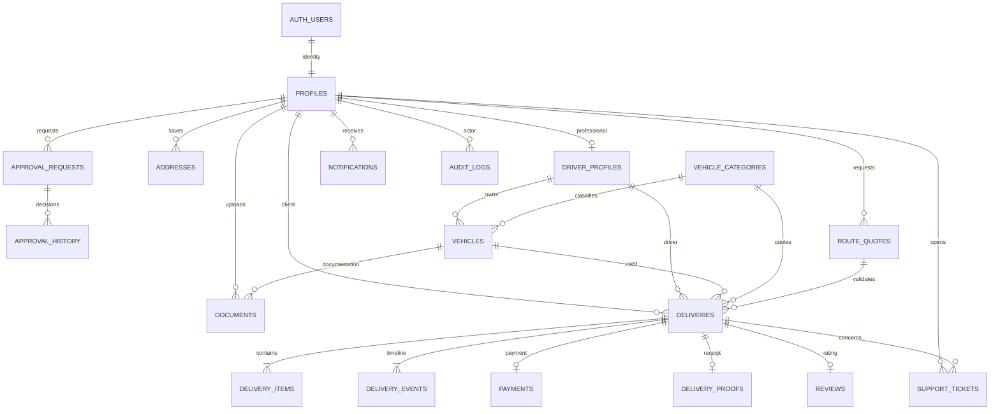

# Banco de dados Movee — PostgreSQL / Supabase

Este banco é novo e foi desenhado para os arquivos desta entrega. Nenhuma tabela do ZIP original é reaproveitada. PostgreSQL 15 ou superior é necessário para `security_invoker` nas views.

## Instalação e ordem dos scripts

No projeto Supabase novo, abra **SQL Editor** e execute os arquivos abaixo na ordem. Cada arquivo abre sua própria transação (`begin`/`commit`). Aguarde sucesso antes do próximo. Não execute arquivos `tests/` em produção. Não use a opção de ignorar erros: corrija o primeiro erro e repita apenas o arquivo cuja transação foi revertida. Os scripts são de instalação inicial, não migrações repetíveis sobre banco populado.

| Ordem | Arquivo | Conteúdo |
|---|---|---|
| 01 | `sql/01_initial.sql` | Extensão, schema privado, parâmetros de preço e retenção |
| 02 | `sql/02_validations.sql` | CPF, CNPJ numérico/alfanumérico, telefone, nome, endereço e conversão exata de peso |
| 03 | `sql/03_profiles.sql` | Perfil único ligado a `auth.users`; verificação administrativa |
| 04 | `sql/04_drivers.sql` | Dados profissionais e status do entregador |
| 05 | `sql/05_approvals.sql` | Solicitações e histórico de decisões |
| 06 | `sql/06_addresses.sql` | Endereços do titular |
| 07 | `sql/07_vehicle_categories.sql` | Catálogo de 11 categorias e tarifas fictícias configuráveis |
| 08 | `sql/08_vehicles.sql` | Vários veículos por entregador |
| 09 | `sql/09_documents.sql` | Metadados de documentos privados |
| 10 | `sql/10_deliveries.sql` | Entregas, itens e histórico |
| 11 | `sql/11_payments.sql` | Pagamentos sem número de cartão ou CVV |
| 12 | `sql/12_communication.sql` | Notificações, caixa de saída, auditoria, avaliações, comprovantes e suporte |
| 13 | `sql/13_account_functions.sql` | Cadastro, perfil, CNH e aprovação de documentos/contas |
| 14 | `sql/14_delivery_functions.sql` | Cotação, criação atômica, aceite, etapas, cancelamento e rastreamento |
| 15 | `sql/15_admin_service_functions.sql` | Tarifas, relatório, pagamentos de serviço, bootstrap e fila de e-mail |
| 16 | `sql/16_triggers.sql` | Limites concorrentes, propriedade e validações de operações |
| 17 | `sql/17_rls_storage.sql` | RLS, concessões mínimas e bucket privado |
| 18 | `sql/18_indexes_views.sql` | Índices, views por status e restrições de finitude |
| 19 | `sql/19_admin_monthly_revenue.sql` | Comissão 30/70, datas de confirmação, snapshots imutáveis e rendimentos mensais administrativos |
| 20 | `sql/20_email_confirmation.sql` | Confirmação canônica de e-mail: RLS restritiva, guardas e consultas protegidas |

O schema `auth` e as tabelas/funções `storage` já são fornecidos pelo Supabase. O arquivo `tests/local/supabase-stubs.sql` serve **somente para PostgreSQL local vazio de testes**; nunca execute esse arquivo no Supabase.

## Modelo de identidade e tipos de conta

`profiles.id = auth.users.id`. Senhas, códigos e sessões pertencem ao Supabase Auth; não há senha em tabela personalizada. `role` é o papel operacional autorizado: `client`, `driver` ou `admin`. O cadastro sempre recebe `role=client`; valores enviados no navegador não concedem permissões. `requested_role` indica `client`, `seller`, `driver` ou `admin`.

Vendedor é um subtipo de cliente: mantém solicitação, endereço da loja e acompanhamento, com CPF **ou** CNPJ, inclusive CNPJ alfanumérico. Os demais cadastros exigem CPF válido. O identificador é normalizado para a forma canônica sem pontuação; unicidade não pode ser contornada por letras adicionadas ao CPF.

Dados pessoais não são copiados para tabelas separadas de clientes e administradores. `clients` é uma view. Um administrador autorizado consulta solicitações por `kind` e `status`; as views `driver_approvals` e `admin_approvals` mantêm a RLS das tabelas de origem. Estados: `pending`, `in_review`, `approved`, `rejected` e `suspended`. Reenvio de solicitação já pendente é idempotente.

A escolha de verificação é persistida em `profiles.verification_channel`, sem depender de metadados do Auth que o usuário possa editar posteriormente. Para a opção SMS, a criação de entrega exige telefone confirmado no Auth, compatível com o telefone do perfil, além do e-mail da identidade. Essa configuração usa o fluxo de confirmação descrito em `SETUP.md`.

## DER



A caixa de saída `outbox` é uma fila técnica para envio externo; seus eventos são gravados na mesma transação das operações. `system_settings` contém parâmetros globais. Essas tabelas não precisam de relações adicionais para duplicar pessoas ou entregas.

## Dicionário de dados

Todos os IDs são `uuid` salvo `vehicle_categories.id` e `system_settings.key` (`text`). Todos os horários são `timestamptz` e são armazenados com referência UTC; a interface os apresenta no fuso do navegador. Textos de usuário são tratados como texto no frontend. Campos não relacionados a cálculos têm limites de tamanho no banco.

| Tabela | Campos e finalidade |
|---|---|
| `profiles` | `id` PK/FK Auth; `full_name text` 4–140 caracteres; `cpf_cnpj text` único validado; `phone text`; `birth_date date` entre 18 e 120 anos; `role text`; `requested_role text`; `verification_channel text`; `terms_accepted_at timestamptz`; `created_at`, `updated_at` |
| `driver_profiles` | `id` PK/FK perfil; `cnh_number text` 11 dígitos; `cnh_category text` A/B/AB/C/AC/D/AD/E/AE; `cnh_expires_at date`; `status text`; `created_at`. Dados profissionais podem começar vazios no cadastro, mas análise e aceite exigem todos preenchidos |
| `approval_requests` | `id`; `user_id` FK perfil; `kind text` driver/admin; `status text`; `justification text` 10–2000 caracteres; `created_at`, `updated_at`; unicidade `(user_id,kind)` |
| `approval_history` | `id`; `request_id` FK solicitação; `actor_id` FK perfil ou nulo para operador inicial; `status text`; `reason text`; `created_at`; histórico sem edição pública |
| `addresses` | `id`; `user_id` FK perfil; `label text`; `postal_code text` 8 dígitos; `street`, `number`, `complement`, `neighborhood`, `city`, `state`, `reference text`; `is_default boolean`; `created_at` |
| `vehicle_categories` | `id text` slug; `name text`; `max_weight_kg numeric(16,6)`; `max_volume_m3 numeric(16,6)`; `length_cm`, `width_cm`, `height_cm numeric`; `base_price`, `price_per_km`, `volume_price`, `operational_fee`, `protection_fee numeric(12,2)`; `weight_price numeric(12,4)`; `fuel_km_per_litre numeric(8,3)` (bicicleta 0); `description`, `protection`, `image text`; `active boolean` |
| `vehicles` | `id`; `driver_id` FK entregador; `category_id` FK categoria; `brand`, `model`, `plate text`; placa única no formato antigo ou Mercosul; bicicleta pode não ter placa; `year int` 1980 até ano atual + 1; `active boolean`; `created_at` |
| `documents` | `id`; `user_id` FK perfil; `vehicle_id` FK veículo quando `kind=vehicle`; `kind text` identity/cnh/vehicle; `storage_path text` único; `mime_type text` JPEG/PNG/PDF; `size_bytes int` de 100 bytes até 5 MiB; `status text` pending/verified/rejected; `created_at`. Bytes permanecem no Storage |
| `deliveries` | `id`; `code text` único aleatório MV-…; `client_id`, `driver_id`, `vehicle_id`, `category_id` FKs; `status text`; `pickup`, `destination jsonb` snapshots de endereço; `recipient_name`, `recipient_phone text`; `distance_km numeric(12,3)`; `total_weight_kg numeric(20,6)`; `total_volume_m3 numeric(20,9)`; `price numeric(14,2)`; `price_breakdown jsonb`; `scheduled_at`, `eta_at timestamptz`; `notes`, `special_instructions text`; `urgent`, `protection boolean`; `extras`, `tolls numeric`; `route_quote_id` FK rota confiável opcional; `vehicle_confirmed_at timestamptz`, `vehicle_confirmed_by` FK cliente; `created_at`, `updated_at` |
| `route_quotes` | `id`; `user_id`, `category_id` FKs; `pickup`, `destination jsonb` canônicos; `distance_km numeric(12,3)`; `duration_minutes numeric(12,3)`; `expires_at`, `created_at timestamptz`. Somente serviço pode inserir; cliente não altera distância ou validade |
| `delivery_items` | `id`; `delivery_id` FK entrega; `description text`; `quantity int` 1–10000; `unit_weight_kg numeric(20,6)`; `length_cm`, `width_cm`, `height_cm numeric`. Peso informado é unitário e multiplicado pela quantidade |
| `delivery_events` | `id`; `delivery_id` FK entrega; `status text`; `note text`; `created_at`; somente operações do backend acrescentam etapas |
| `payments` | `id`; `delivery_id` FK único; `user_id` FK cliente; `method text` pix/credit/debit; `status text` pending/confirmed/failed/refunded; `amount numeric(14,2)`; `is_demo boolean`; `provider text` demo/mercadopago; `currency text` BRL; `provider_reference text` única; `created_at`, `updated_at`. Sem PAN/CVV |
| `notifications` | `id`; `user_id` FK destinatário; `title`, `body text`; `read_at timestamptz` opcional; `created_at` |
| `outbox` | `id`; `event text`; `payload jsonb`; `status text` pending/processing/sent/failed; `attempts int`; `locked_at`, `available_at`, `created_at timestamptz`; `last_error text`; consumo somente serviço |
| `audit_logs` | `id`; `actor_id` FK perfil opcional; `action`, `entity`, `entity_id text`; `details jsonb`; `created_at`; não expõe histórico a clientes |
| `reviews` | `id`; `delivery_id` FK único; `client_id`, `driver_id` FKs; `rating int` 1–5; `comment text` até 1000; `created_at`; somente cliente da entrega concluída |
| `delivery_proofs` | `id`; `delivery_id` FK único; `driver_id` FK; `recipient_name`, `notes text`; `created_at`; criado atomicamente ao concluir entrega |
| `support_tickets` | `id`; `user_id` FK; `delivery_id` FK opcional; `subject text` 5–150; `message text` 10–4000; `status text` open/in_progress/closed; `admin_reply text`; `created_at` |
| `system_settings` | `key text` PK; `value jsonb`; `updated_at timestamptz`; parâmetros de urgência, serviços extras, distância máxima, pedágios e retenção |

O recebedor é um snapshot dentro da entrega/comprovante. Não é criada uma conta ou tabela de pessoa duplicada para ele. Endereços de coleta/destino também são snapshots: editar um endereço salvo não altera o histórico de uma entrega já solicitada.

## Peso e frete

`weight_kg` usa `numeric`, sem `float`: mg ÷ 1.000.000, g ÷ 1.000, kg sem conversão e t × 1.000. Armazenamento com seis casas de kg, precisão mínima de 1 mg. Valores menores são rejeitados em vez de arredondados silenciosamente para zero. Volume é quantidade × comprimento × largura × altura em cm ÷ 1.000.000.

O preço é obtido no PostgreSQL e recalculado dentro de `create_delivery`, sem confiar no total do navegador. Considera base + distância × tarifa/km + peso × tarifa/kg + volume × tarifa/m³ + custo operacional + proteção opcional + serviços extras + combustível. Combustível = distância ÷ rendimento km/l do veículo × preço do litro; bicicleta não consome combustível. Urgência aplica seu multiplicador e depois o pico acrescenta o percentual configurado sobre esse resultado. Pedágio começa desabilitado e valor diferente de zero é rejeitado; ativação exige fonte externa confiável. Todos os parâmetros iniciais são fictícios para TCC.

`extras` é quantidade inteira de serviços extras (0–5), **não** valor monetário escolhido pelo cliente. Cada unidade usa a tarifa global. Sem credenciais de roteirização, a distância é uma **estimativa manual declarada**, identificada na interface. Quando o provedor de rotas está configurado, o PHP consulta o serviço, normaliza os endereços e grava uma `route_quote` confiável através de RPC de serviço. A cotação exige o titular, categoria, validade e distância coincidentes; criar a entrega também exige os mesmos snapshots de coleta/destino. O navegador não pode criar ou editar a rota confiável. `pricing.route_required=true` bloqueia o modo manual no banco. A previsão continua aproximada e não equivale a GPS em tempo real.

Valores iniciais: combustível R$ 6,20/l; multiplicador de pico 1,20; segunda a sexta, 7h–9h e 17h–20h em `America/Sao_Paulo` (início inclusivo, fim exclusivo). Horário considerado é o agendamento da entrega, e não o relógio enviado pelo navegador. O administrador configura preço do litro, multiplicadores, dias ISO 1–7 e janelas pelo RPC `update_pricing_settings`; configura rendimento por categoria em `update_tariff`. Mudanças são auditadas. `get_pricing_settings()` e `admin_report().pricing` exigem administrador. O detalhamento guarda `fuel`, `peak`, `peak_applied`, `scheduled_time`, `pricing_timezone`, preço do litro e rendimento utilizados.

## Operações protegidas e concorrência

- Endereços: trigger bloqueia a linha do perfil com `FOR UPDATE`, conta endereços sob o mesmo bloqueio e rejeita o quarto cadastro. Índice parcial garante no máximo um principal.
- Criação: entrega, itens, evento inicial e notificação são uma transação. Erro em qualquer item reverte tudo.
- Aceite: bloqueia entrega com `FOR UPDATE`, verifica status atual, entregador aprovado, CNH válida/categoria compatível e veículo do titular com documentação verificada. A segunda tentativa concorrente vê a entrega ocupada.
- Veículo exato: o aceite grava um veículo específico do entregador. O cliente consulta modelo/placa por `assigned_vehicle` ou rastreamento e confirma a conferência física em `confirm_pickup_vehicle`. Informar divergência abre chamado e mantém a coleta bloqueada. `advance_delivery` exige exatamente o ID designado em cada atualização; coleta exige confirmação registrada pelo cliente. O veículo não pode ser alterado/desativado durante o serviço. A aplicação registra a declaração; comprovação física depende da conferência do cliente e não é garantida por software.
- Etapas: `awaiting_payment` → `awaiting_driver` → `to_pickup` → `collected` → `in_transit` → `near_destination` → `delivered`. Não é permitido saltar etapas. Conclusão exige nome do recebedor e grava comprovante.
- Cancelamento do cliente é permitido antes do aceite; após isso, suporte/admin. Demonstração é estornada apenas no registro demonstrativo. Estorno financeiro real precisa ser tratado no provedor, sem inventar sucesso.
- Documentos e contas: decisões exigem administrador, justificativa e auditoria. Aprovação exige identidade verificada; entregador exige CNH e veículo documentados/verificados. Autoaprovação é rejeitada.
- Tarifas: somente `update_tariff`, com lista explícita de campos e auditoria antes/depois. Valores negativos, `NaN` e infinitos são rejeitados.
- Pagamento: RPCs de criação/confirmação são exclusivos de `service_role`. Referência de transação é única, valor precisa coincidir exatamente com a entrega e moeda é BRL. Reenvio de confirmação já registrada é idempotente.
- Fila: `claim_outbox` usa `FOR UPDATE SKIP LOCKED`, recupera locks vencidos e limita tentativas; `finish_outbox` confirma ou agenda nova tentativa. Envio depende de worker e credenciais reais.

## Permissões (RLS e concessões)

| Recurso | Visitante | Cliente/vendedor | Entregador | Administrador | Serviço servidor |
|---|---|---|---|---|---|
| Catálogo ativo/cotação | Ler | Ler/cotar | Ler/cotar | Ler/alterar via RPC auditado | Manutenção |
| Perfil | Sem acesso | Próprio; edição limitada via RPC | Próprio; CNH via RPC | Consulta e decisões protegidas | Bootstrap/manutenção |
| Endereços | Sem acesso | CRUD dos próprios, máximo 3 | CRUD dos próprios | Sem acesso indiscriminado | Manutenção |
| Documentos | Sem acesso | Próprios | Próprios | Documentos de análise; verificar/rejeitar | Upload/retencão administrativa |
| Entregas | Sem acesso | Próprias; criar/cancelar por RPC | Próprias; ofertas redigidas via RPC | Todas; cancelar por RPC | Pagamentos |
| Dados completos de ofertas | Sem acesso | Sem acesso | Só após aceitar | Consulta | Manutenção |
| Pagamentos | Sem acesso | Próprios/comprovante | Sem acesso aos pagamentos de clientes | Consulta | Confirmar por provedor |
| Aprovações | Sem acesso | Próprias | Próprias | Analisar/decidir | Primeiro administrador |
| Notificações | Sem acesso | Próprias; marcar lida | Próprias; marcar lida | Próprias | Inserção via transações |
| Suporte | Sem acesso | Próprios; abrir | Próprios; abrir | Responder/alterar status auditado | Manutenção |
| Auditoria | Sem acesso | Sem acesso | Sem acesso | Consulta | Inserção protegida |
| Outbox | Sem acesso | Sem acesso | Sem acesso | Sem API de edição | Claim/ack |

Não há `UPDATE` público em papéis, aprovações, entregas, pagamentos ou status de documentos. RPCs usam `SECURITY DEFINER`, `search_path` fixo e verificam explicitamente identidade/papel. Concessões de execução são removidas e restauradas por lista. A chave pública não substitui a autorização. `service_role` contorna RLS por definição e deve permanecer exclusivamente em ambiente do servidor/CLI.

`available_deliveries()` apresenta somente código, capacidade, preço, agendamento e cidades; telefone/endereço completo do cliente não ficam visíveis a todos os entregadores aprovados. `track_delivery()` exige participante ou administrador e retorna nome limitado do entregador e histórico. Um código aleatório não torna o rastreamento público.

## Storage, dados pessoais e retenção

O bucket `movee-documents` é privado, de 100 bytes até 5 MiB por arquivo, JPEG/PNG/PDF. Caminho começa com UUID do titular; metadados só podem apontar para objeto existente. Veículo deve pertencer ao mesmo titular. Uploads e assinaturas de download são exclusivos do servidor. JWT de usuário não recebe políticas de escrita ou leitura dos objetos de Storage. O BFF exige identidade/autorização via RPC, registra o acesso e só então usa a chave de serviço para gerar URL assinada curta.

O PHP inspeciona assinatura do arquivo, tamanho e tipo. Não é antivírus, OCR nem certificação de autenticidade: a análise humana permanece obrigatória. Não publique URLs, documentos ou cópias em repositórios, logs de erro, e-mails ou ambientes de demonstração. O e-mail da empresa recebe apenas aviso com link protegido, sem anexos pessoais.

O parâmetro inicial de retenção é **180 dias após encerramento da conta**, sujeito à finalidade, obrigações legais e revisão da instituição. A aplicação não declara exclusão automática implantada: o operador deve executar a rotina administrativa de encerramento, registrar a decisão, excluir os objetos no Storage e então os metadados quando cabível. Não apagar entregas, comprovantes ou auditoria sujeitos a obrigação de retenção; anonimização precisa de decisão documentada. Solicitações de acesso/correção/eliminação podem ser abertas pelo suporte. Os textos de privacidade devem ser revisados pelo responsável pelo tratamento antes de uso público.

O primeiro administrador é configurado por operador confiável via CLI/SQL de serviço, após cadastro solicitado como administrador, confirmação de e-mail e inspeção manual da identidade enviada. `bootstrap_admin` só funciona enquanto não existir administrador e usa bloqueio para impedir dois bootstraps simultâneos. Depois disso, novas contas administrativas seguem aprovação por administrador autenticado. Possuir o e-mail `MoveeEntregas@gmail.com` não concede acesso.

## Consultas úteis

No painel autenticado, as políticas aplicam o escopo do usuário. O SQL Editor com usuário `postgres` é privilegiado e não reproduz RLS de uma sessão comum.

```sql
-- Catálogo e tarifas iniciais de demonstração
select id,name,max_weight_kg,max_volume_m3,base_price,price_per_km
from public.vehicle_categories where active order by max_weight_kg;

-- Pendências por tipo, sem duplicar dados pessoais
select * from public.driver_approvals where status in ('pending','in_review');
select * from public.admin_approvals where status in ('pending','in_review');

-- Estados e volume operacional
select status,count(*) from public.deliveries group by status;

-- Falhas de envio (somente operador de serviço)
select id,event,status,attempts,available_at,last_error
from public.outbox where status='failed' order by created_at;
```

## Testes separados da instalação

Em banco de teste instalado, execute `sql/tests/01_validations.sql`, `02_workflow.sql`, `03_malformed_input.sql` e `04_pricing_routes.sql`. O quarto cenário cobre combustível, pico por fuso, rota real persistida pelo serviço, adulteração de distância/endereços e preço integrado. Eles usam `ROLLBACK`, dados fictícios, UUIDs fixos e objetos simulados de Storage; não são dados de produção nem envio real de arquivos. O teste de fluxo cria contas por SQL para exercitar triggers, RLS e RPCs — não testa a API remota Supabase Auth, SMTP, SMS ou cobrança real.

A execução local com PostgreSQL real é registrada em `TESTES.md`. O comportamento remoto depende da instalação dos scripts, configuração das credenciais e permissões do projeto Supabase. `tests/local/concurrency.py` usa duas conexões PostgreSQL reais para disputar simultaneamente o terceiro endereço e o aceite de uma entrega; ambos os cenários foram executados com exatamente um vencedor e sem ultrapassar os limites. O script também usa dados fictícios e remove seus fixtures ao final.

## Comissão e rendimentos mensais

O script 19 adiciona `commission_percent` e `commission_amount` em entregas e pagamentos. Pagamentos também recebem `confirmed_at` e `confirmation_time_estimated`. A criação da entrega fixa a taxa vigente (inicialmente 30%) e seu valor; a confirmação financeira copia essa divisão e preserva sua data. Alterar a taxa não recalcula entregas anteriores.

`admin_monthly_revenue(p_year integer)` só admite administradores e entrega doze meses do ano selecionado em `America/Sao_Paulo`, com receita de comissões, valor bruto dos fretes, parcela destinada aos entregadores e contagens. Exclui simulações, pagamentos pendentes/falhos e estornos. Históricos sem comissão registrada entram no valor bruto, mas não recebem uma taxa retroativa: são sinalizados como desconhecidos. A parcela do entregador soma somente registros com divisão conhecida. O relatório não é lucro líquido nem confirmação de repasse.

O recurso de comissões está no script19. A versão final também exige o20: instalação nova01..20; se já instalou até18, aplique19 e20; se instalou até19, somente20. Os testes financeiros ficam separados em `sql/tests/05_monthly_revenue.sql`.

## Confirmação de e-mail e instalação final

A fonte de verdade é `auth.users.email_confirmed_at`, mantida pelo Supabase Auth. Não existe coluna de confirmação editável no perfil. `public.email_is_verified()` expõe apenas o estado da própria sessão; o script 20 acrescenta políticas restritivas e guardas que impedem operações de conta sem confirmação, inclusive nas funções de negócio. O catálogo público e a matemática de cotação continuam disponíveis conforme seus grants.

Instalação nova: scripts 01..20. Instalação anterior até 19: somente 20. Instalação anterior até 18: 19 e 20. O teste `sql/tests/06_email_confirmation.sql` valida usuários não confirmados, metadata sem valor de prova, papéis e operações protegidas. A configuração Confirm email e os templates/SMTP são obrigatórios para o fluxo externo.
